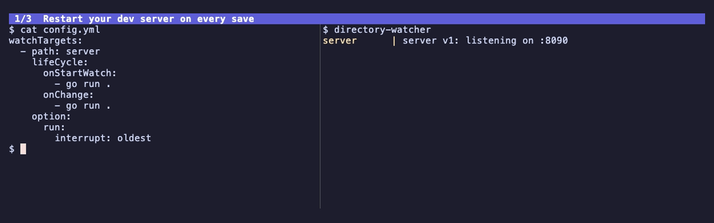

# Directory Watcher

🇺🇸 [English](README.md) | 🇰🇷 한국어

- Directory Watcher는 파일이 바뀌면 `config.yml` 하나에 적어 둔 명령을 실행합니다. 테스트 실행, 다시 빌드하기, 개발 서버 재시작은 물론이고 감시를 멈출 때의 정리 작업까지 맡길 수 있습니다.



## 30초 예제

다음 `config.yml`은 Go 서버의 코드가 바뀌면 서버를 재시작하고, 프론트엔드 소스가 바뀌면 프론트엔드를 다시 빌드합니다.

```yaml
# yaml-language-server: $schema=https://raw.githubusercontent.com/seungyeop-lee/directory-watcher/v3/directory-watcher.schema.json
watchTargets:
  - path: server
    lifeCycle:
      onStartWatch:
        - go run .
      onChange:
        - go run .
    option:
      run:
        interrupt: oldest
  - path: web/src
    lifeCycle:
      onChange:
        - dir: web
          cmd: npm run build
```

- 이 `config.yml`이 있는 디렉터리에서 `directory-watcher`를 실행합니다.
- 감시를 시작하면 서버가 시작되고, `server` 아래에서 파일을 저장할 때마다 서버를 멈췄다가 다시 시작합니다.
- `web/src` 아래에서 파일을 저장하면, 여러 파일이 한꺼번에 바뀌어도 `npm run build`가 한 번 실행됩니다.
- Ctrl+C를 누르면 서버를 멈춘 뒤 watcher도 끝납니다.

## 기능

### 저장할 때마다 개발 서버를 안전하게 재시작하기

- 파일을 저장할 때마다 실행 중인 서버와 그 서버가 띄운 프로세스를 멈추고, 서버가 끝나기를 기다린 뒤에야 서버를 다시 시작하므로, 이전 서버와 새 서버가 동시에 실행되지 않습니다.
- 위의 30초 예제가 이 방식으로 서버를 재시작합니다. 자세한 내용은 [run으로 hook 실행하기](docs/guide/running.ko.md#run으로-hook-실행하기)를 확인하세요.

### 파일 수백 개가 한꺼번에 바뀌어도 한 번만 실행하기

- 포매터를 돌리거나 브랜치를 바꿔서 파일 수백 개가 바뀌어도, 명령은 파일마다 실행되지 않고 몰려든 변경 전체에 대해 한 번 실행됩니다.
- 명령은 마지막 변경 뒤 100ms가 지나면 실행되고, 변경이 계속 이어지면 첫 변경 뒤 1초가 지났을 때 실행됩니다.
- 바뀐 파일마다 한 번씩 실행하거나 이벤트마다 실행하도록 바꿀 수도 있습니다. 자세한 내용은 [hookBatch로 기다리고 합치기](docs/guide/running.ko.md#hookbatch로-기다리고-합치기)를 확인하세요.

### 폴더째 생기거나 사라지면 폴더 이벤트 하나로 받기

- 폴더가 안의 내용과 함께 생기거나 사라지면, 명령은 안에 든 파일마다 이벤트를 받지 않고 맨 위 폴더의 이벤트 하나를 받습니다.

| 동작 | 명령이 받는 이벤트 |
|---|---|
| `mkdir -p src/a/b/c` | `src/a`의 폴더 생성 이벤트 하나 |
| 파일 300개가 든 `src/pkg`를 `rm -rf`로 삭제 | `src/pkg`의 폴더 삭제 이벤트 하나 |

- 감시하는 디렉터리 안으로 폴더를 옮겨 오거나 밖으로 옮겨 낼 때도 같습니다. 자세한 내용은 [폴더 이벤트](docs/guide/events.ko.md#폴더-이벤트)를 확인하세요.

### 감시를 시작하고 끝낼 때 준비·정리 명령 실행하기

- 감시를 시작할 때와 끝낼 때 각각 명령을 실행할 수 있습니다. 예를 들어 감시를 시작할 때 데이터베이스 컨테이너를 띄우고, Ctrl+C를 누르면 그 컨테이너를 지웁니다.

```yaml
global:
  lifeCycle:
    onStartWatch:
      - docker compose up -d db
    onFinishWatch:
      - docker compose down
```

- 감시 대상마다 시작 명령과 종료 명령을 따로 둘 수도 있습니다.
- 오류 때문에 watcher가 멈출 때도 종료 명령은 실행됩니다.

### 변경을 놓쳤을 수 있으면 알림 받기

- 명령이 처리하는 속도보다 변경이 빠르게 쌓이거나 OS가 이벤트를 버렸다고 보고하면, watcher는 밀린 작업을 끝없이 쌓지 않고 멈춘 뒤 미리 정해 둔 알림 명령을 한 번 실행합니다. 자세한 내용은 [이벤트 유실 알림](docs/guide/running.ko.md#이벤트-유실-알림)을 확인하세요.
- 대상의 밀린 작업이 한도의 70%와 90%에 닿으면 그보다 먼저 경고하는 명령도 따로 둘 수 있습니다. 자세한 내용은 [대기열 용량과 경고](docs/guide/running.ko.md#대기열-용량과-경고)를 확인하세요.

### 실행 파일 하나로 어디서나 설치하기

- Directory Watcher는 실행 파일 하나로 되어 있어서 Homebrew, Scoop, `go install`로 설치하거나 게시된 Docker 이미지로 실행할 수 있습니다. 자세한 내용은 [설치](#설치)를 확인하세요.

직접 만드는 이미지에 넣으려면 게시된 이미지에서 실행 파일을 복사합니다.

```dockerfile
COPY --from=ghcr.io/seungyeop-lee/directory-watcher:latest /directory-watcher /usr/local/bin/
```

### 그 밖의 기능

| 기능 | 사용 안내 |
|---|---|
| 여러 디렉터리를 감시하고, 디렉터리마다 명령을 따로 정하기 | [`config.yml`](docs/guide/configuration.ko.md#configyml) |
| 바뀐 파일의 경로, 이름, 확장자, 이벤트 종류를 명령에 넘기기. 파일 이름이 명령으로 실행되는 일은 없습니다. | [실행 명령에서 쓸 수 있는 변수](docs/guide/configuration.ko.md#실행-명령에서-쓸-수-있는-변수) |
| 명령을 실행할 파일 이벤트와 폴더 이벤트 고르기 | [폴더 이벤트](docs/guide/events.ko.md#폴더-이벤트) |
| 경로 패턴으로 파일과 폴더를 감시에서 빼기. `.git`처럼 이름이 `.`이나 `_`로 시작하면 기본으로 빠집니다. | [exclude로 경로 제외하기](docs/guide/events.ko.md#exclude로-경로-제외하기), [기본 제외 규칙](docs/guide/events.ko.md#기본-제외-규칙) |
| 한 대상의 여러 변경을 동시에 실행하기 | [run으로 hook 실행하기](docs/guide/running.ko.md#run으로-hook-실행하기) |
| `sh`, `cmd`, Windows PowerShell에서 명령 실행하기 | [hook 명령을 실행하는 셸](docs/guide/configuration.ko.md#hook-명령을-실행하는-셸) |
| 경로가 겹치는 대상 감시하기. 변경 하나에 대상마다 명령이 실행됩니다. | [감시 대상의 경로가 겹칠 때](docs/guide/events.ko.md#감시-대상의-경로가-겹칠-때) |

## 설치

> [!NOTE]
> Homebrew cask를 설치하려면 Homebrew 5.1.14 이상이 필요합니다. Homebrew를 업데이트하는 방법은 [Homebrew로 설치하기](docs/guide/installation.ko.md#homebrew로-설치하기)에 있습니다.

패키지 관리자로 설치합니다.

```sh
# macOS or Linux
brew install --cask seungyeop-lee/tap/directory-watcher

# Windows using scoop
scoop bucket add seungyeop-lee https://github.com/seungyeop-lee/scoop-bucket
scoop install seungyeop-lee/directory-watcher
```

또는 `config.yml`과 감시할 디렉터리를 마운트해 Docker로 실행합니다.

```sh
docker run --rm \
  -v "$PWD/config.yml:/config.yml" \
  -v "$PWD/src:/src" \
  ghcr.io/seungyeop-lee/directory-watcher:latest -c /config.yml
```

- 이때 hook은 컨테이너 안에서 실행됩니다. hook이 쓸 수 있는 경로와 도구, bind mount의 알려진 이슈는 [Docker로 실행하기](docs/guide/installation.ko.md#docker로-실행하기)에 있습니다.
- 직접 만드는 이미지에 실행 파일을 넣는 방법은 [직접 만드는 이미지에 넣기](docs/guide/installation.ko.md#직접-만드는-이미지에-넣기)에 있습니다.

또는 실행 파일을 내려받습니다.

- [releases page](https://github.com/seungyeop-lee/directory-watcher/releases/latest)에 macOS, Linux, Windows용 실행 파일이 있습니다.

또는 `go`로 바로 설치합니다. Go 1.27 이상이 필요합니다.

```sh
go install github.com/seungyeop-lee/directory-watcher/v3@latest
```

## 시작하기

1. watcher를 실행할 디렉터리에 `config.yml`을 만듭니다. 다음 예시는 `src` 아래의 파일이 바뀔 때마다 그 디렉터리에서 `make test`를 실행합니다.

   ```yaml
   # yaml-language-server: $schema=https://raw.githubusercontent.com/seungyeop-lee/directory-watcher/v3/directory-watcher.schema.json
   watchTargets:
     - path: src
       lifeCycle:
         onChange:
           - dir: .
             cmd: make test
   ```

   첫 줄이 있으면 VS Code의 Red Hat YAML 확장처럼 yaml-language-server를 쓰는 에디터가 키를 자동 완성하고 검사합니다. 자세한 내용은 [설정 파일](docs/guide/configuration.ko.md#configyml)에 있습니다.

2. 같은 디렉터리에서 watcher를 시작합니다.

   ```shell
   directory-watcher
   ```

   다른 위치의 설정 파일을 쓰려면 `-c <설정 파일 경로>`로 경로를 지정합니다.

3. `src` 아래의 파일을 고칩니다. 마지막 변경 뒤 100ms가 지나면 `make test`가 실행됩니다.

- **hook의 결과 파일:** hook이 `path` 안에 쓴 파일도 변경이므로, hook이 다시 실행되며 끝없이 반복됩니다. 그 파일을 감시 대상의 `watch.exclude`에 적습니다. 예를 들어 `onChange`가 `src/build.log`에 쓰면 `option.watch` 아래에 `exclude: ['build.log']`를 적습니다. 자세한 내용은 [hook이 자기 결과로 다시 실행되지 않게 하기](docs/guide/events.ko.md#hook이-자기-결과로-다시-실행되지-않게-하기)를 확인하세요.
- **멈추기:** Ctrl+C를 누르거나 SIGTERM을 보냅니다. watcher는 실행 중인 명령을 취소하고 종료 명령을 실행한 뒤 끝납니다.
- **더 알아보기:** [사용 안내](USAGE.ko.md)에는 저장할 때 테스트를 실행하거나 Docker에서 watcher를 실행하는 것처럼 자주 쓰는 설정의 예시와 주제별 문서의 목록이 있습니다. 주제별 문서는 [설치와 실행](docs/guide/installation.ko.md), [설정 파일](docs/guide/configuration.ko.md), [이벤트와 감시 경로](docs/guide/events.ko.md), [hook 실행](docs/guide/running.ko.md), [동작 방식](docs/guide/how-it-works.ko.md)입니다. 더 많은 설정을 담은 예시는 [`config.example.yml`](config.example.yml)에 있습니다.

## 요구 사항

- macOS 또는 Linux. 이 두 환경에서 정상 작동하는 것을 확인했습니다.
- Windows. 콘솔 출력과 일부 hook을 멈추는 속도에 제약이 있습니다. 자세한 내용은 [Windows에서 실행하기](docs/guide/installation.ko.md#windows에서-실행하기)를 확인하세요.

## 개발 검증

- 현재 워크트리 소스를 사용하는 macOS·Linux·Windows 자동 E2E 실행과 시나리오 추가 방법은 [E2E 가이드](e2e/README.ko.md)를 확인하세요.

## 기여

- 버그 제보와 기능 제안은 GitHub 이슈로 받고, pull request는 받지 않습니다. 자세한 내용은 [CONTRIBUTING.md](CONTRIBUTING.md)를 확인하세요.

## 라이선스

- 이 프로젝트는 [MIT 라이선스](LICENSE)에 따라 제공됩니다.
- 자세한 내용은 라이선스 파일을 확인하세요.
- 3.0.0 이전 버전은 GPL-3.0 라이선스로 배포되었습니다.
