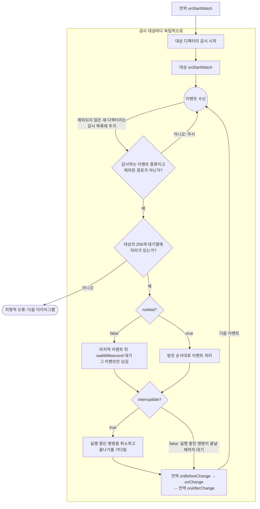
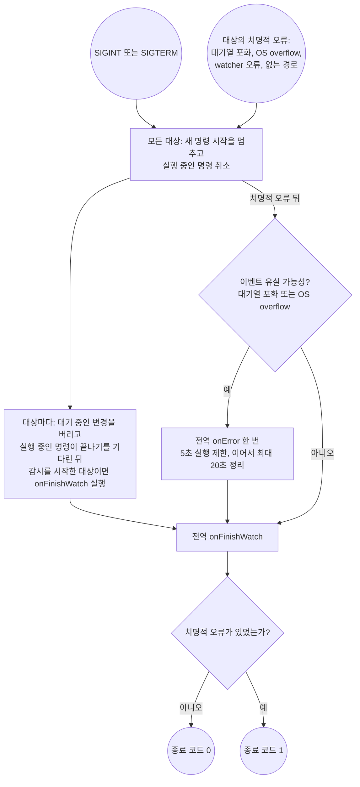

# Directory Watcher

🇺🇸 [English](README.md) | 🇰🇷 한국어

- Directory Watcher는 감시하는 디렉터리에서 파일이 생성·수정·삭제되면 미리 정해 둔 명령을 실행하는 프로그램입니다.
- 코드를 고칠 때마다 빌드나 테스트를 다시 실행하거나, 소스가 바뀌면 개발 서버를 재시작하거나, 파일이 바뀔 때 백업을 만드는 작업을 자동화할 수 있습니다.

## 기능

### 파일이 바뀌면 명령 실행하기

- 여러 디렉터리를 한 번에 감시합니다. 감시 대상마다 `onChange` 명령을 따로 정하고, 전역 `onBeforeChange`와 `onAfterChange` 명령은 모든 대상의 `onChange` 앞뒤에 실행됩니다.
- 반응할 이벤트(생성, 수정, 삭제)를 고르고, 경로 패턴으로 파일과 폴더를 감시에서 빼거나 하위 디렉터리를 감시하지 않게 할 수 있습니다.
- 바뀐 파일의 경로, 이름, 확장자, 디렉터리, 이벤트 종류를 [템플릿 변수](USAGE.ko.md#실행-명령에서-쓸-수-있는-변수)로 명령에 넘깁니다.
- 감시 대상의 경로가 겹치면, 겹치는 폴더의 변경 하나에 대상마다 hook이 실행됩니다. 자세한 내용은 [감시 대상의 경로가 겹칠 때](USAGE.ko.md#감시-대상의-경로가-겹칠-때)를 확인하세요.

### 몰려드는 변경 다루기

- 기본 동작에서는 이벤트가 몰려도 마지막 이벤트 뒤 `waitMillisecond`(기본 100ms)가 지나면 hook을 한 번만 실행합니다.
- `noWait: true`로 설정하면 이벤트마다 hook을 실행하며, 이벤트를 받은 순서를 지킵니다.
- 대상마다 대기 이벤트를 최대 256개까지 보관합니다. 대기열이 가득 차면 대기열을 늘리지 않고 watcher를 멈춥니다.

### 오래 실행되는 프로세스 재시작하기

- `interruptible: true`로 설정하면 새 변경이 생겼을 때 실행 중인 명령을 취소하고, 그 명령이 끝나기를 기다린 뒤 변경 명령을 다시 실행합니다. 스스로 끝나지 않는 서버 같은 프로세스에 사용합니다.
- watcher를 멈추면 실행 중인 명령을 취소한 뒤 종료 명령을 실행합니다.

### 시작·종료 명령 실행하기

- `onStartWatch`와 `onFinishWatch`는 감시를 시작하고 끝낼 때 실행되며, 전역과 감시 대상별로 각각 정할 수 있습니다.

### 이벤트 유실 가능성 알림 받기

- 대상의 대기열이 가득 차거나 OS가 이벤트 overflow를 보고하면, 선택 항목인 전역 `onError` 명령이 한 번 실행됩니다. 오류 정보는 `DW_ERROR_*` 환경 변수로 전달됩니다. 자세한 내용은 [이벤트 유실 알림](USAGE.ko.md#이벤트-유실-알림)을 확인하세요.

## 요구 사항

- macOS 또는 Linux. 이 두 환경에서 정상 작동하는 것을 확인했습니다.
- Windows. 아래 경고의 제약이 있습니다.
- Go 1.27 이상. `go install`로 설치할 때만 필요합니다.

> [!WARNING]
> Windows에서는 다음을 주의하세요.
> - PowerShell이나 명령 프롬프트에서는 출력이 제대로 보이지 않을 수 있습니다. 이때는 Git Bash에서 실행하세요.
> - watcher가 hook을 멈출 때, CTRL+BREAK로 끝나지 않는 hook 프로세스는 20초가 지나서야 강제로 끝냅니다. 이런 hook은 일부 `powershell` hook을 포함해 교체와 종료가 최대 20초 늦어질 수 있습니다. 자세한 내용은 [과부하와 종료](USAGE.ko.md#과부하와-종료)에 있습니다.

## 설치

### Homebrew

- macOS와 Linux에서 설치합니다.
- cask를 설치하려면 Homebrew 5.1.14 이상이 필요합니다.
- 그보다 낮은 버전에서는 `Unexpected method 'postflight_steps'` 오류로 설치가 실패합니다.

`brew --version`으로 버전을 확인하고, 5.1.14보다 낮으면 먼저 Homebrew를 업데이트합니다.

```shell
brew update
```

그다음 cask를 설치합니다.

```shell
brew install --cask seungyeop-lee/tap/directory-watcher
```

- 2.x 버전을 `brew install seungyeop-lee/tap/directory-watcher`로 설치했다면 Homebrew formula로 설치된 것이고, formula는 더 이상 새 버전을 받지 않습니다.

formula를 지운 뒤 cask로 설치합니다.

```shell
brew uninstall --formula directory-watcher
brew install --cask seungyeop-lee/tap/directory-watcher
```

### Scoop

Windows에서 설치합니다.

```shell
scoop bucket add seungyeop-lee https://github.com/seungyeop-lee/scoop-bucket
scoop install seungyeop-lee/directory-watcher
```

### `go install`

```shell
go install github.com/seungyeop-lee/directory-watcher/v3@latest
```

### Docker로 실행

게시된 이미지에 `config.yml`과 감시할 폴더를 마운트해 실행합니다.

```shell
docker run --rm \
  -v "$PWD/config.yml:/config.yml" \
  -v "$PWD/src:/src" \
  ghcr.io/seungyeop-lee/directory-watcher:latest -c /config.yml
```

- 컨테이너의 작업 폴더가 `/`이므로 `config.yml`의 `path: src`는 마운트한 `/src`를 가리킵니다.
- hook은 컨테이너 안에서 실행되므로, hook이 쓰는 파일과 도구가 컨테이너에 있어야 합니다.
- bind mount의 알려진 이슈는 [Docker로 실행하기](USAGE.ko.md#docker로-실행하기)에 있습니다.

### Dockerfile에서 설치

```dockerfile
COPY --from=ghcr.io/seungyeop-lee/directory-watcher:latest /directory-watcher /usr/local/bin/
```

### 릴리스 파일

- [releases page](https://github.com/seungyeop-lee/directory-watcher/releases/latest)에서 실행 파일을 내려받습니다.

## 시작하기

1. watcher를 실행할 디렉터리에 `config.yml`을 만듭니다. 다음 예시는 `src` 아래의 파일이 바뀔 때마다 그 디렉터리에서 `make test`를 실행합니다.

   ```yaml
   watchTargets:
     - path: src
       lifeCycle:
         onChange:
           - dir: .
             cmd: make test
   ```

2. 같은 디렉터리에서 watcher를 시작합니다.

   ```shell
   directory-watcher
   ```

   다른 위치의 설정 파일을 쓰려면 `-c <설정 파일 경로>`로 경로를 지정합니다.

3. `src` 아래의 파일을 고칩니다. 마지막 변경 뒤 100ms가 지나면 `make test`가 실행됩니다.

- **hook의 결과 파일:** hook이 `path` 안에 쓴 파일도 변경이므로, hook이 다시 실행되며 끝없이 반복됩니다. 그 파일을 감시 대상의 `exclude`에 적습니다. 예를 들어 `onChange`가 `src/build.log`에 쓰면 `option` 아래에 `exclude: ['build.log']`를 적습니다. 자세한 내용은 [hook이 자기 결과로 다시 실행되지 않게 하기](USAGE.ko.md#hook이-자기-결과로-다시-실행되지-않게-하기)를 확인하세요.
- **멈추기:** Ctrl+C를 누르거나 SIGTERM을 보냅니다. watcher는 실행 중인 명령을 취소하고 종료 명령을 실행한 뒤 끝납니다.
- **더 알아보기:** [사용 안내](USAGE.ko.md)에서 명령줄 옵션, Docker로 실행하기, `config.yml` 전체 사양, 명령 실행 위치, 템플릿 변수, 경로 제외, 겹치는 감시 경로, 이벤트 유실 알림, 과부하·종료·폴더 이벤트의 제약을 다룹니다. 더 많은 설정을 담은 예시는 [`config.example.yml`](config.example.yml)에 있습니다.

## 동작 다이어그램

- 전역 `onStartWatch`가 가장 먼저 실행됩니다.

그 뒤 감시 대상마다 따로 시작하고, 각 대상은 다른 대상과 관계없이 자기 변경을 처리합니다.



- `interruptible: false`에서는 대상 `onStartWatch`나 변경 명령이 실행되는 동안 들어온 이벤트가 그 명령이 끝날 때까지 대기열에서 기다립니다. `interruptible: true`에서는 실행 중인 대상 `onStartWatch`도 다음 변경이 취소합니다.
- 한 번의 실행에 속한 명령은 차례대로 실행되며, 실패한 명령이 나오면 그 실행을 멈춥니다. 이 실패는 `[ERROR]` 로그로 남습니다. 자세한 내용은 사용 안내의 [`config.yml`](USAGE.ko.md#configyml)을 확인하세요.

종료 신호와 치명적 오류는 모두 전체 감시 대상을 멈춘 뒤 종료 명령을 실행합니다.



- 대상 종료 명령은 `onError`가 실행되는 동안에도 실행될 수 있습니다. 전역 `onFinishWatch`는 두 쪽이 모두 끝나기를 기다립니다.
- 종료 명령에는 별도의 실행 제한 시간이 없습니다.

## 개발 검증

- 현재 워크트리 소스를 사용하는 macOS·Linux·Windows 자동 E2E 실행과 시나리오 추가 방법은 [E2E 가이드](e2e/README.ko.md)를 확인하세요.

## 라이선스

- 이 프로젝트는 [GPL-3.0 라이선스](LICENSE)에 따라 제공됩니다.
- 자세한 내용은 라이선스 파일을 확인하세요.
