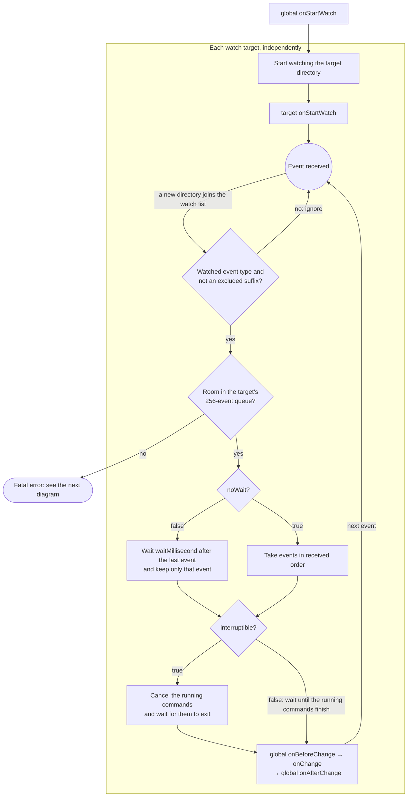
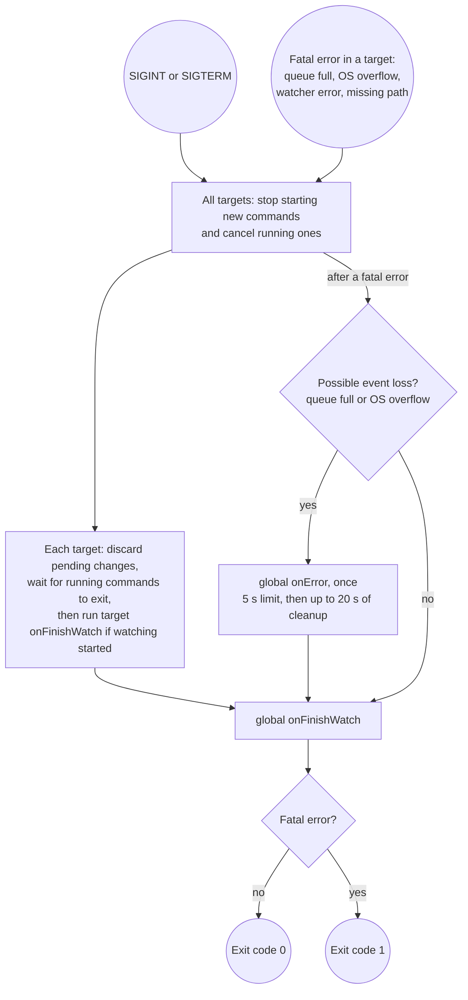

# Directory Watcher

🇺🇸 English | 🇰🇷 [한국어](README.ko.md)

Directory Watcher runs the commands you define when files are created, modified, or deleted in the directories you watch. Use it to rebuild or test code as you edit it, restart a development server when its sources change, or back up files when they change.

## Features

### Run commands when files change

- Watch several directories at once. Each watch target has its own `onChange` commands, and the global `onBeforeChange` and `onAfterChange` commands run before and after every target's `onChange`.
- Choose which events to react to (create, update, delete), and exclude directories, file suffixes, or subdirectories from watching.
- Pass the changed file's path, name, extension, directory, and event type to a command with [template variables](USAGE.md#variables-in-commands).

### Handle bursts of changes

- By default, a burst of events runs the hook once, `waitMillisecond` (100 ms by default) after the last event.
- With `noWait: true`, every event runs the hook, in the order the events were received.
- Each target holds at most 256 pending events. Instead of growing without bound, the watcher stops when a target's queue is full.

### Restart long-running processes

- With `interruptible: true`, a new change cancels the running commands, waits for them to exit, and then runs the change commands again. Use it for servers and other processes that do not exit on their own.
- When you stop the watcher, it cancels running commands and then runs the finish commands.

### Run setup and cleanup commands

- `onStartWatch` and `onFinishWatch` run when watching starts and stops, both globally and for each target.

### Get notified when events may be lost

- When a target's queue fills up or the OS reports an event overflow, the optional global `onError` command runs once, with the details in `DW_ERROR_*` environment variables. See [Event-loss notification](USAGE.md#event-loss-notification).

## Requirements

- macOS or Linux. The program has been verified to work correctly on these systems.
- Windows, with the limits below.
- Go 1.23 or later, only if you install with `go install`.

> [!WARNING]
> On Windows:
> - Output may not display correctly in PowerShell or Command Prompt. Run the watcher in Git Bash instead.
> - When the watcher stops a hook, it ends the hook's processes that do not exit on CTRL+BREAK only 20 seconds later, so replacing or stopping such a hook, including some `powershell` hooks, can take up to 20 seconds. See [Overload and shutdown](USAGE.md#overload-and-shutdown).

## Installation

### Homebrew

This works on macOS and Linux and needs Homebrew 5.1.14 or later. With an older Homebrew, installing the cask fails with `Unexpected method 'postflight_steps'`. Check the version with `brew --version`, and if it is older, update Homebrew first:

```shell
brew update
```

Then install the cask:

```shell
brew install --cask seungyeop-lee/tap/directory-watcher
```

If you installed version 2.x with `brew install seungyeop-lee/tap/directory-watcher`, you have the Homebrew formula, which no longer gets new versions. Uninstall it, then install the cask:

```shell
brew uninstall --formula directory-watcher
brew install --cask seungyeop-lee/tap/directory-watcher
```

### Scoop

On Windows:

```shell
scoop bucket add seungyeop-lee https://github.com/seungyeop-lee/scoop-bucket
scoop install seungyeop-lee/directory-watcher
```

### `go install`

```shell
go install github.com/seungyeop-lee/directory-watcher/v3@latest
```

### Run with Docker

Mount `config.yml` and the directory to watch into the published image:

```shell
docker run --rm \
  -v "$PWD/config.yml:/config.yml" \
  -v "$PWD/src:/src" \
  ghcr.io/seungyeop-lee/directory-watcher:latest -c /config.yml
```

The container's working directory is `/`, so `path: src` in `config.yml` refers to the mounted `/src`. Hooks run inside the container, so the files and tools they use must be available there. For a known issue with bind mounts, see [Running with Docker](USAGE.md#running-with-docker).

### In Dockerfile

```dockerfile
COPY --from=ghcr.io/seungyeop-lee/directory-watcher:latest /directory-watcher /usr/local/bin/
```

### Releases

Download the executable from the [releases page](https://github.com/seungyeop-lee/directory-watcher/releases/latest).

## Getting started

1. Create `config.yml` in the directory where you will run the watcher. This example runs `make test` in that directory whenever a file under `src` changes:

   ```yaml
   watchTargets:
     - path: src
       lifeCycle:
         onChange:
           - dir: .
             cmd: make test
   ```

2. Start the watcher in the same directory:

   ```shell
   directory-watcher
   ```

   To use a config file elsewhere, pass its path with `-c <config path>`.

3. Change a file under `src`. `make test` runs 100 ms after the last change.

- **Stop:** press Ctrl+C or send SIGTERM. The watcher cancels running commands, runs the finish commands, and exits.
- **More:** the [usage guide](USAGE.md) covers command-line options, running with Docker, the full `config.yml` format, where commands run, template variables, event-loss notification, and the limits of overload, shutdown, and folder events. For a fuller example, see [`config.example.yml`](config.example.yml).

## How it works

Global `onStartWatch` runs first. Then each watch target starts on its own and handles its changes independently of the other targets:



- With `interruptible: false`, events that arrive while target `onStartWatch` or a change is running wait in the queue until it finishes. With `interruptible: true`, the next change cancels a running target `onStartWatch` too.
- The commands of one run execute one after another, and the run stops at the first command that fails. The failure is logged as an `[ERROR]` line; see [`config.yml`](USAGE.md#configyml) in the usage guide.

A shutdown signal and a fatal error both stop every target before the finish commands run:



- Target finish commands may run while `onError` is still running. Global `onFinishWatch` waits for both.
- Finish commands have no time limit of their own.

## Development checks

See the [E2E guide](e2e/README.md) for automated macOS, Linux, and Windows checks against the current worktree and instructions for adding scenarios.

## License

This project is licensed under the [GPL-3.0 License](LICENSE). See the license file for details.
