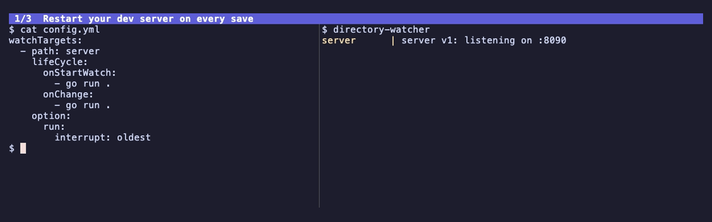

# Directory Watcher

🇺🇸 English | 🇰🇷 [한국어](README.ko.md)

- Directory Watcher runs the commands you describe in one `config.yml` when files change: run tests, rebuild, restart your dev server, and clean up when you stop.



## 30-second example

This `config.yml` restarts a Go server when its code changes and rebuilds the frontend when its sources change:

```yaml
watchTargets:
  - path: server
    lifeCycle:
      onStartWatch:
        - go run .
      onChange:
        - go run .
    option:
      run:
        interrupt: oldest
  - path: web/src
    lifeCycle:
      onChange:
        - dir: web
          cmd: npm run build
```

- Run `directory-watcher` in the directory that holds this `config.yml`.
- The server starts when watching starts, and each save under `server` stops it and starts it again.
- A save under `web/src` runs `npm run build` once, even when many files change together.
- Ctrl+C stops the server and then the watcher.

## Features

### Restart your dev server safely on every save

- Each save stops the running server and the processes it started, waits for the server to exit, and only then starts it again, so the old and new servers never run at the same time.
- The 30-second example above restarts its server this way. See [Running hooks with run](docs/guide/running.md#running-hooks-with-run).

### Run once when hundreds of files change at once

- When a formatter or a branch switch changes hundreds of files, your command runs once for the whole burst instead of once per file.
- The command runs 100 ms after the last change, or 1 second after the first change if changes keep coming.
- You can also run it once for each changed file or once for each event. See [Waiting and merging with hookBatch](docs/guide/running.md#waiting-and-merging-with-hookbatch).

### Get one event when a whole folder appears or disappears

- When a folder appears or disappears together with its contents, your command receives one event for the top folder instead of one for every file inside.

| Action | What your command receives |
|---|---|
| `mkdir -p src/a/b/c` | One folder-created event for `src/a` |
| `rm -rf src/pkg` with 300 files inside | One folder-deleted event for `src/pkg` |

- Moving a folder in or out of a watched directory works the same way. See [Folder events](docs/guide/events.md#folder-events).

### Run setup and cleanup when watching starts and stops

- Commands can run when watching starts and again when it stops, such as starting a database container and removing it when you press Ctrl+C.

```yaml
global:
  lifeCycle:
    onStartWatch:
      - docker compose up -d db
    onFinishWatch:
      - docker compose down
```

- Each watch target can have its own start and finish commands as well.
- The finish commands also run when the watcher stops because of an error.

### Find out when changes may have been missed

- When changes pile up faster than your commands can handle, or the OS reports that it dropped events, the watcher stops instead of growing its backlog without limit and runs a notification command of your choice once. See [Event-loss notification](docs/guide/running.md#event-loss-notification).
- Another command of your choice can warn you earlier, when a target's backlog reaches 70% and 90% of its limit. See [Queue size and warnings](docs/guide/running.md#queue-size-and-warnings).

### Install one executable anywhere

- Directory Watcher is a single executable that you can install with Homebrew, Scoop, or `go install`, or run from the published Docker image. See [Installation](#installation).

To add it to an image you build, copy it from the published image:

```dockerfile
COPY --from=ghcr.io/seungyeop-lee/directory-watcher:latest /directory-watcher /usr/local/bin/
```

### Also in Directory Watcher

| Feature | Usage guide |
|---|---|
| Watch several directories, each with its own commands | [`config.yml`](docs/guide/configuration.md#configyml) |
| Pass the changed file's path, name, extension, or event type to a command, without file names ever running as commands | [Variables in commands](docs/guide/configuration.md#variables-in-commands) |
| Choose which file and folder events run commands | [Folder events](docs/guide/events.md#folder-events) |
| Exclude files and folders with path patterns; names that start with `.` or `_`, such as `.git`, are skipped by default | [Excluding paths with exclude](docs/guide/events.md#excluding-paths-with-exclude), [Default exclusion](docs/guide/events.md#default-exclusion) |
| Run several changes of one target at the same time | [Running hooks with run](docs/guide/running.md#running-hooks-with-run) |
| Run commands in `sh`, `cmd`, or Windows PowerShell | [Shell that runs hook commands](docs/guide/configuration.md#shell-that-runs-hook-commands) |
| Watch overlapping paths, where one change runs the commands of each target | [Overlapping target paths](docs/guide/events.md#overlapping-target-paths) |

## Installation

> [!NOTE]
> The Homebrew cask needs Homebrew 5.1.14 or later. For updating Homebrew, see [Installing with Homebrew](docs/guide/installation.md#installing-with-homebrew).

Use a package manager:

```sh
# macOS or Linux
brew install --cask seungyeop-lee/tap/directory-watcher

# Windows using scoop
scoop bucket add seungyeop-lee https://github.com/seungyeop-lee/scoop-bucket
scoop install seungyeop-lee/directory-watcher
```

Or, use Docker, mounting `config.yml` and the directory to watch:

```sh
docker run --rm \
  -v "$PWD/config.yml:/config.yml" \
  -v "$PWD/src:/src" \
  ghcr.io/seungyeop-lee/directory-watcher:latest -c /config.yml
```

- Hooks then run inside the container. See [Running with Docker](docs/guide/installation.md#running-with-docker) for the paths and tools they can use and a known issue with bind mounts.
- To add the executable to an image you build, see [Adding the watcher to your own image](docs/guide/installation.md#adding-the-watcher-to-your-own-image).

Or, download it:

- The [releases page](https://github.com/seungyeop-lee/directory-watcher/releases/latest) has the executable for macOS, Linux, and Windows.

Or, just install it with `go`, which needs Go 1.27 or later:

```sh
go install github.com/seungyeop-lee/directory-watcher/v3@latest
```

## Getting started

1. Create `config.yml` in the directory where you will run the watcher. This example runs `make test` in that directory whenever a file under `src` changes:

   ```yaml
   watchTargets:
     - path: src
       lifeCycle:
         onChange:
           - dir: .
             cmd: make test
   ```

2. Start the watcher in the same directory:

   ```shell
   directory-watcher
   ```

   To use a config file elsewhere, pass its path with `-c <config path>`.

3. Change a file under `src`. `make test` runs 100 ms after the last change.

- **Hook output:** a file that a hook writes inside `path` is a change too, so the hook runs again and keeps rerunning. Add that file to the target's `watch.exclude`: if `onChange` writes `src/build.log`, add `exclude: ['build.log']` under `option.watch`. See [Stopping a hook from rerunning itself](docs/guide/events.md#stopping-a-hook-from-rerunning-itself).
- **Stop:** press Ctrl+C or send SIGTERM. The watcher cancels running commands, runs the finish commands, and exits.
- **More:** the [usage guide](USAGE.md) has recipes for common setups, such as running tests on save and running the watcher in Docker, and lists the topic guides: [Installing and running](docs/guide/installation.md), [Configuration file](docs/guide/configuration.md), [Events and watched paths](docs/guide/events.md), [Running hooks](docs/guide/running.md), and [How it works](docs/guide/how-it-works.md). For a fuller example, see [`config.example.yml`](config.example.yml).

## Requirements

- macOS or Linux. The watcher has been verified to work correctly on these systems.
- Windows, with limits on console output and on how quickly some hooks stop. See [Running on Windows](docs/guide/installation.md#running-on-windows).

## Development checks

- See the [E2E guide](e2e/README.md) for automated macOS, Linux, and Windows checks against the current worktree and instructions for adding scenarios.

## License

- This project is licensed under the [MIT License](LICENSE).
- See the license file for details.
- Versions before 3.0.0 were released under GPL-3.0.
