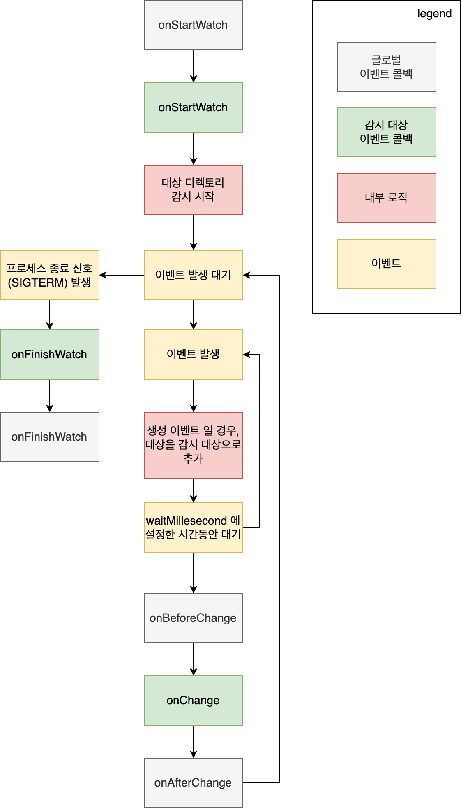

<p align="center">
    <a href="README.md"><b>English</b></a> •
    <a href="README.ko.md"><b>Korean</b></a>
</p>

> [!WARNING]
> This program has been verified to work correctly on macOS and Linux.
> On Windows, it can be used within Git Bash. Standard output may have issues in PowerShell or Command Prompt.
> Also, on Windows, using the `interruptible: true` setting may cause child processes to not terminate correctly; caution is advised.

# Directory Watcher

This program executes predefined commands when changes (creation, modification, deletion) occur within a directory.
Using this tool, you can react to file system changes in real-time and automate specific tasks based on these changes.
For example, you can set up tasks such as automatically creating backups when a file changes in a specific directory or running tests when code changes.

## Features

- Monitor multiple directories
- Configure individual commands to execute for changes in each directory
- Configure common commands to be executed at the start and end of monitoring
- Exclude specific directories within the monitored directory
- Exclude files with specific suffixes within the monitored directory
- Configure a delay between an event and the execution of its associated hook
- Configure whether to monitor subdirectories
- Configure which events to monitor (C: Create, U: Update, D: Delete)
- Define variables that can be used within the execution commands
- Allow stopping the currently running command and executing a new command when an event occurs during command execution (to handle daemon processes)

## Installation

### Homebrew

```shell
brew install seungyeop-lee/tap/directory-watcher
```

### `go install`

```shell
go install github.com/seungyeop-lee/directory-watcher/v2@latest
```

### In Dockerfile

```dockerfile
COPY --from=ghcr.io/seungyeop-lee/directory-watcher:latest /directory-watcher /usr/local/bin/
```

### Releases

Download the executable from the [releases page](https://github.com/seungyeop-lee/directory-watcher/releases/latest).

## Usage

You can run `directory-watcher` with the following command:

```shell
directory-watcher
```

It can also be run using docker.

```shell
docker run --rm ghcr.io/seungyeop-lee/directory-watcher:latest

# Known Issue: Inconsistent Delete Events with Bind Mounts
# When deleting files on the host system within a directory that's been bind-mounted into a container, the delete event may not always be detected. 
# This is a known issue with the underlying file system notification library (fsnotify).
# For more details, see: https://github.com/fsnotify/fsnotify/issues/592
```

This command provides the following options:

```shell
Usage:
  directory-watcher [flags]

Flags:
  -c, --config-path string   set config path (default "config.yml")
  -h, --help                 help for directory-watcher
  -l, --log-level string     set log level (default "ERROR")
  -v, --version              version for directory-watcher
```

## config.yml

Refer to the `config.example.yml` file for a practical example.
The `config.yml` file defines the directories to monitor and the commands to execute for changes occurring in each directory.
You can also define commands to be executed when starting or stopping the monitoring process.

```yaml
global:
  lifeCycle:
    onStartWatch: # global onStartWatch hook
      - 'command to execute'
      - dir: 'directory path where the command will be executed'
        cmd: 'command to execute'
      - dir: 'directory path where the command will be executed'
        cmd:
          - 'command to execute 1'
          - 'command to execute 2'
    onBeforeChange: # global onBeforeChange hook
      [ Same specification as global onStartWatch hook ]
    onAfterChange: # global onAfterChange hook
      [ Same specification as global onStartWatch hook ]
    onFinishWatch: # global onFinishWatch hook
      [ Same specification as global onStartWatch hook ]
    onError: # optional global event-loss notification
      [ Same specification as global onStartWatch hook ]
watchTargets:
  - path: [ path of the directory to monitor ]
    lifeCycle:
      onStartWatch: # onStartWatch hook
        [ Same specification as global onStartWatch hook ]
      onChange: # onChange hook
        [ Same specification as global onStartWatch hook ]
      onFinishWatch: # onFinishWatch hook
        [ Same specification as global onStartWatch hook ]
    option:
      excludeDir:
        - [ path of the directory to exclude from monitoring ]
      excludeSuffix:
        - [ file suffix to exclude from monitoring ]
      waitMillisecond: [ wait time after an event occurs before executing the hook, default is 100 ]
      watchSubDir: [ whether to monitor subdirectories, default is true ]
      watchEvent: [ monitoring events (C: create, U: update, D: delete), default is "CUD" ]
      noWait: [ whether to execute the hook immediately without waiting after an event occurs, default is false ]
      interruptible: [ whether to stop the currently running command and execute a new command, default is false ]
```

### Command Execution Location

The following describes the command execution location for each hook:

| dir | global onStartWatch, global onFinishWatch, global onError | Other hooks |
|-----|-------------------------------------------|-------------------------|
| O   | Specified dir location                    | Specified dir location  |
| X   | Program execution location                | Specified path location |

### Available Variables in Execution Commands

| Variable        | Description                                             | Example (when `test/dir2` is set as the monitored directory) |
|-----------------|---------------------------------------------------------|--------------------------------------------------------------|
| {{.Path}}       | Relative path of the file where the event occurred      | test/dir2/b.txt                                              |
| {{.AbsPath}}    | Absolute path of the file where the event occurred      | /Users/example/directory-watcher/test/dir2/b.txt             |
| {{.FileName}}   | File name where the event occurred                      | b.txt                                                        |
| {{.ExtName}}    | Extension of the file where the event occurred          | .txt                                                         |
| {{.DirPath}}    | Relative path of the directory where the event occurred | test/dir2                                                    |
| {{.DirAbsPath}} | Absolute path of the directory where the event occurred | /Users/example/directory-watcher/test/dir2                   |
| {{.Event}}      | Event type (C: create, U: update, D: delete)            | C                                                            |

### Event-loss notification

`global.lifeCycle.onError` is optional and uses the same command list and structured `dir`/`cmd` format as other hooks. It runs at most once per runner, only when the first fatal error satisfies `errors.Is(err, fsnotify.ErrEventOverflow)`. This includes dispatch queue saturation and OS-reported overflow. Other fatal errors, normal termination, and debounce replacement do not notify.

Error context is passed as environment variables, never interpolated into command templates:

| Environment variable | Value |
|----------------------|-------|
| `DW_ERROR_TARGET` | Watched target associated with the fatal error |
| `DW_ERROR_KIND` | `event_loss` |
| `DW_ERROR_CAUSE` | Original cause string |
| `DW_ERROR_MESSAGE` | Complete `FatalError.Error()` message |
| `DW_ERROR_POSSIBLE_LOSS` | `true` (possible loss, not a lost-event count) |

Have the notification executable read these environment variables directly; command strings do not perform shell expansion or redirection. If you use an executable shell script, quote expansions inside it, for example `printf '%s\n' "$DW_ERROR_MESSAGE"`. File-event template variables are not available for this hook. A structured `dir` selects its working directory; without it, the command uses the program execution directory.

The first fatal error immediately prevents new normal-hook approvals across all targets. The notification has an independent, fixed 5-second execution timeout, followed by up to 20 seconds of cancellation cleanup (at most 25 seconds total), regardless of normal-hook cancellation. A notification failure or timeout is logged and never replaces the original fatal error; the CLI still exits nonzero for that original error. Normal finish hooks still run after cancellation, with their existing behavior.

## Caution

### waitMillisecond and noWait

- When an event occurs within `watchTargets.path`, the hook is executed after waiting for waitMillisecond.
- If another event occurs within `watchTargets.path` during the waiting period, the previous event is ignored. That is, the waitMillisecond is reset based on the new event, and the hook is executed after the new waiting period.
- If you want the hook to be executed immediately for every event within `watchTargets.path` without ignoring any events, set noWait to true. (Hooks for events are executed sequentially.)

### Overload and shutdown

- Each target admits at most 256 pending events and one active hook generation. `noWait: true` preserves received-event order; it does not become latest-only under load. Debounce retains the last received valid event, and excluded suffixes neither execute nor reset its timer. Creation-call order across files does not guarantee notification receipt order, so the last file created is not necessarily the debounce result.
- A full dispatch queue or a watcher error stops processing. The default log includes the watched target and original cause; the CLI cleans up all targets and exits nonzero. Queue saturation is reported as `dispatch queue full`, distinct from an OS-reported overflow. No automatic restart or persistent queue is provided.
- Interruptible replacement cancels and waits for the previous generation before starting another. A shutdown signal cancels active startup/change commands, discards pending changes, joins event handlers, then runs finish hooks. Finish hooks keep their existing command behavior and have no additional timeout. Targets run independently.
- Path checks close any files they open before returning, including when directory metadata lookup fails. Releasing these handles does not depend on garbage collection.
- Filesystem actions do not map one-to-one to notifications. In fsnotify v1.7.0, inotify reports `ErrEventOverflow`; kqueue on macOS does not report that sentinel. Application bounds do not guarantee detection of every OS-level loss. See [E2E scenarios and limits](e2e/README.md#경합과-과부하-검증).


### Limitations on Folder Event Detection

- By default, hooks are executed based on **file** events within the monitored folder.
- Therefore, hooks are not executed for folder creation or renaming.
- However, hooks are executed for folder deletion (including empty folders) as it cannot be recognized that the target is a folder.

## Operational Diagram

The following diagram illustrates how `Directory Watcher` works:



## Development checks

See the [E2E guide (Korean)](e2e/README.md) for automated macOS/Linux checks against the current worktree and instructions for adding scenarios.

## License

This project is licensed under the [GPL-3.0 License](LICENSE). See the license file for details.
