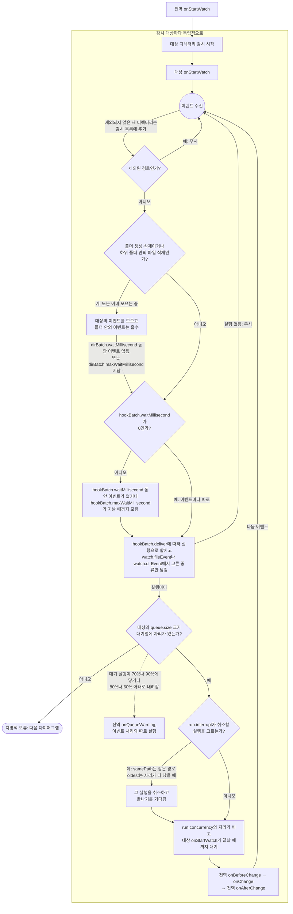
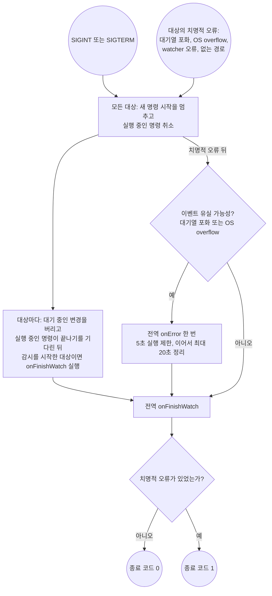

# 동작 방식

🇺🇸 [English](how-it-works.md) | 🇰🇷 한국어

- 전역 `onStartWatch`가 가장 먼저 실행됩니다.

그 뒤 감시 대상마다 따로 시작하고, 각 대상은 다른 대상과 관계없이 자기 변경을 처리합니다.

- 명령이 실행되는 동안에도 이벤트를 계속 받아 모으므로, `hookBatch`가 기다리는 시간이 끝날 때마다 그때 만든 실행이 대기열에 들어갑니다.
- 대기열에 자리가 없는 실행은 곧바로 watcher를 멈추며, 폴더 이벤트를 위해 모은 이벤트에서 만든 실행도 같습니다. 폴더 이벤트의 약속과 모으는 시간은 [폴더 이벤트](events.ko.md#폴더-이벤트)에 있습니다.
- 실행은 시작할 때까지 대기열에서 기다리므로, 대상 `onStartWatch`나 `run.concurrency`개의 실행이 도는 동안 만든 실행은 대기열에 남습니다. `run.interrupt: oldest`에서는 실행 중인 대상 `onStartWatch`도 첫 실행이 취소합니다.
- 한 번의 실행에 속한 명령은 차례대로 실행되며, 실패한 명령이 나오면 그 실행을 멈춥니다. 이 실패는 `[ERROR]` 로그로 남습니다. 자세한 내용은 [`config.yml`](configuration.ko.md#configyml)을 확인하세요.

종료 신호와 치명적 오류는 모두 전체 감시 대상을 멈춘 뒤 종료 명령을 실행합니다.

- 대상 종료 명령은 `onError`가 실행되는 동안에도 실행될 수 있습니다. 전역 `onFinishWatch`는 두 쪽이 모두 끝나기를 기다립니다.
- 종료 명령에는 별도의 실행 제한 시간이 없습니다.
