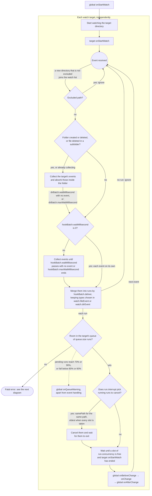
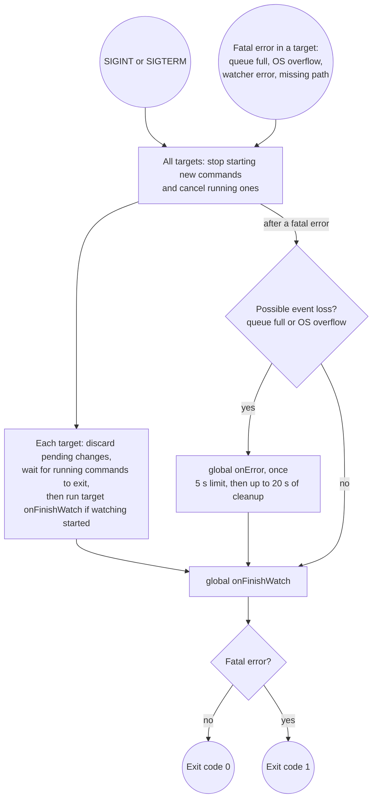

# How it works

🇺🇸 English | 🇰🇷 [한국어](how-it-works.ko.md)

- Global `onStartWatch` runs first.

Then each watch target starts on its own and handles its changes independently of the other targets:

- Events keep being received and collected while commands run, so each `hookBatch` wait that ends adds its runs to the queue.
- A run that finds no room stops the watcher at once, including runs made from events collected for folder events. See [Folder events](events.md#folder-events) for what the folder events promise and how long they are collected.
- A run waits in the queue until it starts, so runs made while target `onStartWatch` or `run.concurrency` runs are running wait there. With `run.interrupt: oldest`, the first run also cancels a running target `onStartWatch`.
- The commands of one run execute one after another, and the run stops at the first command that fails. The failure is logged as an `[ERROR]` line; see [`config.yml`](configuration.md#configyml).

A shutdown signal and a fatal error both stop every target before the finish commands run:

- Target finish commands may run while `onError` is still running. Global `onFinishWatch` waits for both.
- Finish commands have no time limit of their own.
