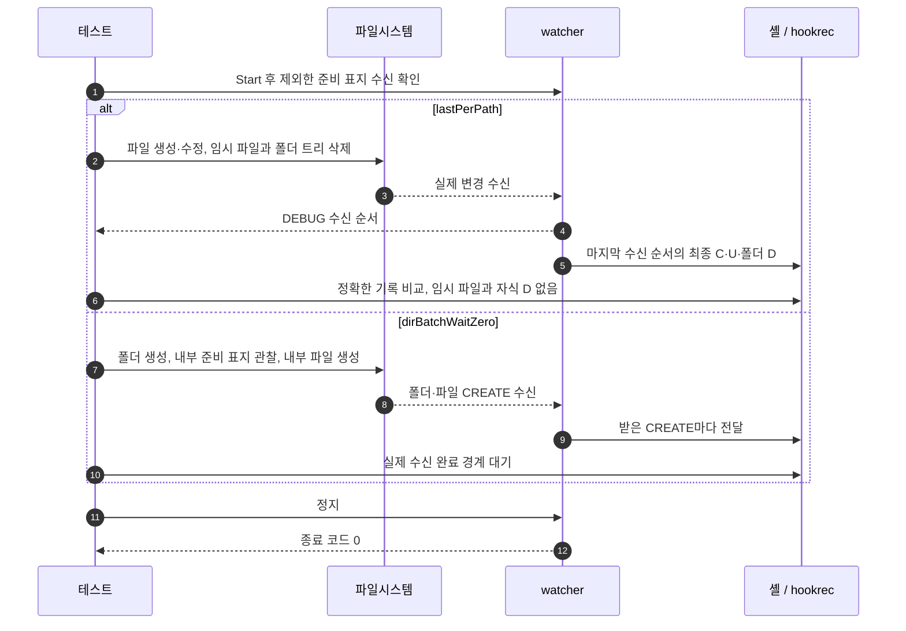

# `TestBatchingOptions`: 경로별 최종 변경과 폴더 대기 0

🇺🇸 [English](batching-options.md) | 🇰🇷 한국어

- 실제 watcher 바이너리·OS 이벤트·셸 hook으로 `hookBatch.deliver: lastPerPath`와 `dirBatch.waitMillisecond: 0`을 확인합니다.
- 이벤트가 계속 들어오는 동안의 최대 대기는 여기서 확인하지 않습니다. `internal/app/service/runner_watch_target_test.go`의 `TestMaxWaitSendsRunWhileEventsKeepArriving`이 제어한 이벤트 입력으로 `hookBatch`와 `dirBatch`의 최대 대기를 확인합니다.

## 확인 내용과 성공 기준

- `lastPerPath`는 경로마다 최종 변경을 하나씩 마지막 수신 순서대로 실행하며, 새 파일은 수정해도 `C`, 기존 파일은 `U`, 생성 후 삭제한 파일은 생략하고, 삭제한 폴더 아래 경로의 `D`는 버립니다.
  - 기대 순서는 파일 조작 순서가 아닌 실제 DEBUG 수신 순서에서 구하며, 폴더 모으기를 꺼서 hook 모으기 전에 자식 삭제가 흡수되지 않게 합니다.
- `dirBatch.waitMillisecond: 0`이면 새 폴더와 그 안의 두 파일이 hook에 전달되며, 중복 수신을 포함해 실제 받은 `CREATE`마다 기록 하나가 남습니다.
- 완료는 고정 sleep이나 파일 조작 수와 OS 알림 수의 일치가 아니라 하네스의 실제 수신 완료 경계와 120ms 무변화 관찰로 판정합니다.
  - 완료 대기는 받은 이벤트와 기록이 10초 동안 변하지 않으면 실패하므로, 받은 `CREATE`의 hook이 기록을 남기지 않으면 하위 테스트가 실패합니다.
- 모든 하위 테스트는 watcher를 정상 종료해 종료 코드 0을 확인하며 macOS·Linux Docker·UTM Windows에서 `SKIP` 없이 `PASS`여야 합니다.
- 2026-11-04 Windows ARM64 반복 실행에서 `lastPerPath`는 폴더 `REMOVE` 중복 수신 뒤 폴더 `D`의 `IsDir`가 `false`가 되고 자식 `D`도 남아 실패하며, `dirBatchWaitZero`는 통과합니다. 테스트는 이 결과를 허용하지 않고 문서의 계약을 유지합니다.
- 동작 계약은 [hook 모으기](../../../docs/guide/running.ko.md#hookbatch로-기다리고-합치기)와 [폴더 이벤트 모으기](../../../docs/guide/events.ko.md#폴더-이벤트를-모으는-시간)에 있습니다.

## 설정

| 하위 테스트 | `dirBatch` 대기 / 최대 (ms) | `hookBatch` 대기 / 최대 (ms) | 전달 방식 |
|---|---|---|---|
| `lastPerPath` | 0 / 0 | 1500 / 10000 | `lastPerPath` |
| `dirBatchWaitZero` | 0 / 0 | 0 / 0 | `each` |

- 모두 `**/*.probe`를 제외하고 파일 이벤트 `CUD`, 기본 폴더 이벤트와 순차 실행을 사용합니다.
- hook은 `CHANGE:<절대 경로>`를 기록하되, `lastPerPath`는 `CHANGE:<event>,<isDir>,<절대 경로>`를 기록합니다.

## 진행 순서



## 하위 테스트

- `lastPerPath`는 한 기다림의 경로별 최종 변경·마지막 수신 순서·임시 파일 생략·삭제한 자식 필터링을 확인합니다.
- `dirBatchWaitZero`는 폴더 모으기 없이 폴더와 내부 파일이 전달되는지 확인합니다.

## 실행

- 저장소 루트에서 Linux Docker와 [UTM Windows E2E](../windows-utm.ko.md)의 VM 준비를 마친 뒤 실행합니다.

```sh
go test -count=3 -v -run '^TestBatchingOptions$' ./e2e/scenarios
go run ./e2e/linux -- -count=3 -run '^TestBatchingOptions$'
make e2e-windows ARGS="-vm=Windows-E2E -- -count=3 -run '^TestBatchingOptions$'"
```

- 시간 경계에 민감해 [경합·과부하 반복 목록](../reliability.ko.md#경합과-과부하-검증)에 포함하며, 유실 알림과 Windows 정상 종료 목록에는 넣지 않습니다.

## 관련 코드

- `e2e/scenarios/batching_test.go`에 `TestBatchingOptions`·설정·DEBUG 수신 해석이 있습니다.
- `e2e/scenarios/helpers_test.go`: `mkdirAll`과 `createEmpty`는 폴더와 빈 파일을 만듭니다.
- `e2e/harness`의 `NewScenario`, `Start`, `Hook`, `Write`, `Await`, `AwaitChangesComplete`, `Lines`, `Log`, `CountRecord`, `Stop`을 사용하며, 책임은 [하네스 구조](../harness.ko.md#책임별-코드-위치)에 있습니다.
