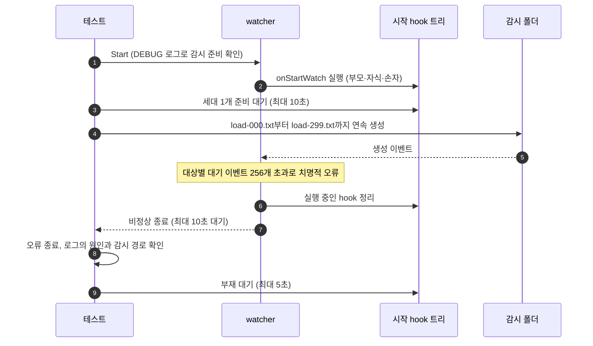

# `TestBoundedOverloadCLI`: 전달 대기열 포화와 비정상 종료

시작 hook이 실행 중이어서 변경 hook을 실행할 수 없는 동안 대기열 상한(256개)보다 많은 유효 생성 이벤트를 넣습니다. 이때 watcher가 감시 대상과 원인을 로그에 남기고 스스로 비정상 종료하며, hook 프로세스 트리를 정리하는지 확인합니다.

## 확인 내용과 성공 조건

- 파일 300개를 생성한 뒤 watcher가 10초 안에 스스로 종료하고, 종료 결과가 오류여야 합니다. 정상 종료(종료 코드 0)는 실패입니다.
- watcher 로그에 `dispatch queue full (capacity 256)`과 따옴표로 감싼 감시 폴더 경로가 함께 있어야 합니다.
- 시작 hook의 부모·자식·손자 프로세스가 5초 안에 모두 사라져야 합니다. 이 시나리오는 `signal` 뒤 `complete`로 판정하는 정상 완료를 검사하지 않습니다.

이 포화는 애플리케이션 대기열의 포화입니다. OS overflow와의 구분은 [유실 검증의 구분](../reliability.ko.md#유실-검증의-구분)에 있습니다.

## 설정

- 대상 `onStartWatch`는 `hookrec --depth=2`입니다. 변경 hook과 종료 hook은 설정하지 않습니다.
- 대상 옵션은 `noWait: true`, `watchEvent: C`, `excludeSuffix: [.probe]`입니다.

## 진행 순서



파일은 간격 없이 연속으로 생성합니다. 실행 결과는 `actual application overload: 300 creates ...` 로그에 소요 시간과 종료 결과로 남습니다.

## 실행

저장소 루트에서 실행합니다. 차례로 로컬, Linux Docker, UTM Windows VM에서 실행하는 명령입니다.

```sh
go test -count=1 -v -run '^TestBoundedOverloadCLI$' ./e2e/scenarios
go run ./e2e/linux -- -run '^TestBoundedOverloadCLI$'
make e2e-windows ARGS="-- -run '^TestBoundedOverloadCLI$'"
```

UTM 명령은 [UTM Windows VM에서 E2E 실행](../windows-utm.ko.md)의 사전 준비를 마치고 `make e2e-windows-up`으로 VM을 켠 뒤 실행합니다. 경합 시나리오를 함께 반복하는 명령은 [경합과 과부하 검증](../reliability.ko.md#경합과-과부하-검증)에 있습니다.

## 관련 코드

- `e2e/scenarios/reliability_test.go`: `TestBoundedOverloadCLI`
- `e2e/harness`: `Start`, `Hook`, `AwaitReadyGenerations`, `Await`, `Exited`, `ExitErr`, `Log`, `ProcessRecords`, `AwaitProcessesGone`. 각 함수의 위치와 책임은 [책임별 코드 위치](../harness.ko.md#책임별-코드-위치)에 있습니다.
