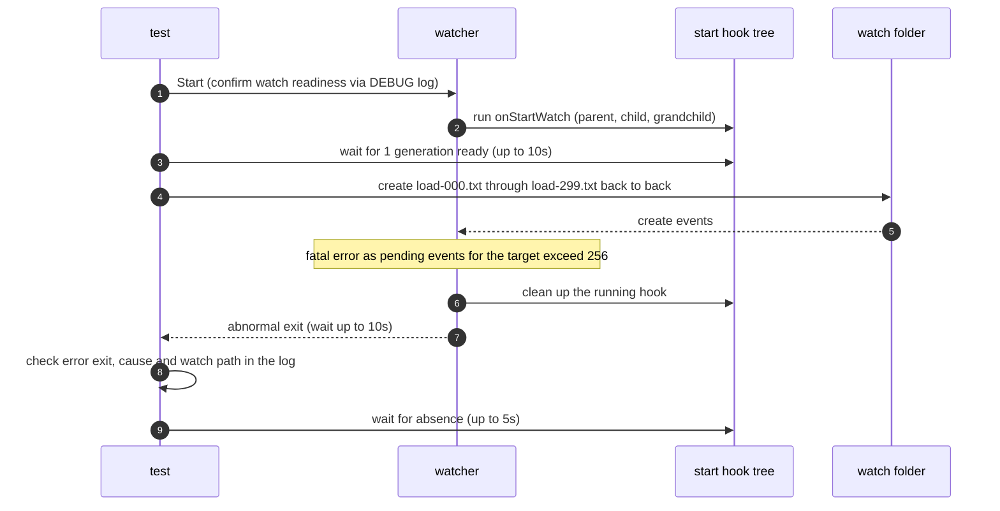

# `TestBoundedOverloadCLI`: dispatch queue saturation and abnormal exit

🇺🇸 English | 🇰🇷 [한국어](bounded-overload-cli.ko.md)

- While the start hook is running and the change hook therefore cannot run, the test feeds more valid create events than the queue limit (256).
- Checks that the watcher then logs the watch target and the cause, exits abnormally on its own, and cleans up the hook process tree.

## What it checks and success criteria

- After 300 files are created, the watcher must exit on its own within 10 seconds, and the exit result must be an error. A graceful exit (exit code 0) is a failure.
- The watcher log must contain `dispatch queue full (capacity 256)` together with the quoted watch folder path.
- The parent, child, and grandchild processes of the start hook must all be gone within 5 seconds. On Windows, a recorded PID that a program other than `hookrec` already holds when it is first checked counts as gone ([how liveness is judged](../harness.md#code-locations-by-responsibility)). This scenario does not check graceful completion judged by `complete` after `signal`.

- This saturation is a saturation of the application queue.
- How it differs from an OS overflow is in [Kinds of loss verification](../reliability.md#kinds-of-loss-verification).

## Configuration

- The target `onStartWatch` is `hookrec --depth=2`. No change hook or finish hook is configured.
- The target options are `noWait: true`, `watchFileEvent: C`, and `exclude: ['*.probe']`.

## Sequence



- Files are created back to back with no interval.
- The run result is logged as `actual application overload: 300 creates ...` with the elapsed time and the exit result.

## Running

- Run from the repository root.

The commands run locally, in Linux Docker, and on the UTM Windows VM, in that order.

```sh
go test -count=1 -v -run '^TestBoundedOverloadCLI$' ./e2e/scenarios
go run ./e2e/linux -- -run '^TestBoundedOverloadCLI$'
make e2e-windows ARGS="-- -run '^TestBoundedOverloadCLI$'"
```

- Run the UTM command after completing the prerequisites in [Running E2E on a UTM Windows VM](../windows-utm.md) and starting the VM with `make e2e-windows-up`.
- The commands that repeat the race scenarios together are in [Race and overload verification](../reliability.md#race-and-overload-verification).

## Related code

- `e2e/scenarios/reliability_test.go`: `TestBoundedOverloadCLI`
- `e2e/harness`: `Start`, `Hook`, `AwaitReadyGenerations`, `Await`, `Exited`, `ExitErr`, `Log`, `ProcessRecords`, `AwaitProcessesGone`. Where each function lives and what it does is in [Code locations by responsibility](../harness.md#code-locations-by-responsibility).
