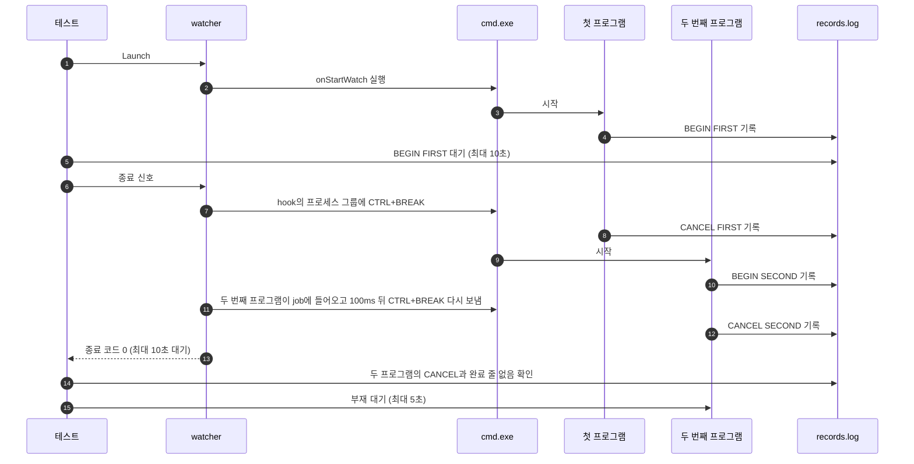

# `TestCanceledCommandListStopsNextProgram`: 취소된 `cmd` 명령 목록의 다음 프로그램 정지

🇺🇸 [English](canceled-command-list-stops-next-program.md) | 🇰🇷 한국어

- Windows에서 `cmd` 명령 목록인 시작 hook을 첫 프로그램이 실행되는 중에 취소합니다.
- `cmd.exe`가 첫 CTRL+BREAK 뒤에 시작한 다음 프로그램도 CTRL+BREAK를 받고 끝나는지 확인합니다.

## 확인 내용과 성공 조건

- 첫 프로그램이 `BEGIN`을 기록한 뒤 종료 신호를 보내면, watcher가 10초 안에 종료 코드 0으로 끝납니다.
- 두 프로그램이 모두 `CANCEL`을 기록하고, 완료 줄(`FIRST`, `SECOND`)은 기록하지 않습니다. 두 번째 프로그램의 `CANCEL`은 watcher가 그 프로그램이 시작된 뒤에 CTRL+BREAK를 다시 보냈다는 뜻입니다.
- `BEGIN`을 기록한 hook 프로세스는 모두 5초 안에 사라집니다. Windows에서는 기록된 PID를 처음 확인할 때 이미 `hookrec`이 아닌 프로그램이 쓰고 있으면 사라진 것으로 봅니다([생존 판정 방식](../harness.ko.md#책임별-코드-위치)).

## 설정

대상의 `onStartWatch`는 `<첫 프로그램> <구분자> <두 번째 프로그램>` 형태의 `cmd` 명령 한 줄이고, 기본 셸 `cmd`가 실행합니다.

| 프로그램 | 명령 |
|---|---|
| 첫 프로그램 | `hookrec --delay=30s --line=FIRST --cancel-exit-code=<코드>` |
| 두 번째 프로그램 | `hookrec --delay=30s --line=SECOND` |

## 하위 테스트

첫 프로그램은 `CANCEL`을 기록한 뒤 아래 종료 코드로 끝나므로, 모든 하위 테스트에서 `cmd.exe`가 두 번째 프로그램을 시작합니다.

| 하위 테스트 | 구분자 | `CANCEL` 뒤 첫 프로그램의 종료 코드 |
|---|---|---|
| `separator=&` | `&` | 0 |
| `separator=&&` | `&&` | 0 |
| `separator=\|\|` | `\|\|` | 1 |

## 진행 순서



## 실행

- 이 테스트는 Windows에서만 실행됩니다.

저장소 루트에서 UTM Windows VM으로 실행합니다.

```sh
make e2e-windows ARGS="-- -run '^TestCanceledCommandListStopsNextProgram$'"
```

- UTM 명령은 [UTM Windows VM에서 E2E 실행](../windows-utm.ko.md)의 사전 준비를 마치고 `make e2e-windows-up`으로 VM을 켠 뒤 실행합니다.
- Windows 호스트에서 직접 실행하려면 [Windows 실행 명령](../windows.ko.md#실행-명령)을 참고합니다.

## 관련 코드

- `e2e/scenarios/windows_cancel_test.go`: `TestCanceledCommandListStopsNextProgram`
- `e2e/harness`: `Launch`, `Hook`, `Await`, `DelayedHookBegun`, `DelayedHookCanceled`, `CountRecord`, `Stop`, `AwaitDelayedHooksGone`. 각 함수의 위치와 책임은 [책임별 코드 위치](../harness.ko.md#책임별-코드-위치)에 있습니다.
