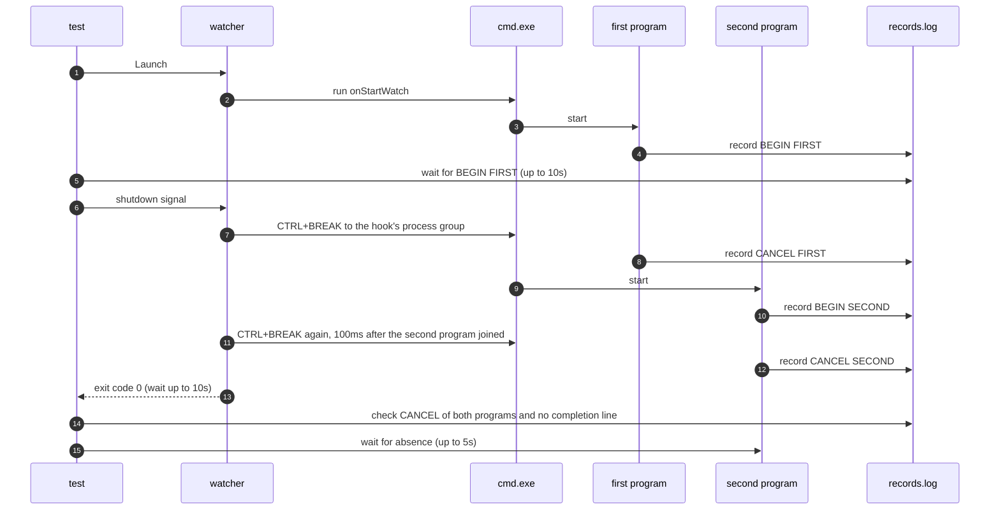

# `TestCanceledCommandListStopsNextProgram`: stopping the next program of a canceled `cmd` command list

🇺🇸 English | 🇰🇷 [한국어](canceled-command-list-stops-next-program.ko.md)

- On Windows, a start hook that is a `cmd` command list is canceled while its first program runs.
- Checks that the next program, which `cmd.exe` starts after the first CTRL+BREAK, also gets CTRL+BREAK and ends.

## What it checks and success criteria

- After the first program records `BEGIN`, the watcher exits with exit code 0 within 10 seconds of receiving the shutdown signal.
- Both programs record `CANCEL`, and neither records its completion line (`FIRST` or `SECOND`). A `CANCEL` from the second program means the watcher sent CTRL+BREAK again after that program started.
- Every hook process that recorded `BEGIN` is gone within 5 seconds. On Windows, a recorded PID that a program other than `hookrec` already holds when it is first checked counts as gone ([how liveness is judged](../harness.md#code-locations-by-responsibility)).

## Configuration

The target `onStartWatch` is one `cmd` command line, `<first> <separator> <second>`, and the default shell `cmd` runs it.

| Program | Command |
|---|---|
| First | `hookrec --delay=30s --line=FIRST --cancel-exit-code=<code>` |
| Second | `hookrec --delay=30s --line=SECOND` |

## Subtests

The first program exits with the code below after it records `CANCEL`, so `cmd.exe` starts the second program in every subtest.

| Subtest | Separator | First program's exit code after `CANCEL` |
|---|---|---|
| `separator=&` | `&` | 0 |
| `separator=&&` | `&&` | 0 |
| `separator=\|\|` | `\|\|` | 1 |

## Sequence



## Running

- This test runs only on Windows.

Run from the repository root on the UTM Windows VM.

```sh
make e2e-windows ARGS="-- -run '^TestCanceledCommandListStopsNextProgram$'"
```

- Run the UTM command after completing the prerequisites in [Running E2E on a UTM Windows VM](../windows-utm.md) and starting the VM with `make e2e-windows-up`.
- To run directly on a Windows host, see [Windows run commands](../windows.md#run-commands).

## Related code

- `e2e/scenarios/windows_cancel_test.go`: `TestCanceledCommandListStopsNextProgram`
- `e2e/harness`: `Launch`, `Hook`, `Await`, `DelayedHookBegun`, `DelayedHookCanceled`, `CountRecord`, `Stop`, `AwaitDelayedHooksGone`. Where each function lives and what it does is in [Code locations by responsibility](../harness.md#code-locations-by-responsibility).
