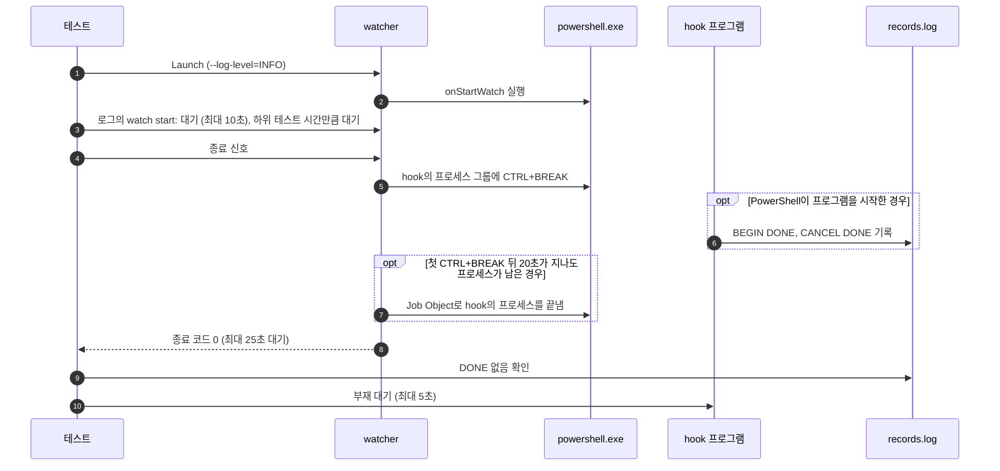

# `TestCanceledPowershellHookStops`: 여러 시점에 취소한 `powershell` hook의 정지

🇺🇸 [English](canceled-powershell-hook-stops.md) | 🇰🇷 한국어

Windows에서 `shell: powershell`로 실행하는 시작 hook을 watcher가 시작한 뒤 0–1000ms에 취소합니다. PowerShell이 시작하는 중이든, 프로그램을 시작하는 중이든, 프로그램을 실행하는 중이든 hook이 실행하는 프로그램이 끝까지 실행되지 않는지 확인합니다.

## 확인 내용과 성공 조건

- watcher가 종료 신호를 받고 25초 안에 종료 코드 0으로 끝납니다. 25초는 watcher가 hook의 프로세스를 강제로 끝내는 20초에 여유 5초를 더한 값입니다.
- hook 프로그램이 끝까지 실행될 때만 남기는 `DONE` 기록이 없습니다.
- `BEGIN`을 기록한 hook 프로세스는 모두 5초 안에 사라집니다. Windows에서는 기록된 PID를 처음 확인할 때 이미 `hookrec`이 아닌 프로그램이 쓰고 있으면 사라진 것으로 봅니다([생존 판정 방식](../harness.ko.md#책임별-코드-위치)).

hook 프로그램이 시작되는지는 취소 시점에 따라 달라지므로 `BEGIN`과 `CANCEL`은 요구하지 않습니다. UTM VM(2026-11-04)에서는 PowerShell이 시작하는 중에 취소하면 프로그램을 시작하기 전에 PowerShell이 끝났고, Windows 오류 보고(`wermgr.exe`)가 실행되는 동안 5초쯤 걸리기도 했습니다. 그보다 늦게 취소하면 실행 중인 프로그램이 신호를 받고 `CANCEL`을 기록했습니다.

## 설정

최상위 `shell`은 `powershell`이고, 대상의 `onStartWatch`는 `& hookrec --delay=30s --line=DONE`입니다. watcher는 `--log-level=INFO`로 실행하고, 테스트는 watcher가 `onStartWatch`를 시작하기 직전에 남기는 `watch start:` 로그를 기준으로 취소 시점을 잽니다.

## 하위 테스트

하위 테스트 `after=<시간>`은 로그에 `watch start:`가 나타나고 `<시간>`이 지난 뒤 종료 신호를 보냅니다. 시간은 `0s`부터 `1s`까지 100ms 간격입니다.

## 진행 순서



## 실행

이 테스트는 Windows에서만 실행됩니다. 저장소 루트에서 UTM Windows VM으로 실행합니다.

```sh
make e2e-windows ARGS="-- -run '^TestCanceledPowershellHookStops$'"
```

UTM 명령은 [UTM Windows VM에서 E2E 실행](../windows-utm.ko.md)의 사전 준비를 마치고 `make e2e-windows-up`으로 VM을 켠 뒤 실행합니다. Windows 호스트에서 직접 실행하려면 [Windows 실행 명령](../windows.ko.md#실행-명령)을 참고합니다.

## 관련 코드

- `e2e/scenarios/windows_cancel_test.go`: `TestCanceledPowershellHookStops`
- `e2e/harness`: `Launch`, `Hook`, `Await`, `Log`, `StopWithin`, `CountRecord`, `AwaitDelayedHooksGone`. 각 함수의 위치와 책임은 [책임별 코드 위치](../harness.ko.md#책임별-코드-위치)에 있습니다.
