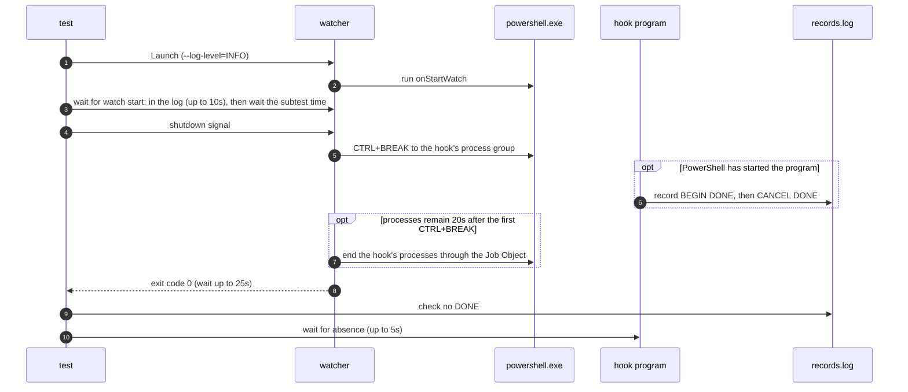

# `TestCanceledPowershellHookStops`: stopping a `powershell` hook canceled at different points

🇺🇸 English | 🇰🇷 [한국어](canceled-powershell-hook-stops.ko.md)

On Windows, a start hook run by `shell: powershell` is canceled 0–1000ms after the watcher starts it. Checks that the program the hook runs never runs to completion, whether PowerShell is still starting, is starting the program, or is running it.

## What it checks and success criteria

- The watcher exits with exit code 0 within 25 seconds of receiving the shutdown signal. 25 seconds is the 20-second limit after which the watcher ends the hook's processes, plus 5 seconds of slack.
- There is no `DONE` record, which the hook program writes only when it runs to completion.
- Every hook process that recorded `BEGIN` is gone within 5 seconds. On Windows, a recorded PID that a program other than `hookrec` already holds when it is first checked counts as gone ([how liveness is judged](../harness.md#code-locations-by-responsibility)).

Whether the hook program starts depends on when the cancel arrives, so the test does not require `BEGIN` or `CANCEL`. On the UTM VM (2026-11-04), a cancel during PowerShell's startup ended PowerShell before the program started, sometimes only after about 5 seconds while Windows Error Reporting (`wermgr.exe`) ran. A later cancel reached the running program, which recorded `CANCEL`.

## Configuration

The top-level `shell` is `powershell`, and the target `onStartWatch` is `& hookrec --delay=30s --line=DONE`. The watcher runs with `--log-level=INFO`, and the test measures the cancel time from the `watch start:` log line, which the watcher writes right before it starts `onStartWatch`.

## Subtests

The subtest `after=<time>` sends the shutdown signal `<time>` after `watch start:` appears in the log, in 100ms steps from `0s` to `1s`.

## Sequence



## Running

This test runs only on Windows. Run from the repository root on the UTM Windows VM.

```sh
make e2e-windows ARGS="-- -run '^TestCanceledPowershellHookStops$'"
```

Run the UTM command after completing the prerequisites in [Running E2E on a UTM Windows VM](../windows-utm.md) and starting the VM with `make e2e-windows-up`. To run directly on a Windows host, see [Windows run commands](../windows.md#run-commands).

## Related code

- `e2e/scenarios/windows_cancel_test.go`: `TestCanceledPowershellHookStops`
- `e2e/harness`: `Launch`, `Hook`, `Await`, `Log`, `StopWithin`, `CountRecord`, `AwaitDelayedHooksGone`. Where each function lives and what it does is in [Code locations by responsibility](../harness.md#code-locations-by-responsibility).
