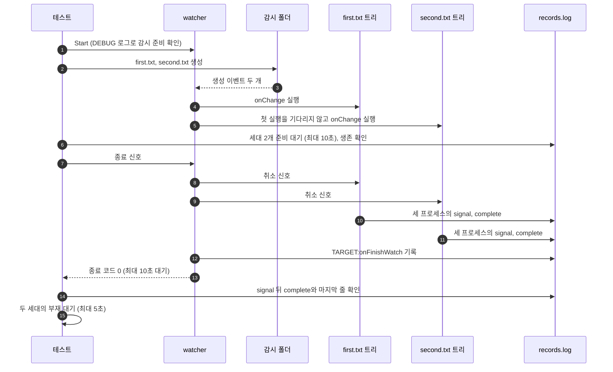

# `TestConcurrentRunsShutdown`: 동시에 도는 hook의 종료

🇺🇸 [English](concurrent-runs-shutdown.md) | 🇰🇷 한국어

- `run.concurrency: 2`에서 파일 두 개를 만들어 프로세스 트리 hook 두 개를 동시에 실행합니다.
- watcher가 종료할 때 실행 중인 트리가 모두 정상 완료하고, 그 뒤에 대상 `onFinishWatch`가 실행되는지 확인합니다.

## 확인 내용과 성공 조건

- 두 세대의 부모·자식·손자가 `ready`를 기록하고, `start`를 기록한 PID가 살아 있습니다. `hookrec` 트리는 신호를 받기 전에는 끝나지 않으므로, 두 세대가 준비되면 두 실행이 동시에 돌고 있는 것입니다.
- watcher가 종료 신호를 받고 10초 안에 종료 코드 0으로 끝납니다. `ready`를 기록한 모든 프로세스는 `signal`을 기록한 뒤 `complete`를 기록합니다.
- `records.log`의 마지막 줄이 `TARGET:onFinishWatch`입니다. 프로세스 기록도 같은 파일에 남으므로, 이 조건은 두 세대의 `complete`가 모두 기록된 뒤에 종료 hook이 실행되었다는 뜻입니다.
- 두 세대의 프로세스가 5초 안에 사라집니다([생존 판정](../harness.ko.md#프로세스-생존-판정과-강제-정리)).

## 설정

- 대상 `onChange`는 `hookrec --depth=2` 명령입니다. 기록 형식(`generation|PID|depth|state`)과 신호 처리는 [`hookrec` 프로세스 트리와 지연 hook](../harness.ko.md#hookrec-프로세스-트리와-지연-hook)에 있습니다.
- 대상 `onFinishWatch`는 `TARGET:onFinishWatch`를 기록합니다.
- 대상 옵션은 `run.concurrency: 2`, `hookBatch.waitMillisecond: 0`, `hookBatch.deliver: each`, `watch.fileEvent: C`, `watch.exclude: ['*.probe']`입니다.

## 진행 순서



- 두 트리가 기록하는 순서는 정해져 있지 않습니다.

## 실행

저장소 루트에서 차례로 로컬, Linux Docker, UTM Windows VM에서 실행하는 명령입니다.

```sh
go test -count=1 -v -run '^TestConcurrentRunsShutdown$' ./e2e/scenarios
go run ./e2e/linux -- -run '^TestConcurrentRunsShutdown$'
make e2e-windows ARGS="-- -run '^TestConcurrentRunsShutdown$'"
```

- UTM 명령은 [UTM Windows VM에서 E2E 실행](../windows-utm.ko.md)의 사전 준비를 마치고 `make e2e-windows-up`으로 VM을 켠 뒤 실행합니다.
- 경합 시나리오를 함께 반복하는 명령은 [경합과 과부하 검증](../reliability.ko.md#경합과-과부하-검증)에 있습니다.

## 관련 코드

- `e2e/scenarios/process_test.go`에는 `TestConcurrentRunsShutdown`이 있습니다.
- `e2e/harness`: `NewScenario`, `Start`, `Hook`, `Write`, `AwaitReadyGenerations`, `AssertRunning`, `Stop`, `ProcessRecords`, `AssertGracefulCompletion`, `Lines`, `AwaitProcessesGone`. 각 함수의 위치와 책임은 [책임별 코드 위치](../harness.ko.md#책임별-코드-위치)에 있습니다.
