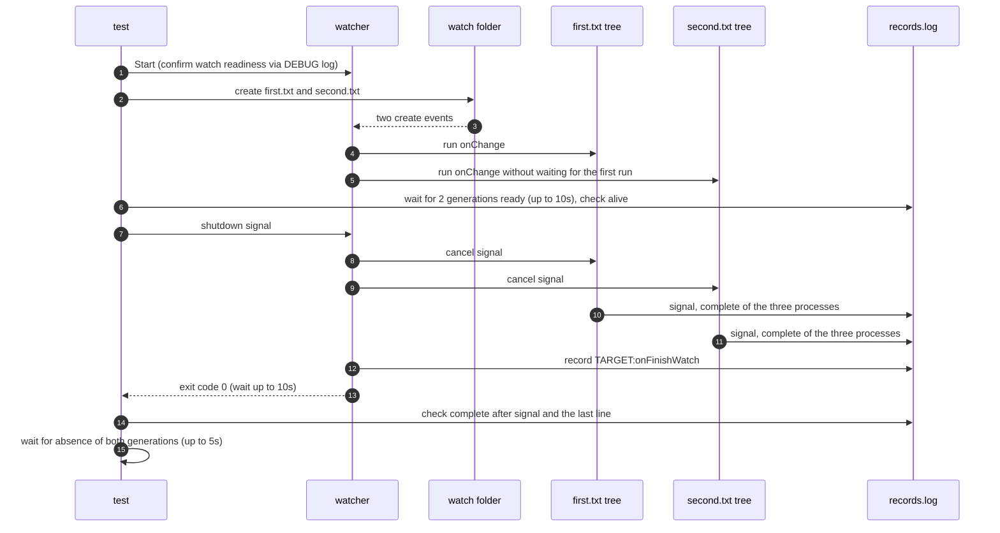

# `TestConcurrentRunsShutdown`: shutting down hooks that run at the same time

🇺🇸 English | 🇰🇷 [한국어](concurrent-runs-shutdown.ko.md)

- With `run.concurrency: 2`, two file creations run two process tree hooks at the same time.
- Checks that, when the watcher shuts down, every running tree completes gracefully and the target `onFinishWatch` runs after them.

## What it checks and success criteria

- The parent, child, and grandchild of two generations record `ready`, and the PIDs that recorded `start` are alive. A `hookrec` tree does not end before it gets a signal, so two ready generations mean that two runs run at the same time.
- The watcher exits with exit code 0 within 10 seconds of receiving the shutdown signal. Every process that recorded `ready` records `signal` and then `complete`.
- The last line of `records.log` is `TARGET:onFinishWatch`. Process records go to the same file, so this condition means the finish hook ran after the `complete` of both generations.
- The processes of both generations are gone within 5 seconds. On Windows, a recorded PID that a program other than `hookrec` already holds when it is first checked counts as gone ([how liveness is judged](../harness.md#code-locations-by-responsibility)).

## Configuration

- The target `onChange` is a `hookrec --depth=2` command. The record format (`generation|PID|depth|state`) and signal handling are described in [`hookrec` process trees and delayed hooks](../harness.md#hookrec-process-trees-and-delayed-hooks).
- The target `onFinishWatch` records `TARGET:onFinishWatch`.
- The target options are `run.concurrency: 2`, `hookBatch.waitMillisecond: 0`, `hookBatch.deliver: each`, `watch.fileEvent: C`, and `watch.exclude: ['*.probe']`.

## Sequence



- The two trees can record in any order.

## Running

- Run from the repository root.

The commands run locally, in Linux Docker, and on the UTM Windows VM, in that order.

```sh
go test -count=1 -v -run '^TestConcurrentRunsShutdown$' ./e2e/scenarios
go run ./e2e/linux -- -run '^TestConcurrentRunsShutdown$'
make e2e-windows ARGS="-- -run '^TestConcurrentRunsShutdown$'"
```

- Run the UTM command after completing the prerequisites in [Running E2E on a UTM Windows VM](../windows-utm.md) and starting the VM with `make e2e-windows-up`.
- To run directly on a Windows host, see [Windows run commands](../windows.md#run-commands).

## Related code

- `e2e/scenarios/process_test.go`: `TestConcurrentRunsShutdown`
- `e2e/harness`: `Start`, `Hook`, `Write`, `AwaitReadyGenerations`, `AssertRunning`, `Stop`, `ProcessRecords`, `AssertGracefulCompletion`, `Lines`, `AwaitProcessesGone`. Where each function lives and what it does is in [Code locations by responsibility](../harness.md#code-locations-by-responsibility).
