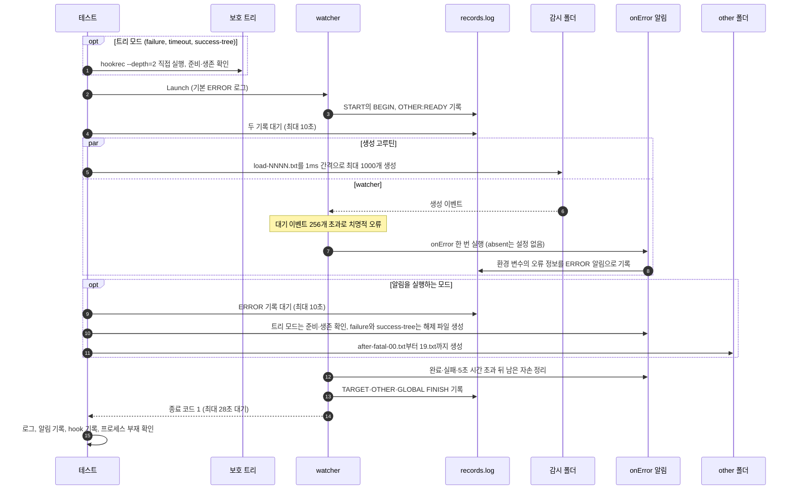

# `TestEventLossNotificationCLI`: 이벤트 유실 알림 `onError`

🇺🇸 [English](event-loss-notification-cli.md) | 🇰🇷 한국어

실제 전달 대기열 포화로 치명적 오류를 일으켜, CLI가 `global.lifeCycle.onError`를 한 번 실행하고 원래 오류로 비정상 종료하는지 확인합니다. 알림이 없거나, 실행 파일이 없거나, 실패·시간 초과하거나, 부모만 먼저 끝나는 경우에도 원래 오류와 종료 hook이 보존되고 알림의 자손만 정리되는지 여섯 모드로 확인합니다.

이 포화는 애플리케이션 대기열의 유실이며 OS overflow를 관찰한 증거가 아닙니다. 알림의 환경 변수와 실행·정리 제한 시간 계약은 [이벤트 유실 알림](../../../USAGE.ko.md#이벤트-유실-알림)을 따릅니다.

## 확인 내용과 성공 조건

모든 모드에서 다음 조건을 확인합니다.

- watcher가 알림 정리를 포함해 28초 안에 종료 코드 1로 끝납니다.
- 기본 ERROR 수준 로그에 `watch target "<감시 폴더>": dispatch queue full (capacity 256): fsnotify: queue or buffer overflow`와 `possible event loss`가 있고, DEBUG 로그의 `event:` 줄은 없습니다.
- 일반 hook 기록 `CHANGE`, `OTHER:CHANGE`, `BEFORE`, `START`가 하나도 없습니다. `START`는 30초 지연 시작 hook이므로 완료 전에 취소되어야 하고, 다른 대상의 변경 hook도 치명적 오류 뒤에는 승인되지 않아야 합니다.
- 종료 hook 기록 `TARGET:FINISH`, `OTHER:FINISH`, `GLOBAL:FINISH`가 각각 정확히 한 번 있습니다.
- 지연 시작 hook 프로세스와 기록된 알림 프로세스가 각각 5초 안에 사라집니다. Windows에서는 기록된 PID를 처음 확인할 때 이미 `hookrec`이 아닌 프로그램이 쓰고 있으면 사라진 것으로 봅니다([생존 판정 방식](../harness.ko.md#책임별-코드-위치)).

알림을 실행하는 모드(`success`, `failure`, `timeout`, `success-tree`)에서는 `ERROR|<JSON>` 알림 기록이 정확히 한 개이고, JSON에 아래 6개 항목만 있어야 합니다.

| 항목 | 기대값 |
|---|---|
| `DW_ERROR_TARGET` | 감시 폴더 경로 |
| `DW_ERROR_KIND` | `event_loss` |
| `DW_ERROR_CAUSE` | `dispatch queue full (capacity 256): fsnotify: queue or buffer overflow` |
| `DW_ERROR_MESSAGE` | `watch target "<감시 폴더>": <DW_ERROR_CAUSE 값>` |
| `DW_ERROR_POSSIBLE_LOSS` | `true` |
| `workdir` | 모드별 작업 디렉터리(아래 표) |

## 하위 테스트

| 모드 | `onError` 설정 형식 | 알림 동작 | 모드별 확인 |
|---|---|---|---|
| `success` | 문자열 명령 | 오류 정보를 기록하고 `NOTIFY` 기록 후 종료 | 작업 디렉터리는 실행 폴더, `NOTIFY` 1회 |
| `absent` | 설정 없음 | 실행 없음 | 알림 기록 0개 |
| `missing-command` | 실행 폴더의 없는 실행 파일 `missing-notification-executable` | 실행 실패 | 알림 기록 0개, 로그에 `onError notification failed` |
| `failure` | 문자열 명령 | 부모·자식·손자 준비 뒤 해제 파일을 보면 부모만 exit 7 | 작업 디렉터리는 실행 폴더, 로그에 `onError notification failed`와 `exit status 7` |
| `timeout` | 구조화 `dir`, 문자열 `cmd` | 부모·자식·손자가 신호를 받을 때까지 실행 | 작업 디렉터리는 `notification-workdir`, 로그에 `onError notification failed`, 소요 시간 5초 이상 27초 이하, `NOTIFY` 0회 |
| `success-tree` | 구조화 `dir`, 목록 `cmd` | 부모·자식·손자 준비 뒤 해제 파일을 보면 부모만 exit 0 | 작업 디렉터리는 `notification-workdir`, 로그에 `onError notification failed` 없음 |

`absent`를 뺀 모드는 `onError`에 항목 하나짜리 명령 목록을 설정하며, 표의 설정 형식은 그 항목의 형식입니다. `absent`·`missing-command`를 뺀 모드의 알림 명령은 `hookrec --error-context --line=NOTIFY`입니다. `failure`·`success-tree`는 `--depth=2 --release-file=<실행 폴더>/release-notification`을, `failure`는 `--exit-code=7`을, `timeout`은 `--depth=2`를 더합니다. 소요 시간은 생성 시작부터 잽니다.

### 트리 모드의 추가 확인

`failure`, `timeout`, `success-tree`는 알림이 실제 부모·자식·손자 트리를 만들며, 다음을 더 확인합니다.

- 시나리오 시작 전에 별도 실행 폴더에서 watcher와 무관한 보호 트리(`hookrec --depth=2`)를 직접 실행하고, 준비와 생존을 확인합니다.
- 알림 트리의 세 프로세스가 준비되고 살아 있어야 합니다. `failure`·`success-tree`는 이 확인 뒤에 해제 파일을 만들어 부모만 종료시키고, 자식·손자는 남깁니다.
- 지연 시작 hook의 부재를 확인한 직후, 추가 대기 없이 확인했을 때 알림 트리의 모든 프로세스가 이미 사라져 있어야 합니다. 테스트 정리 단계의 강제 종료로 사라진 것은 제품의 정리 성공으로 세지 않습니다.
- 보호 트리의 프로세스는 모두 살아 있어야 합니다.

생존 기록은 실행 폴더의 `notification-before.log`·`notification-after.log`와 보호 트리 실행 폴더의 `protected-before.log`·`protected-after.log`에 남습니다. 각 파일에는 기록 시각과 프로세스마다 세대·깊이·PID·생존 여부가 남고, Windows에서는 각 PID를 처음 확인할 때 연 프로세스 handle로 조회한 생성 시각과 프로그램, 지금 그 PID를 쓰는 프로그램, handle 열기·조회·대기 오류도 함께 남습니다. 실패하거나 `DW_E2E_KEEP=1`일 때만 실행 폴더가 보존됩니다.

## 설정

| 위치 | hook과 옵션 |
|---|---|
| 전역 | `onError`(모드별), `onBeforeChange`: `BEFORE`, `onFinishWatch`: `GLOBAL:FINISH` |
| 대상 1: 감시 폴더 | `onStartWatch`: `hookrec --delay=30s --line=START`, `onChange`: `CHANGE`, `onFinishWatch`: `TARGET:FINISH`, `noWait: true`, `watchEvent: C`, `excludeSuffix: [.probe]` |
| 대상 2: 실행 폴더의 `other` | `onStartWatch`: `OTHER:READY`, `onChange`: `OTHER:CHANGE`, `onFinishWatch`: `OTHER:FINISH`, `noWait: true`, `watchEvent: C` |

watcher는 `Launch`로 기본 ERROR 로그 수준에서 실행합니다. DEBUG 로그가 없으므로 probe 이벤트 대신 `START`의 `BEGIN` 기록과 `OTHER:READY` 기록으로 감시 준비를 판정합니다.

## 진행 순서



- 생성 고루틴은 watcher가 종료하면 남은 파일을 만들지 않고 멈춥니다. 고루틴의 파일 생성 오류도 테스트 실패로 이어집니다.
- 알림을 실행하는 모드에서만 `other` 폴더에 파일 20개를 만들어, 치명적 오류 뒤 다른 대상의 변경 hook이 실행되지 않는지 확인합니다.

## 플랫폼별 자손 정리

- macOS·Linux의 트리 모드는 부모가 먼저 끝나거나 실패한 뒤에도 남은 자손까지 정리되는지 검사합니다. 알림의 프로세스 그룹에는 TERM을 보내고 필요하면 KILL을 보내며, 5초 실행 제한과 20초 정리 상한을 공유합니다.
- Windows의 같은 모드는 Job Object로 자손을 정리합니다. CI 단계와 확인할 기록은 [Windows CI 단계](../windows.ko.md#ci-단계)와 [CI 결과 확인](../windows.ko.md#ci-결과-확인)에 있습니다.

## 실행

저장소 루트에서 실행합니다. 차례로 로컬, Linux Docker, UTM Windows VM에서 실행하는 명령입니다.

```sh
go test -count=1 -v -run '^TestEventLossNotificationCLI$' ./e2e/scenarios
go run ./e2e/linux -- -run '^TestEventLossNotificationCLI$'
make e2e-windows ARGS="-- -run '^TestEventLossNotificationCLI$'"
```

모드 하나만 실행하려면 `-run '^TestEventLossNotificationCLI$/^timeout$'`처럼 지정합니다. UTM 명령은 [UTM Windows VM에서 E2E 실행](../windows-utm.ko.md)의 사전 준비를 마치고 `make e2e-windows-up`으로 VM을 켠 뒤 실행합니다.

## 관련 코드

- `e2e/scenarios/error_notification_test.go`: `TestEventLossNotificationCLI`, 모드별 `onError`를 만드는 `notificationConfig`, 알림 기록을 읽는 `errorContexts`, 검사 함수 `assertErrorContext`·`assertLossExit`
- `e2e/harness`: `NewScenario`, `StartProcess`, `HookrecBin`, `Launch`, `WatcherBin`, `Hook`, `Await`, `DelayedHookBegun`, `CountRecord`, `ReadLinesLenient`, `AwaitReadyGenerations`, `AssertRunning`, `SnapshotProcesses`, `Done`, `Exited`, `ExitErr`, `Log`, `AwaitDelayedHooksGone`, `ProcessRecords`, `ProcessesGone`, `Alive`, `AwaitProcessesGone`. 각 함수의 위치와 책임은 [책임별 코드 위치](../harness.ko.md#책임별-코드-위치)에 있습니다.
- `e2e/hookrec`: `--error-context`(오류 환경 변수와 작업 디렉터리를 `ERROR|<JSON>`으로 기록), `--release-file`(해제 파일이 생기면 부모만 종료), `--exit-code`
