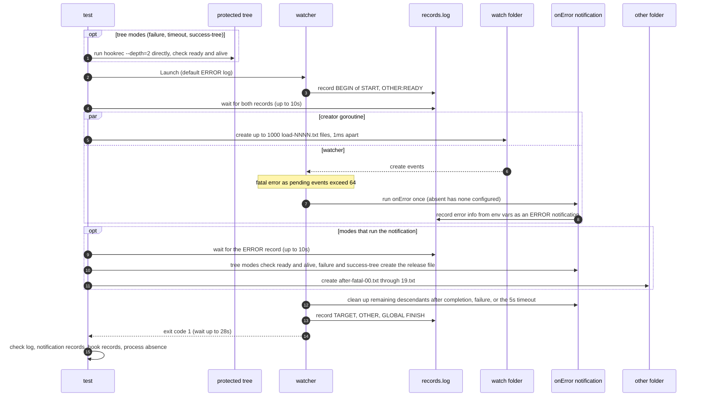

# `TestEventLossNotificationCLI`: event-loss notification `onError`

🇺🇸 English | 🇰🇷 [한국어](event-loss-notification-cli.ko.md)

- Causes a fatal error with a real dispatch queue saturation and checks that the CLI runs `global.lifeCycle.onError` once and exits abnormally with the original error.
- Six modes check that, even when the notification is absent, its executable is missing, it fails or times out, or only its parent exits first, the original error and the finish hooks are preserved and only the notification's descendants are cleaned up.

- This saturation is a loss in the application queue and is not evidence of an observed OS overflow.
- The notification's environment variables and its run and cleanup time limit contract follow [Event-loss notification](../../../docs/guide/running.md#event-loss-notification).

## What it checks and success criteria

Every mode checks the following.

- The watcher exits with exit code 1 within 28 seconds, including notification cleanup.
- The default ERROR-level log contains `watch target "<watch folder>": dispatch queue full (capacity 64): fsnotify: queue or buffer overflow` and `possible event loss`, and contains no `event:` lines from the DEBUG log.
- There are none of the normal hook records `CHANGE`, `OTHER:CHANGE`, `BEFORE`, and `START`. `START` is a 30-second delayed start hook, so it must be cancelled before it completes, and the change hook of the other target must not be admitted after the fatal error either.
- Each of the finish hook records `TARGET:FINISH`, `OTHER:FINISH`, and `GLOBAL:FINISH` appears exactly once.
- The delayed start hook process and the recorded notification processes are each gone within 5 seconds. On Windows, a recorded PID that a program other than `hookrec` already holds when it is first checked counts as gone ([how liveness is judged](../harness.md#code-locations-by-responsibility)).

In the modes that run the notification (`success`, `failure`, `timeout`, `success-tree`), there is exactly one `ERROR|<JSON>` notification record, and the JSON must contain only the 6 entries below.

| Entry | Expected value |
|---|---|
| `DW_ERROR_TARGET` | Watch folder path |
| `DW_ERROR_KIND` | `event_loss` |
| `DW_ERROR_CAUSE` | `dispatch queue full (capacity 64): fsnotify: queue or buffer overflow` |
| `DW_ERROR_MESSAGE` | `watch target "<watch folder>": <value of DW_ERROR_CAUSE>` |
| `DW_ERROR_POSSIBLE_LOSS` | `true` |
| `workdir` | Working directory for the mode (table below) |

## Subtests

| Mode | `onError` configuration form | Notification behavior | Mode-specific checks |
|---|---|---|---|
| `success` | String command | Records the error information, records `NOTIFY`, and exits | Working directory is the run folder, `NOTIFY` once |
| `absent` | Not configured | Does not run | 0 notification records |
| `missing-command` | Nonexistent executable `missing-notification-executable` in the run folder | Fails to run | 0 notification records, `onError notification failed` in the log |
| `failure` | String command | After the parent, child, and grandchild are ready, only the parent exits 7 when it sees the release file | Working directory is the run folder, `onError notification failed` and `exit status 7` in the log |
| `timeout` | Structured `dir`, string `cmd` | Parent, child, and grandchild run until they receive a signal | Working directory is `notification-workdir`, `onError notification failed` in the log, elapsed time at least 5 and at most 27 seconds, `NOTIFY` 0 times |
| `success-tree` | Structured `dir`, list `cmd` | After the parent, child, and grandchild are ready, only the parent exits 0 when it sees the release file | Working directory is `notification-workdir`, no `onError notification failed` in the log |

- Every mode except `absent` sets `onError` to a command list with one entry, and the configuration form in the table is the form of that entry.
- In every mode except `absent` and `missing-command`, the notification command is `hookrec --error-context --line=NOTIFY`.
- `failure` and `success-tree` add `--depth=2 --release-file=<run folder>/release-notification`, `failure` adds `--exit-code=7`, and `timeout` adds `--depth=2`.
- Elapsed time is measured from the start of file creation.

### Extra checks for tree modes

In `failure`, `timeout`, and `success-tree`, the notification creates a real parent, child, and grandchild tree, and the following are also checked.

- Before the scenario starts, a protected tree (`hookrec --depth=2`) unrelated to the watcher is started directly in a separate run folder, and its readiness and liveness are confirmed.
- The three processes of the notification tree must be ready and alive. After this check, `failure` and `success-tree` create the release file so that only the parent exits and the child and grandchild remain.
- Right after the absence of the delayed start hook is confirmed, a check with no extra wait must find every process of the notification tree already gone. Processes removed by the forced termination in the test cleanup step do not count as a successful cleanup by the product.
- Every process of the protected tree must be alive.

- Liveness records are left in `notification-before.log` and `notification-after.log` in the run folder, and in `protected-before.log` and `protected-after.log` in the protected tree's run folder.
- Each file holds the time of recording and, for each process, the generation, depth, PID, and whether it is alive.
- On Windows, it also holds the creation time and program queried through the process handle opened when each PID was first checked, the program that holds the PID now, and any errors from opening, querying, or waiting on the handle.
- The run folder is kept only on failure or with `DW_E2E_KEEP=1`.

## Configuration

| Location | Hooks and options |
|---|---|
| Global | `onError` (per mode), `onBeforeChange`: `BEFORE`, `onFinishWatch`: `GLOBAL:FINISH` |
| Target 1: watch folder | `onStartWatch`: `hookrec --delay=30s --line=START`, `onChange`: `CHANGE`, `onFinishWatch`: `TARGET:FINISH`, `queue.size: 64`, `hookBatch.waitMillisecond: 0`, `hookBatch.deliver: each`, `watch.fileEvent: C`, `watch.exclude: ['*.probe']` |
| Target 2: `other` in the run folder | `onStartWatch`: `OTHER:READY`, `onChange`: `OTHER:CHANGE`, `onFinishWatch`: `OTHER:FINISH`, `hookBatch.waitMillisecond: 0`, `hookBatch.deliver: each`, `watch.fileEvent: C` |

- The watcher is launched with `Launch` at the default ERROR log level.
- With no DEBUG log, watch readiness is judged from the `BEGIN` record of `START` and the `OTHER:READY` record instead of probe events.

## Sequence



- The creator goroutine stops without creating the remaining files once the watcher exits. A file creation error in the goroutine also fails the test.
- Only in the modes that run the notification, 20 files are created in the `other` folder to check that the other target's change hook does not run after the fatal error.

## Descendant cleanup by platform

- On macOS and Linux, the tree modes check that remaining descendants are cleaned up even after the parent exits first or fails. The notification's process group receives TERM, and KILL if needed, sharing the 5-second run limit and the 20-second cleanup cap.
- On Windows, the same modes clean up descendants with a Job Object. The CI steps and the records to check are in [Windows CI steps](../windows.md#ci-steps) and [Checking CI results](../windows.md#checking-ci-results).

## Running

- Run from the repository root.

The commands run locally, in Linux Docker, and on the UTM Windows VM, in that order.

```sh
go test -count=1 -v -run '^TestEventLossNotificationCLI$' ./e2e/scenarios
go run ./e2e/linux -- -run '^TestEventLossNotificationCLI$'
make e2e-windows ARGS="-- -run '^TestEventLossNotificationCLI$'"
```

- To run a single mode, specify it as in `-run '^TestEventLossNotificationCLI$/^timeout$'`.
- Run the UTM command after completing the prerequisites in [Running E2E on a UTM Windows VM](../windows-utm.md) and starting the VM with `make e2e-windows-up`.

## Related code

- `e2e/scenarios/error_notification_test.go`: `TestEventLossNotificationCLI`, `notificationConfig`, which builds the per-mode `onError`, `errorContexts`, which reads the notification records, and the check functions `assertErrorContext`·`assertLossExit`
- `e2e/harness`: `NewScenario`, `StartProcess`, `HookrecBin`, `Launch`, `WatcherBin`, `Hook`, `Await`, `DelayedHookBegun`, `CountRecord`, `ReadLinesLenient`, `AwaitReadyGenerations`, `AssertRunning`, `SnapshotProcesses`, `Done`, `Exited`, `ExitErr`, `Log`, `AwaitDelayedHooksGone`, `ProcessRecords`, `ProcessesGone`, `Alive`, `AwaitProcessesGone`. Where each function lives and what it does is in [Code locations by responsibility](../harness.md#code-locations-by-responsibility).
- `e2e/hookrec`: `--error-context` (records every environment variable whose name starts with `DW_ERROR_`, and the working directory, as `ERROR|<JSON>`), `--release-file` (only the parent exits once the release file appears), `--exit-code`
