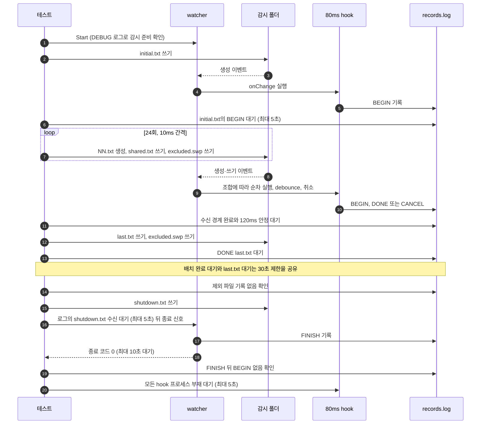

# `TestFastInflowSlowHook`: 느린 hook 실행 중 빠른 파일 유입

80ms 걸리는 변경 hook이 실행되는 동안 파일 변경이 10ms 간격으로 몰려 들어올 때, `noWait`·`interruptible` 네 조합에서 마지막으로 수신한 유효 변경까지 처리되는지 확인합니다. 제외 파일이 hook을 실행하지 않는지, 종료 뒤에 hook이 새로 실행되지 않고 hook 프로세스가 사라지는지도 확인합니다.

## 확인 내용과 성공 조건

- **유입 배치의 완료**: 유효 경로(`initial.txt`, `shared.txt`, `00.txt`~`23.txt`)의 `CREATE`·`WRITE` 이벤트 가운데 DEBUG 로그에 실제로 수신된 것만 대상으로 합니다. 마지막 `DONE:` 기록의 경로가 마지막으로 수신된 경로와 같고, `BEGIN`을 기록한 hook이 모두 완료(`DONE:`)되거나 취소(`CANCEL`)되었으며, 로그와 기록이 120ms 동안 변하지 않아야 합니다. 이 판정의 근거와 한계는 [OS E2E의 수신 경계 판정](../reliability.ko.md#os-e2e의-수신-경계-판정)에 있습니다.
- **비중단 순차 처리**: `noWait=true/interruptible=false`에서는 `DONE:` 기록 수가 수신된 유효 이벤트 수와 같아야 하고, `00.txt`~`23.txt` 각각에 `DONE:` 기록이 하나 이상 있어야 합니다. 기준은 파일을 조작한 횟수가 아니라 관찰된 수신 횟수입니다.
- **고립된 변경**: 배치가 안정된 뒤 쓴 `last.txt`의 `DONE:` 기록이 나타나야 합니다. 이 대기와 배치 완료 대기는 하나의 30초 제한을 공유합니다.
- **제외 파일**: 종료 전까지의 기록에 `excluded.swp`나 `readiness.probe`가 들어 있는 줄이 없어야 합니다.
- **종료**: watcher가 종료 신호를 받고 10초 안에 종료 코드 0으로 끝나며, 마지막 `FINISH` 기록 뒤에 `BEGIN|` 기록이 없어야 합니다. 즉 종료 시 대기 중인 변경은 실행되지 않습니다. `BEGIN`을 기록한 모든 hook 프로세스는 5초 안에 사라져야 합니다.

## 설정

- 대상 `onChange`는 `hookrec --delay=80ms --line=DONE:{{.Path}}`입니다. 시작할 때 `BEGIN|PID|DONE:<경로>`를, 80ms 뒤 `DONE:<경로>`를, 그 전에 취소되면 `CANCEL|PID|DONE:<경로>`를 기록합니다.
- 대상 `onFinishWatch`는 `FINISH`를 기록합니다.
- 대상 옵션은 하위 테스트별 `noWait`·`interruptible`과 `waitMillisecond: 30`, `watchEvent: CU`, `excludeSuffix: [.probe, .swp]`입니다.

## 하위 테스트

| 하위 테스트 | 변경 이벤트 처리 | 추가 확인 |
|---|---|---|
| `noWait=false/interruptible=false` | 30ms debounce, 실행 중인 hook 유지 | 없음 |
| `noWait=false/interruptible=true` | 30ms debounce, 실행 중인 hook 취소 후 교체 | 없음 |
| `noWait=true/interruptible=false` | 수신한 이벤트마다 순차 실행 | 완료 수와 수신 수 일치, 고유 파일 24개 모두 완료 |
| `noWait=true/interruptible=true` | 수신한 이벤트마다 실행, 실행 중인 hook 취소 후 교체 | 없음 |

## 진행 순서



- 24회 반복은 약 0.3초 동안 고유 파일 24개 생성, 같은 파일 `shared.txt` 24회 쓰기, 제외 파일 `excluded.swp` 24회 쓰기를 입력합니다. 고립된 변경 뒤의 `excluded.swp` 쓰기를 더하면 제외 파일 쓰기는 25회입니다.
- 종료 신호는 느린 hook이 실행 중이고 이벤트가 더 들어오는 상태에서 보냅니다.
- 실행 결과는 `load: 24 unique creates + 24 shared writes + 25 excluded writes; ...` 로그에 실제 입력 시간과 기록 수로 남습니다.

## 실행

저장소 루트에서 실행합니다. 차례로 로컬, Linux Docker, UTM Windows VM에서 실행하는 명령입니다.

```sh
go test -count=1 -v -run '^TestFastInflowSlowHook$' ./e2e/scenarios
go run ./e2e/linux -- -run '^TestFastInflowSlowHook$'
make e2e-windows ARGS="-- -run '^TestFastInflowSlowHook$'"
```

하위 테스트 하나만 실행하려면 `-run '^TestFastInflowSlowHook$/^noWait=true$/^interruptible=false$'`처럼 하위 테스트 이름의 각 부분을 `/`로 나눠 지정합니다. UTM 명령은 [UTM Windows VM에서 E2E 실행](../windows-utm.ko.md)의 사전 준비를 마치고 `make e2e-windows-up`으로 VM을 켠 뒤 실행합니다. 경합 시나리오를 함께 반복하는 명령은 [경합과 과부하 검증](../reliability.ko.md#경합과-과부하-검증)에 있습니다.

## 관련 코드

- `e2e/scenarios/reliability_test.go`: `TestFastInflowSlowHook`
- `e2e/harness`: `Start`, `Hook`, `Await`, `DelayedHookBegun`, `AwaitChangesComplete`, `AwaitLine`, `CountRecord`, `Stop`, `AwaitDelayedHooksGone`. 각 함수의 위치와 책임은 [책임별 코드 위치](../harness.ko.md#책임별-코드-위치)에 있습니다.
