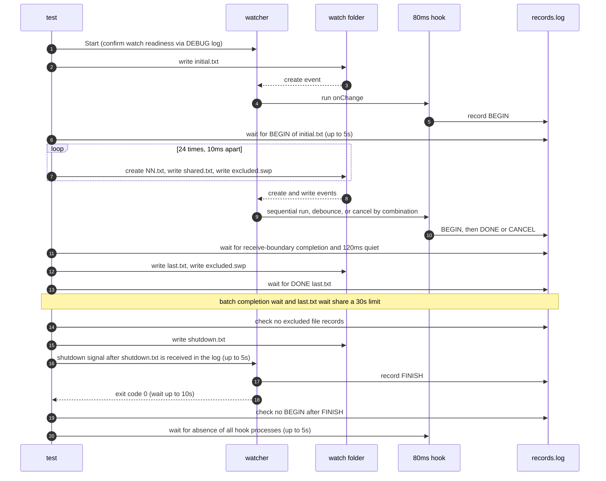

# `TestFastInflowSlowHook`: fast file inflow while a slow hook runs

🇺🇸 English | 🇰🇷 [한국어](fast-inflow-slow-hook.ko.md)

While a change hook that takes 80ms is running, file changes pour in at 10ms intervals. Checks, in the four `noWait`·`interruptible` combinations, that processing reaches the last valid change received. It also checks that excluded files do not run the hook, and that after shutdown no new hook runs and the hook processes are gone.

## What it checks and success criteria

- **Completion of the inflow batch**: Only the `CREATE` and `WRITE` events for valid paths (`initial.txt`, `shared.txt`, `00.txt`–`23.txt`) that were actually received in the DEBUG log count. The path of the last `DONE:` record must equal the last received path, every hook that recorded `BEGIN` must have completed (`DONE:`) or been cancelled (`CANCEL`), and the log and records must stay unchanged for 120ms. The basis and limits of this judgment are in [Receive boundary checks in OS E2E](../reliability.md#receive-boundary-checks-in-os-e2e).
- **Sequential processing without interruption**: With `noWait=true/interruptible=false`, the number of `DONE:` records must equal the number of valid events received, and each of `00.txt`–`23.txt` must have at least one `DONE:` record. The baseline is the observed number of receipts, not the number of file operations.
- **Isolated change**: The `DONE:` record for `last.txt`, written after the batch settles, must appear. This wait and the batch completion wait share one 30-second limit.
- **Excluded files**: Records up to shutdown must contain no line with `excluded.swp` or `readiness.probe`.
- **Shutdown**: The watcher exits with exit code 0 within 10 seconds of receiving the shutdown signal, and there must be no `BEGIN|` record after the last `FINISH` record. In other words, changes pending at shutdown are not run. Every hook process that recorded `BEGIN` must be gone within 5 seconds.

## Configuration

- The target `onChange` is `hookrec --delay=80ms --line=DONE:{{.Path}}`. It records `BEGIN|PID|DONE:<path>` when it starts, `DONE:<path>` after 80ms, and `CANCEL|PID|DONE:<path>` if it is cancelled before that.
- The target `onFinishWatch` records `FINISH`.
- The target options are the per-subtest `noWait` and `interruptible`, plus `waitMillisecond: 30`, `watchEvent: CU`, and `excludeSuffix: [.probe, .swp]`.

## Subtests

| Subtest | Change event handling | Extra checks |
|---|---|---|
| `noWait=false/interruptible=false` | 30ms debounce, running hook kept | None |
| `noWait=false/interruptible=true` | 30ms debounce, running hook cancelled and replaced | None |
| `noWait=true/interruptible=false` | Sequential run for each received event | Completion count matches receipt count, all 24 unique files completed |
| `noWait=true/interruptible=true` | Run for each received event, running hook cancelled and replaced | None |

## Sequence



- The 24 iterations, over about 0.3 seconds, create 24 unique files, write the same file `shared.txt` 24 times, and write the excluded file `excluded.swp` 24 times. With the `excluded.swp` write after the isolated change, there are 25 excluded-file writes.
- The shutdown signal is sent while the slow hook is running and more events are arriving.
- The run result is logged as `load: 24 unique creates + 24 shared writes + 25 excluded writes; ...` with the actual input duration and record counts.

## Running

Run from the repository root. The commands run locally, in Linux Docker, and on the UTM Windows VM, in that order.

```sh
go test -count=1 -v -run '^TestFastInflowSlowHook$' ./e2e/scenarios
go run ./e2e/linux -- -run '^TestFastInflowSlowHook$'
make e2e-windows ARGS="-- -run '^TestFastInflowSlowHook$'"
```

To run a single subtest, specify each part of the subtest name separated by `/`, as in `-run '^TestFastInflowSlowHook$/^noWait=true$/^interruptible=false$'`. Run the UTM command after completing the prerequisites in [Running E2E on a UTM Windows VM](../windows-utm.md) and starting the VM with `make e2e-windows-up`. The commands that repeat the race scenarios together are in [Race and overload verification](../reliability.md#race-and-overload-verification).

## Related code

- `e2e/scenarios/reliability_test.go`: `TestFastInflowSlowHook`
- `e2e/harness`: `Start`, `Hook`, `Await`, `DelayedHookBegun`, `AwaitChangesComplete`, `AwaitLine`, `CountRecord`, `Stop`, `AwaitDelayedHooksGone`. Where each function lives and what it does is in [Code locations by responsibility](../harness.md#code-locations-by-responsibility).
