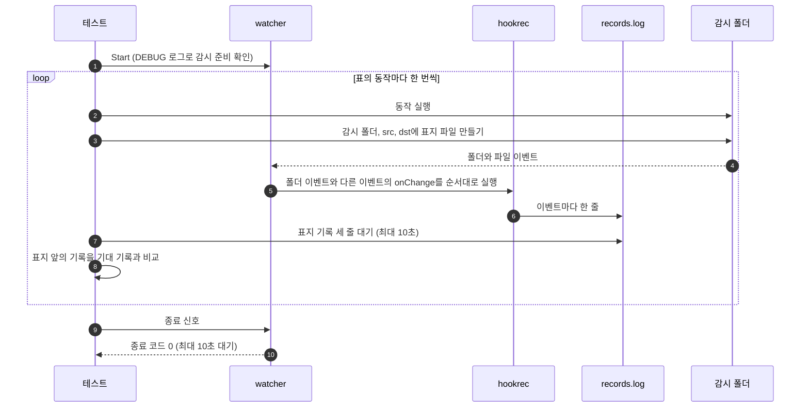

# `TestFolderEvents`: 폴더와 파일 동작마다 받는 이벤트

🇺🇸 [English](folder-events.md) | 🇰🇷 한국어

- 감시 폴더에서 폴더와 파일 동작을 차례로 실행하고, 동작마다 hook이 USAGE의 [폴더 이벤트](../../../USAGE.ko.md#폴더-이벤트) 표와 똑같은 이벤트를 받는지 확인합니다. 폴더가 안의 내용과 함께 생기거나 사라지면 맨 위 폴더의 이벤트 하나만 와야 합니다.

## 확인 내용과 성공 조건

- 기록 한 줄은 `<Event>,<IsDir>,<감시 폴더 기준 경로>`입니다.
- 동작마다 그 동작의 표지 기록 전까지의 기록이 아래 목록과 순서까지 정확히 같아야 합니다.
- 기록이 빠지거나, 더 있거나, 순서가 다르면 실패합니다.

| 동작 | 기대 기록 |
|---|---|
| `src/pkg` 만들기 | `C,true,src/pkg` |
| `src/a/b/c`를 한 번에 만들기 | `C,true,src/a` |
| 파일 3개가 든 `x`를 감시 폴더 밖에서 `src/x`로 옮겨 오기 | `C,true,src/x` |
| `src/n`을 만들고 곧바로 `src/n/a.txt` 쓰기 | `C,true,src/n` |
| 파일 300개가 든 `big`을 밖에서 `src/big`으로 옮겨 오기 | `C,true,src/big` |
| `src/big`을 안의 내용과 함께 지우기 | `D,true,src/big` |
| `src/x`를 감시 폴더 밖으로 옮기기 | `D,true,src/x` |
| `src/n`의 이름을 `src/m`으로 바꾸기 | `D,true,src/n`, `C,true,src/m` |
| `src/m`을 `dst/m`으로 옮기기 | `D,true,src/m`, `C,true,dst/m` |
| 빈 파일 `src/f.txt` 만들기 | `C,false,src/f.txt` |
| `src/f.txt`의 이름을 `src/g.txt`로 바꾸기 | `D,false,src/f.txt`, `C,false,src/g.txt` |
| `src/g.txt` 지우기 | `D,false,src/g.txt` |

- Windows는 감시 중인 하위 폴더가 있는 폴더의 이름 바꾸기와 옮기기를 거부하므로, 옮기거나 이름을 바꾸는 폴더에는 파일만 둡니다.
- watcher는 종료 신호를 받은 뒤 10초 안에 종료 코드 0으로 끝나야 합니다.

## 설정

- 대상 `onChange` hook은 `hookrec`으로 `CHANGE:{{.Event}},{{.IsDir}},{{.Path}}`를 기록합니다.
- 대상 옵션은 `noWait: true`, `watch.exclude: ['*.probe']`입니다. `watch.fileEvent`와 `watch.dirEvent`는 기본값 `CUD`와 `CD`를 씁니다.
- 테스트는 감시를 시작하기 전에 감시 폴더에 `src`와 `dst`를, 실행 폴더에 파일 3개가 든 `outside/x`와 파일 300개가 든 `outside/big`을 만듭니다.

## 진행 순서



- Windows는 감시하는 폴더마다 이벤트를 따로 알리므로, 테스트는 동작이 이벤트를 만드는 폴더마다 표지를 두고 모두 기다립니다.
- 표지 파일은 `O_CREATE|O_EXCL|O_RDONLY`로 내용 없이 만들므로, 어느 OS에서든 생성 이벤트만 생깁니다.

## 실행

- 저장소 루트에서 실행합니다.

차례로 로컬, Linux Docker, UTM Windows VM에서 실행하는 명령입니다.

```sh
go test -count=1 -v -run '^TestFolderEvents$' ./e2e/scenarios
go run ./e2e/linux -- -run '^TestFolderEvents$'
make e2e-windows ARGS="-- -run '^TestFolderEvents$'"
```

- UTM 명령은 [UTM Windows VM에서 E2E 실행](../windows-utm.ko.md)의 사전 준비를 마치고 `make e2e-windows-up`으로 VM을 켠 뒤 실행합니다.
- Windows 호스트에서 직접 실행하는 방법은 [Windows 실행 명령](../windows.ko.md#실행-명령)에 있습니다.

## 관련 코드

- `e2e/scenarios/folder_events_test.go`: `TestFolderEvents`, 기록을 감시 폴더 기준 경로로 바꾸는 `relativeChange`
- `e2e/harness`: `Start`, `Hook`, `Await`, `Lines`, `Stop`. 각 함수의 위치와 책임은 [책임별 코드 위치](../harness.ko.md#책임별-코드-위치)에 있습니다.
