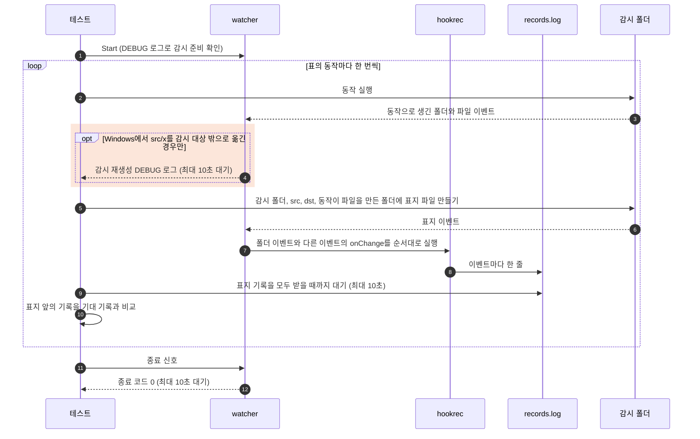

# `TestFolderEvents`: 폴더와 파일 동작마다 받는 이벤트

🇺🇸 [English](folder-events.md) | 🇰🇷 한국어

- 감시 폴더에서 폴더와 파일 동작을 차례로 실행하고, 동작마다 hook이 사용 안내의 [폴더 이벤트](../../../docs/guide/events.ko.md#폴더-이벤트) 표와 똑같은 이벤트를 받는지 확인합니다. 폴더가 안의 내용과 함께 생기거나 사라지면 맨 위 폴더의 이벤트 하나만 와야 합니다.
- 감시 중에 생기거나 옮겨 온 폴더의 이벤트를 hook이 받은 뒤 그 폴더 안에 파일을 만들고, hook이 그 파일의 `C`를 받는지 확인합니다. 감시 대상 밖으로 옮긴 폴더 안에 만든 파일은 [폴더 이벤트 감지에 대한 제약사항](../../../docs/guide/events.ko.md#폴더-이벤트-감지에-대한-제약사항)대로 hook을 실행하지 않아야 합니다.
- 파일 300개가 든 폴더를 옮겨 오거나 지울 때 폴더 이벤트 하나만 오는지는 이 시나리오가 아니라 `internal/app/service/runner_watch_target_test.go`의 `TestFolderChangeNotifiesTopFolderOnce`가 실제 파일 시스템으로 확인합니다.

## 확인 내용과 성공 조건

- 기록 한 줄은 `<Event>,<IsDir>,<감시 폴더 기준 경로>`입니다.
- 동작마다 그 동작의 표지 기록 전까지의 기록이 아래 목록과 순서까지 정확히 같아야 합니다.
- 기록이 빠지거나, 더 있거나, 순서가 다르면 실패합니다.
- "이어서"로 시작하는 행은 바로 윗행의 기록을 hook이 받은 뒤에 파일을 만듭니다.

`actions` 하위 테스트는 아래 동작을 차례로 실행합니다.

| 동작 | 기대 기록 |
|---|---|
| `src/pkg` 만들기 | `C,true,src/pkg` |
| 이어서 빈 파일 `src/pkg/after-mkdir.txt` 만들기 | `C,false,src/pkg/after-mkdir.txt` |
| `src/a/b/c`를 한 번에 만들기 | `C,true,src/a` |
| 이어서 가장 깊은 폴더에 빈 파일 `src/a/b/c/after-mkdir-p.txt` 만들기 | `C,false,src/a/b/c/after-mkdir-p.txt` |
| 파일 3개가 든 `x`를 감시 폴더 밖에서 `src/x`로 옮겨 오기 | `C,true,src/x` |
| 이어서 빈 파일 `src/x/after-move-in.txt` 만들기 | `C,false,src/x/after-move-in.txt` |
| `src/n`을 만들고 곧바로 `src/n/a.txt` 쓰기 | `C,true,src/n` |
| `src/x`를 감시 폴더 밖으로 옮기기 | `D,true,src/x` |
| 이어서 밖으로 옮긴 폴더 `outside/x`에 빈 파일 `after-move-out.txt` 만들기 | 없음 |
| `src/n`의 이름을 `src/m`으로 바꾸기 | `D,true,src/n`, `C,true,src/m` |
| 이어서 빈 파일 `src/m/after-rename.txt` 만들기 | `C,false,src/m/after-rename.txt` |
| `src/m`을 `dst/m`으로 옮기기 | `D,true,src/m`, `C,true,dst/m` |
| 이어서 빈 파일 `dst/m/after-move.txt` 만들기 | `C,false,dst/m/after-move.txt` |
| 빈 파일 `src/f.txt` 만들기 | `C,false,src/f.txt` |
| `src/f.txt`의 이름을 `src/g.txt`로 바꾸기 | `D,false,src/f.txt`, `C,false,src/g.txt` |
| `src/g.txt` 지우기 | `D,false,src/g.txt` |

- Windows는 감시 중인 하위 폴더가 있는 폴더의 이름 바꾸기와 옮기기를 거부하므로, 옮기거나 이름을 바꾸는 폴더에는 파일만 둡니다.
- 사용 안내는 Windows에서 감시 대상 밖으로 폴더를 옮기고 약 100ms 뒤 감시를 다시 만드는 순간에 대상 안에서 생긴 변경의 중복 전달만 허용합니다.
- 테스트는 `src/x`를 밖으로 옮긴 뒤, 그 행의 표지를 만들거나 다음 동작을 실행하기 전에 재생성 DEBUG 로그를 기다립니다.
- 대상 안 폴더의 이름 바꾸기와 옮기기를 포함한 모든 행에서 중복을 합치지 않고 원래 기록을 비교합니다.
- watcher는 종료 신호를 받은 뒤 10초 안에 종료 코드 0으로 끝나야 합니다.

## 설정

- 대상 `onChange` hook은 `hookrec`으로 `CHANGE:{{.Event}},{{.IsDir}},{{.Path}}`를 기록합니다.
- 대상 옵션은 `hookBatch.waitMillisecond: 0`, `hookBatch.deliver: each`, `watch.exclude: ['*.probe']`입니다. `watch.fileEvent`와 `watch.dirEvent`는 기본값 `CUD`와 `CD`를 씁니다.
- 테스트는 감시를 시작하기 전에 감시 폴더에 `src`와 `dst`를 만들고, 실행 폴더에 파일 3개가 든 `outside/x`를 만듭니다.

## 하위 테스트

- 하위 테스트는 `actions` 하나이며, watcher 하나로 [확인 내용과 성공 조건](#확인-내용과-성공-조건)의 표에 있는 동작을 차례로 실행합니다.

## 진행 순서



- Windows는 감시하는 폴더마다 이벤트를 따로 알리므로, 테스트는 동작이 이벤트를 만드는 폴더마다 표지를 두고 모두 기다립니다.
  - 동작이 감시 대상 안의 폴더에 파일을 만들면 그 폴더에도 표지를 둡니다. 그 폴더가 감시 목록에 없으면 표지 기록이 오지 않아 대기가 실패합니다.
  - 밖으로 옮긴 폴더는 감시 대상 밖에 있으므로 표지를 두지 않습니다. 그 동작의 기록이 표지보다 늦게 오면 뒤의 행에서 더 있는 기록으로 실패합니다.
- 표지 파일은 `O_CREATE|O_EXCL|O_RDONLY`로 내용 없이 만들므로, 어느 OS에서든 생성 이벤트만 생깁니다.

## Windows 감시 재생성 관찰

- 수정 전 2026-11-04 UTM Windows 11 ARM64에서 DEBUG 로그를 켜고 실행한 결과는 PASS였으며, `watcher.log`의 `rebuilt watcher to release watches of folders moved out` 줄은 정확히 하나였습니다.
  - 867행의 `REMOVE "...\\watch\\src\\x"` 뒤에 재생성 로그가 879행에 나왔으며, 밖으로 옮긴 행의 `zz-sentinel-9.txt` 이벤트와 다음 행의 `zz-sentinel-10.txt` 이벤트 사이였습니다.
  - 대상 안 이름 바꾸기는 900행의 `RENAME "...\\watch\\src\\n"`에서, 대상 안 옮기기는 932행의 `REMOVE "...\\watch\\src\\m"`에서 시작했으며, 두 동작 뒤부터 종료까지 재생성 로그는 더 없었습니다.
- 이 관찰에서 재생성 경계는 대상 안 이름 바꾸기나 옮기기가 아니라 밖으로 옮기는 전환이었습니다. 테스트는 뒤의 파일 기록 중복을 허용하는 대신 이 경계에서 기다립니다.

## 실행

- 저장소 루트에서 실행합니다.

차례로 로컬, Linux Docker, UTM Windows VM에서 실행하는 명령입니다.

```sh
go test -count=1 -v -run '^TestFolderEvents$' ./e2e/scenarios
go run ./e2e/linux -- -run '^TestFolderEvents$'
make e2e-windows ARGS="-vm=Windows-E2E -- -count=3 -run '^TestFolderEvents$'"
```

- UTM 명령은 [UTM Windows VM에서 E2E 실행](../windows-utm.ko.md)의 사전 준비를 마치고 `make e2e-windows-up`으로 VM을 켠 뒤 실행합니다.
- Windows 호스트에서 직접 실행하는 방법은 [Windows 실행 명령](../windows.ko.md#실행-명령)에 있습니다.

## 관련 코드

- `e2e/scenarios/folder_events_test.go`: `TestFolderEvents`, watcher를 띄우는 `startFolderEvents`, 동작을 차례로 실행하고 기록을 비교하는 `folderEvents.run`, 폴더 이벤트를 받은 폴더 안에 파일을 만드는 행을 만드는 `createLater`입니다.
- `e2e/scenarios/helpers_test.go`: `changeSteps`는 동작마다 표지까지 기록을 읽고, `relativeChange`는 기록을 감시 폴더 기준 경로로 바꿉니다. `mkdirAll`과 `createEmpty`는 폴더와 빈 파일을 만듭니다.
- `e2e/harness`: `Start`, `Hook`, `Await`, `Lines`, `Stop`. 각 함수의 위치와 책임은 [책임별 코드 위치](../harness.ko.md#책임별-코드-위치)에 있습니다.
