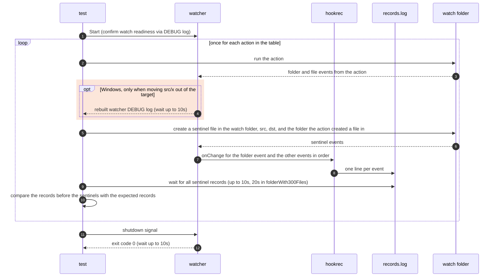

# `TestFolderEvents`: events for folder and file actions

🇺🇸 English | 🇰🇷 [한국어](folder-events.ko.md)

- Runs folder and file actions one after another in the watch folder and checks that the hook receives, for each action, exactly the events in the [Folder events](../../../docs/guide/events.md#folder-events) table of the usage guide, including one event for the top folder when a folder appears or disappears with its contents.
- After the hook receives the event of a folder created or moved during watching, the test creates a file in that folder and checks that the hook receives the file's `C`. It also checks that a file created in a folder moved out of the target runs no hook, as the [Limitations on folder event detection](../../../docs/guide/events.md#limitations-on-folder-event-detection) state.

## What it checks and success criteria

- Each record is `<Event>,<IsDir>,<path relative to the watch folder>`.
- After each action, the records up to the sentinels of that action must be exactly the list below, in that order.
- A missing record, an extra record, or a different order fails the test.
- Rows that start with "Then" create the file after the hook has received the records of the row above.

The `actions` subtest runs these actions in order:

| Action | Expected records |
|---|---|
| Create `src/pkg` | `C,true,src/pkg` |
| Then create the empty file `src/pkg/after-mkdir.txt` | `C,false,src/pkg/after-mkdir.txt` |
| Create `src/a/b/c` at once | `C,true,src/a` |
| Then create the empty file `src/a/b/c/after-mkdir-p.txt` in the deepest folder | `C,false,src/a/b/c/after-mkdir-p.txt` |
| Move `x` with 3 files in from outside the watch folder as `src/x` | `C,true,src/x` |
| Then create the empty file `src/x/after-move-in.txt` | `C,false,src/x/after-move-in.txt` |
| Create `src/n` and write `src/n/a.txt` right after | `C,true,src/n` |
| Move `src/x` out of the watch folder | `D,true,src/x` |
| Then create the empty file `after-move-out.txt` in the moved-out folder `outside/x` | None |
| Rename `src/n` to `src/m` | `D,true,src/n`, `C,true,src/m` |
| Then create the empty file `src/m/after-rename.txt` | `C,false,src/m/after-rename.txt` |
| Move `src/m` to `dst/m` | `D,true,src/m`, `C,true,dst/m` |
| Then create the empty file `dst/m/after-move.txt` | `C,false,dst/m/after-move.txt` |
| Create the empty file `src/f.txt` | `C,false,src/f.txt` |
| Rename `src/f.txt` to `src/g.txt` | `D,false,src/f.txt`, `C,false,src/g.txt` |
| Delete `src/g.txt` | `D,false,src/g.txt` |

The `folderWith300Files` subtest runs these actions in order:

| Action | Expected records |
|---|---|
| Move `big` with 300 files in from outside as `src/big` | `C,true,src/big` |
| Delete `src/big` with everything in it | `D,true,src/big` |

- The folders that are moved or renamed hold only files, because Windows refuses to rename or move a folder that holds a watched subfolder.
- On Windows, the usage guide allows duplicate delivery only for changes made in the target while the watcher re-creates its watches about 100 ms after a folder is moved out of the target.
- After moving `src/x` out, the test waits for the rebuild DEBUG log before creating that row's sentinels or running the next action.
- Every row compares the original records without collapsing duplicates, including internal folder renames and moves.
- The watcher must exit with exit code 0 within 10 seconds of receiving the shutdown signal.

## Configuration

- The target `onChange` hook records `CHANGE:{{.Event}},{{.IsDir}},{{.Path}}` with `hookrec`.
- The target options are `hookBatch.waitMillisecond: 0`, `hookBatch.deliver: each`, and `watch.exclude: ['*.probe']`. `watch.fileEvent` and `watch.dirEvent` keep their defaults, `CUD` and `CD`.
- `folderWith300Files` also sets `dirBatch.waitMillisecond: 1000` and `dirBatch.maxWaitMillisecond: 10000`, and waits up to 20 seconds for the sentinel records, longer than that limit.
  - On a busy Windows CI runner, the gap between events while deleting a folder with 300 files once exceeded the `dirBatch` default wait of 100 ms, and file deletions were not absorbed into the folder's `D`.
- Before watching starts, the test creates `src` and `dst` in the watch folder. In the run folder, `actions` creates `outside/x` with 3 files, and `folderWith300Files` creates `outside/big` with 300 files.

## Subtests

- Each subtest starts its own watcher and runs the actions in its own table under [What it checks and success criteria](#what-it-checks-and-success-criteria).
- `folderWith300Files` takes about 1 second longer per action because of its longer `dirBatch` wait. Keeping these actions separate lets `actions` run with the default wait.

## Sequence



- On Windows, each watched folder reports its events separately, so the test waits for a sentinel in every folder where the action makes events.
  - When an action creates a file in a folder in the target, that folder gets a sentinel too. If the folder is not watched, its sentinel never arrives and the wait fails.
  - The moved-out folder gets no sentinel because it is outside the target. A record of that action that arrives after the sentinels fails a later row as an extra record.
- Sentinel files are created empty with `O_CREATE|O_EXCL|O_RDONLY`, so they make only a create event on every OS.

## Windows rebuild observation

- Before this change, a UTM Windows 11 ARM64 run on 2026-11-04 passed with DEBUG logging enabled. Its `watcher.log` contained exactly one `rebuilt watcher to release watches of folders moved out` line.
  - `REMOVE "...\\watch\\src\\x"` appeared at line 867; the rebuild appeared at line 879, after the move-out row's `zz-sentinel-9.txt` events and before the following row's `zz-sentinel-10.txt` events.
  - The internal rename started with `RENAME "...\\watch\\src\\n"` at line 900; the internal move started with `REMOVE "...\\watch\\src\\m"` at line 932. Neither was followed by another rebuild through shutdown.
- The observation identifies the move-out transition, not an internal rename or move, as the rebuild boundary. The test now waits at that boundary instead of allowing duplicate file records in later rows.

## Running

- Run from the repository root.

The commands run locally, in Linux Docker, and on the UTM Windows VM, in that order.

```sh
go test -count=1 -v -run '^TestFolderEvents$' ./e2e/scenarios
go run ./e2e/linux -- -run '^TestFolderEvents$'
make e2e-windows ARGS="-vm=Windows-E2E -- -count=3 -run '^TestFolderEvents$'"
```

- To run one subtest, append its name, as in `-run '^TestFolderEvents$/^actions$'`.

- Run the UTM command after completing the prerequisites in [Running E2E on a UTM Windows VM](../windows-utm.md) and starting the VM with `make e2e-windows-up`.
- To run directly on a Windows host, see [Windows run commands](../windows.md#run-commands).

## Related code

- `e2e/scenarios/folder_events_test.go`: `TestFolderEvents`; `startFolderEvents`, which starts the watcher of each subtest; `folderEvents.run`, which runs the actions in order and compares the records; and `createLater`, which makes the rows that create a file in a folder after its folder event.
- `e2e/scenarios/helpers_test.go`: `changeSteps` reads each action through its sentinels; `relativeChange` turns a record into a path relative to the watch folder. `mkdirAll` and `createEmpty` create folders and empty files.
- `e2e/harness`: `Start`, `Hook`, `Await`, `Lines`, `Stop`. Where each function lives and what it does is in [Code locations by responsibility](../harness.md#code-locations-by-responsibility).
