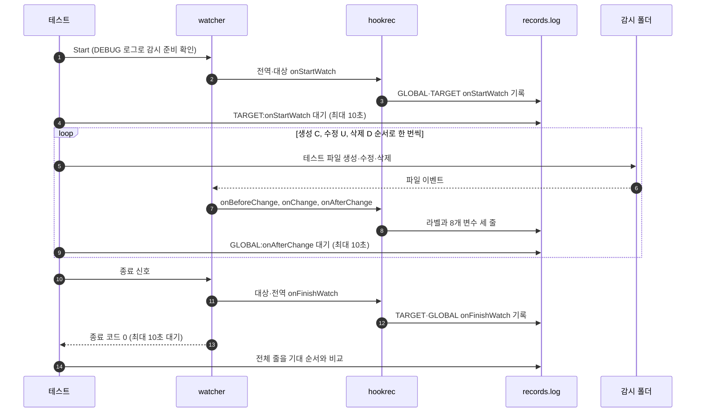

# `TestGoldenPath`: 생성·수정·삭제와 hook 순서

🇺🇸 [English](golden-path.md) | 🇰🇷 한국어

- 셸이 해석하는 문자가 든 이름의 파일 하나를 생성·수정·삭제하고, 전역·대상 hook이 정해진 순서로 한 번씩 실행되며 8개 이벤트 변수가 올바른 값으로 전달되는지, 파일 이름이 명령으로 실행되지 않는지 확인합니다.

## 확인 내용과 성공 조건

- watcher가 정상 종료한 뒤 `records.log`의 전체 줄이 아래 순서와 정확히 같아야 합니다.
- 줄이 빠지거나, 더 있거나, 순서가 다르면 실패합니다.

1. `GLOBAL:onStartWatch`
2. `TARGET:onStartWatch`
3. 생성(`C`), 수정(`U`), 삭제(`D`) 이벤트마다 `GLOBAL:onBeforeChange:<변수>`, `TARGET:onChange:<변수>`, `GLOBAL:onAfterChange:<변수>`
4. `TARGET:onFinishWatch`
5. `GLOBAL:onFinishWatch`

- `<변수>`는 `{{.Path}},{{.AbsPath}},{{.Name}},{{.ExtName}},{{.ParentPath}},{{.ParentAbsPath}},{{.Event}},{{.IsDir}}`입니다.
- 설정의 감시 경로가 절대 경로이므로 `{{.Path}}`와 `{{.AbsPath}}`는 모두 테스트 파일의 절대 경로이고, `{{.ParentPath}}`와 `{{.ParentAbsPath}}`는 모두 감시 폴더의 절대 경로입니다.
- `{{.Name}}`은 테스트 파일 이름, `{{.ExtName}}`은 `.txt`, `{{.Event}}`는 `C`·`U`·`D`, `{{.IsDir}}`는 `false`입니다.

- 테스트 파일 이름은 `a b;mkdir pwned1;$(mkdir pwned2)'&mkdir pwned3&%OS%.txt`입니다.
- 이 이름에는 sh, cmd, powershell이 명령을 잇거나 치환하는 문법이 들어 있어, 셸이 값을 명령으로 해석하면 `pwned`로 시작하는 폴더가 생기고 cmd가 값을 다시 펼치면 `%OS%`가 바뀝니다.
- 종료 뒤 실행 폴더와 감시 폴더에 `pwned`로 시작하는 항목이 없어야 합니다.

- watcher는 종료 신호를 받은 뒤 10초 안에 종료 코드 0으로 끝나야 합니다.

## 설정

- 전역 hook `onStartWatch`·`onBeforeChange`·`onAfterChange`·`onFinishWatch`와 대상 hook `onStartWatch`·`onChange`·`onFinishWatch`를 모두 설정합니다.
- 각 hook은 `hookrec --line=<라벨>`로 `GLOBAL:onBeforeChange`처럼 자기 라벨을 기록합니다. 변경 hook은 라벨 뒤에 `:<변수>`를 붙여 기록합니다. 변수는 값에 공백이 있어도 인자 하나로 넘어가도록 따옴표 밖에 두고, sh와 cmd가 해석하지 않는 쉼표로 구분합니다.
- 대상 옵션은 `hookBatch.waitMillisecond: 100`, `watch.fileEvent: CDU`, `watch.exclude: ['*.probe']`입니다.

## 진행 순서



- 생성은 테스트 파일을 내용 없이 `O_CREATE|O_EXCL|O_RDONLY`로 열었다 닫는 방식이고, 수정은 `hello`를 쓰는 방식입니다.
- 각 단계는 그 이벤트의 `GLOBAL:onAfterChange:<변수>` 기록이 나타나야 다음 단계로 넘어갑니다.
- 종료 신호는 Unix에서 SIGTERM, Windows에서 CTRL+BREAK입니다.

## 실행

- 저장소 루트에서 실행합니다.

차례로 로컬, Linux Docker, UTM Windows VM에서 실행하는 명령입니다.

```sh
go test -count=1 -v -run '^TestGoldenPath$' ./e2e/scenarios
go run ./e2e/linux -- -run '^TestGoldenPath$'
make e2e-windows ARGS="-- -run '^TestGoldenPath$'"
```

- UTM 명령은 [UTM Windows VM에서 E2E 실행](../windows-utm.ko.md)의 사전 준비를 마치고 `make e2e-windows-up`으로 VM을 켠 뒤 실행합니다.
- Windows 호스트에서 직접 실행하는 방법은 [Windows 실행 명령](../windows.ko.md#실행-명령)에 있습니다.

## 관련 코드

- `e2e/scenarios/golden_path_test.go`에 `TestGoldenPath`를 정의합니다.
- `e2e/scenarios/helpers_test.go`: `goldenFileName`은 테스트 파일 이름이고, `goldenConfig`는 설정을, `changeValues`와 `expectedSequence`는 기대 기록을 만듭니다.
- `e2e/harness`: `Start`, `Hook`, `AwaitLine`, `Stop`, `Lines`. 각 함수의 위치와 책임은 [책임별 코드 위치](../harness.ko.md#책임별-코드-위치)에 있습니다.
