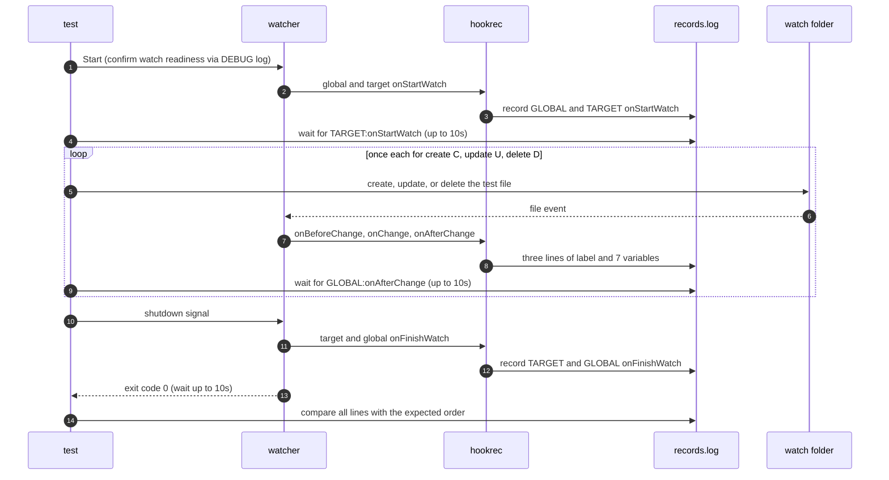

# `TestGoldenPath`: create, update, delete, and hook order

🇺🇸 English | 🇰🇷 [한국어](golden-path.ko.md)

Creates, updates, and deletes one file whose name contains characters that shells interpret, and checks that the global and target hooks each run once in the defined order, receive the correct values for the 7 event variables, and never run the file name as a command.

## What it checks and success criteria

After the watcher shuts down gracefully, the full set of lines in `records.log` must exactly match the order below. A missing line, an extra line, or a different order fails the test.

1. `GLOBAL:onStartWatch`
2. `TARGET:onStartWatch`
3. For each of the create (`C`), update (`U`), and delete (`D`) events: `GLOBAL:onBeforeChange:<variables>`, `TARGET:onChange:<variables>`, `GLOBAL:onAfterChange:<variables>`
4. `TARGET:onFinishWatch`
5. `GLOBAL:onFinishWatch`

`<variables>` is `{{.Path}},{{.AbsPath}},{{.FileName}},{{.ExtName}},{{.DirPath}},{{.DirAbsPath}},{{.Event}}`. The watch path in the configuration is absolute, so `{{.Path}}` and `{{.AbsPath}}` are both the absolute path of the test file, and `{{.DirPath}}` and `{{.DirAbsPath}}` are both the absolute path of the watch folder. `{{.FileName}}` is the test file name, `{{.ExtName}}` is `.txt`, and `{{.Event}}` is `C`, `U`, or `D`.

The test file name is `a b;mkdir pwned1;$(mkdir pwned2)'&mkdir pwned3&%OS%.txt`. It contains the syntax that sh, cmd, and powershell use to chain or substitute commands, so a shell that reads the value as a command creates a folder whose name starts with `pwned`, and cmd changes `%OS%` if it expands the value again. After shutdown, neither the run folder nor the watch folder may contain an entry whose name starts with `pwned`.

The watcher must exit with exit code 0 within 10 seconds of receiving the shutdown signal.

## Configuration

- All of the global hooks `onStartWatch`, `onBeforeChange`, `onAfterChange`, and `onFinishWatch` and the target hooks `onStartWatch`, `onChange`, and `onFinishWatch` are configured.
- Each hook records its own label, such as `GLOBAL:onBeforeChange`, with `hookrec --line=<label>`. Change hooks append `:<variables>` after the label. The variables are written outside quotes so that each value is passed as one argument even with spaces, and they are separated by commas, which sh and cmd do not interpret.
- The target options are `waitMillisecond: 100`, `watchEvent: CDU`, and `exclude: ['*.probe']`.

## Sequence



- Create opens the test file with no content using `O_CREATE|O_EXCL|O_RDONLY` and closes it, and update writes `hello`.
- Each step moves on to the next only after the `GLOBAL:onAfterChange:<variables>` record for that event appears.
- The shutdown signal is SIGTERM on Unix and CTRL+BREAK on Windows.

## Running

Run from the repository root. The commands run locally, in Linux Docker, and on the UTM Windows VM, in that order.

```sh
go test -count=1 -v -run '^TestGoldenPath$' ./e2e/scenarios
go run ./e2e/linux -- -run '^TestGoldenPath$'
make e2e-windows ARGS="-- -run '^TestGoldenPath$'"
```

Run the UTM command after completing the prerequisites in [Running E2E on a UTM Windows VM](../windows-utm.md) and starting the VM with `make e2e-windows-up`. To run directly on a Windows host, see [Windows run commands](../windows.md#run-commands).

## Related code

- `e2e/scenarios/golden_path_test.go`: `TestGoldenPath`, `goldenConfig`, which builds the configuration, and `changeValues`·`expectedSequence`, which build the expected records
- `e2e/harness`: `Start`, `Hook`, `AwaitLine`, `Stop`, `Lines`. Where each function lives and what it does is in [Code locations by responsibility](../harness.md#code-locations-by-responsibility).
