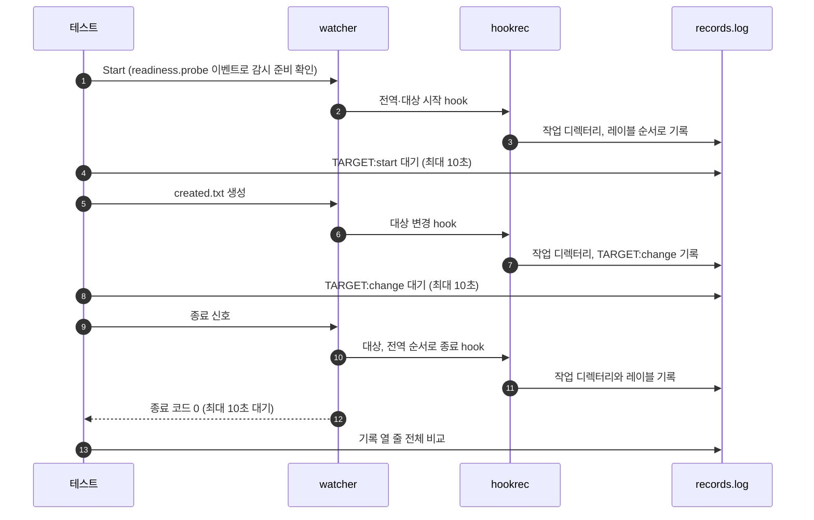

# `TestHookWorkingDirectory`: dir 유무에 따른 hook 실행 위치

🇺🇸 [English](hook-working-directory.md) | 🇰🇷 한국어

- 전역·대상 생명주기 hook의 실제 작업 디렉터리를 [실행 위치 표](../../../docs/guide/configuration.ko.md#명령-실행-위치)와 대조합니다.

## 확인 내용과 성공 조건

- `dir`이 없으면 전역 시작·종료 hook은 프로그램 실행 위치에서, 대상 시작·변경·종료 hook은 감시 `path`에서 실행합니다.
- `dir`이 있으면 다섯 hook 모두 이름에 공백이 든 지정 디렉터리에서 실행합니다.
- 각 hook이 레이블 바로 앞에 `WORKDIR|<디렉터리>`를 기록하며, 전체 열 줄의 순서와 값이 정확히 일치해야 합니다.
- 대상 변경 hook은 10초 안에 완료하고, 종료 신호 뒤 10초 안에 종료 코드 0으로 끝납니다.

## 설정

- 각 생명주기 명령은 구조화된 `cmd`에 `hookrec --workdir --line=<레이블>`을 씁니다.
- 대상은 `watch.fileEvent: C`와 `watch.exclude: ['*.probe']`를 쓰고, hook은 OS 기본 셸을 씁니다.
- 실행 폴더의 링크를 푼 뒤 경로를 설정하여 macOS의 `/var`와 `/private/var` 같은 OS 별칭 때문에 같은 디렉터리가 생명주기 단계마다 다른 문자열로 기록되지 않게 합니다.

## 하위 테스트

- `dir=false`는 기본 실행 위치를 확인합니다.
- `dir=true`는 다섯 명령에 같은 `dir`을 지정합니다.

## 진행 순서



## 실행

저장소 루트에서 차례로 로컬, Linux Docker, UTM Windows VM에서 실행하는 명령입니다.

```sh
go test -count=1 -v -run '^TestHookWorkingDirectory$' ./e2e/scenarios
go run ./e2e/linux -- -run '^TestHookWorkingDirectory$'
make e2e-windows ARGS="-- -run '^TestHookWorkingDirectory$'"
```

- UTM 명령은 [UTM Windows VM에서 E2E 실행](../windows-utm.ko.md)의 사전 준비를 마치고 `make e2e-windows-up`으로 VM을 켠 뒤 실행합니다.

## 관련 코드

- `e2e/scenarios/shell_test.go`에는 `TestHookWorkingDirectory`가 있습니다.
- `e2e/harness`: `NewScenario`, `Hook`, `Start`, `Write`, `AwaitLine`, `Stop`, `Lines`. 각 함수의 위치와 책임은 [책임별 코드 위치](../harness.ko.md#책임별-코드-위치)에 있습니다.
- `e2e/hookrec/main.go`는 `--workdir` 옵션을 구현하고, `e2e/hookrec/main_test.go`의 `TestWorkingDirectoryBeforeLine`이 이 옵션을 확인합니다.
