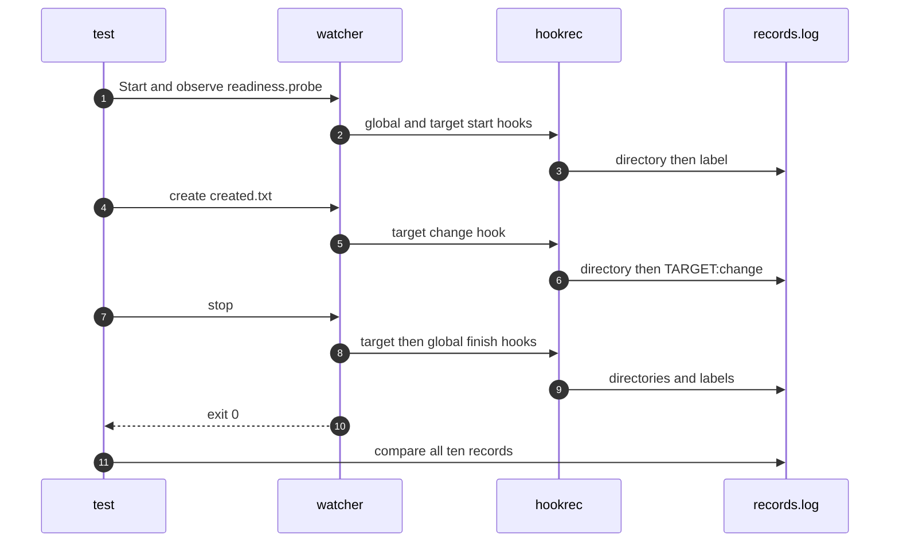

# `TestHookWorkingDirectory`: hook execution locations with and without dir

🇺🇸 English | 🇰🇷 [한국어](hook-working-directory.ko.md)

- The test checks the actual working directories of global and target lifecycle hooks against the [execution location table](../../../docs/guide/configuration.md#command-execution-location).

## What it checks and success criteria

- Without `dir`, global start and finish hooks run in the program execution directory, and target start, change, and finish hooks run in the watched `path`.
- With `dir`, all five hooks run in the specified directory, whose name contains a space.
- Each hook records `WORKDIR|<directory>` immediately before its label; the complete ten-record sequence must match exactly.
- The target change hook completes within 10 seconds, and shutdown exits with code 0 within 10 seconds.

## Configuration

- Each lifecycle command uses structured `cmd` with `hookrec --workdir --line=<label>`.
- The target uses `watch.fileEvent: C` and `watch.exclude: ['*.probe']`; hooks use the OS default shell.
- The run directory is resolved before configuring paths so that OS aliases such as macOS `/var` and `/private/var` cannot change the spelling of an otherwise identical directory between lifecycle phases.

## Subtests

- `dir=false` checks the default locations.
- `dir=true` sets the same explicit directory for all five commands.

## Sequence



## Running

- Run from the repository root.

```sh
go test -count=1 -v -run '^TestHookWorkingDirectory$' ./e2e/scenarios
go run ./e2e/linux -- -run '^TestHookWorkingDirectory$'
make e2e-windows ARGS="-- -run '^TestHookWorkingDirectory$'"
```

- Run the UTM command after completing the prerequisites in [Running E2E on a UTM Windows VM](../windows-utm.md) and starting the VM.

## Related code

- `e2e/scenarios/shell_test.go` defines `TestHookWorkingDirectory`.
- The test uses `NewScenario`, `Hook`, `Start`, `Write`, `AwaitLine`, `Stop`, and `Lines` from `e2e/harness`.
- `e2e/hookrec/main.go` implements `--workdir`, and `main_test.go` verifies it with `TestWorkingDirectoryBeforeLine`.
