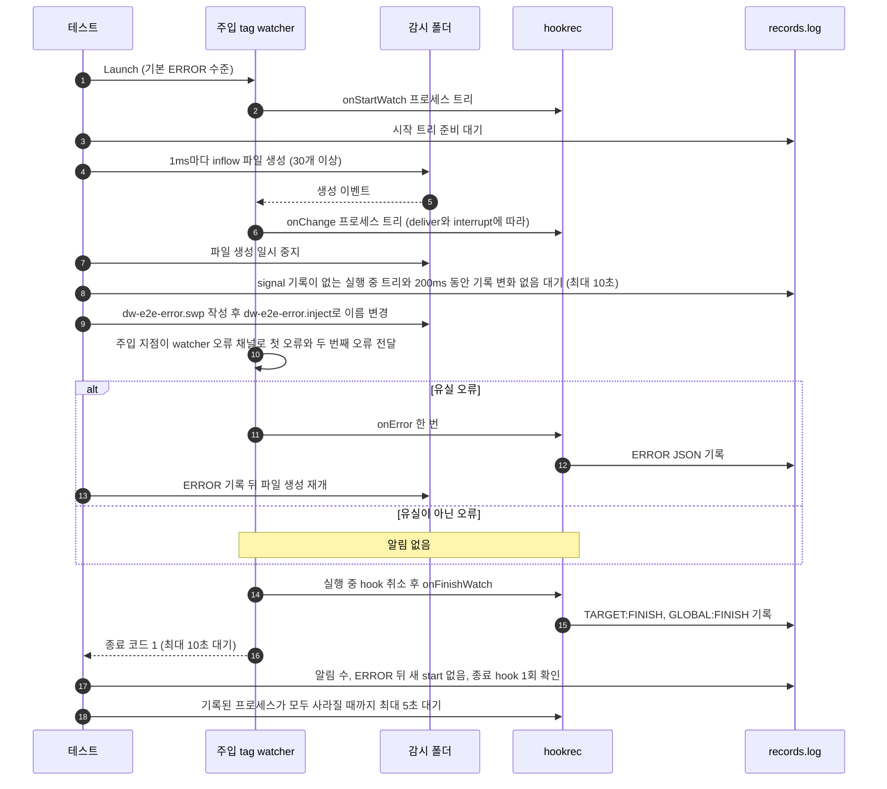

# `TestInjectedLossNotificationCLI`: watcher 오류 채널에 주입한 오류의 알림

🇺🇸 [English](injected-loss-notification-cli.md) | 🇰🇷 한국어

- `dw_e2e_inject` build tag로 빌드한 watcher의 watcher 오류 채널에 오류를 보내, 유실 오류는 `global.lifeCycle.onError`를 한 번 실행하고 종료 코드 1로 끝나고, 유실이 아닌 치명적 오류는 알림 없이 종료 코드 1로 끝나는지 확인합니다.

- 주입한 오류는 실제 OS overflow를 관찰한 증거가 아닙니다.
- 알림의 환경 변수는 [이벤트 유실 알림](../../../docs/guide/running.ko.md#이벤트-유실-알림)을 따릅니다.

## 확인 내용과 성공 조건

모든 하위 테스트에서 다음 조건을 확인합니다.

- 주입하기 전에, 준비를 마쳤고 종료 신호를 받지 않은 hook 프로세스 트리가 돌고 있고, 프로세스 기록이 200ms 동안 바뀌지 않습니다. 테스트는 이 상태를 10초까지 기다립니다.
- 표지 파일이 생긴 뒤 10초 안에 watcher가 종료 코드 1로 끝납니다.
- 기본 ERROR 수준 로그에 `watch target "<감시 폴더>": <첫 오류>`가 있고, DEBUG 로그의 `event:` 줄은 없습니다.
- 로그에 두 번째로 주입한 오류 `later injected error must not replace the first`가 없습니다.
- 유실 하위 테스트에서는 `ERROR|` 알림 기록이 생기면 파일 생성을 다시 시작하고, 그 기록 뒤에는 hook 프로세스 트리의 루트 부모가 `start`를 기록하지 않습니다.
- 종료 hook 기록 `TARGET:FINISH`와 `GLOBAL:FINISH`가 각각 정확히 한 번 있습니다.
- 기록된 hook 프로세스가 모두 5초 안에 사라집니다.

유실 하위 테스트에서는 `ERROR|<JSON>` 알림 기록이 정확히 한 개이고, JSON에 아래 6개 항목만 있어야 합니다.

| 항목 | 기대값 |
|---|---|
| `DW_ERROR_TARGET` | 감시 폴더 경로 |
| `DW_ERROR_KIND` | `event_loss` |
| `DW_ERROR_CAUSE` | `injected 'cause' {{.Path}} $HOME: fsnotify: queue or buffer overflow` |
| `DW_ERROR_MESSAGE` | `watch target "<감시 폴더>": <DW_ERROR_CAUSE 값>` |
| `DW_ERROR_POSSIBLE_LOSS` | `true` |
| `workdir` | 실행 폴더 |

- `DW_ERROR_CAUSE`에는 템플릿, `$HOME`, 작은따옴표가 템플릿이나 셸로 풀리지 않고 그대로 남아야 합니다.
- `non-loss-fatal-does-not-notify`에서는 첫 오류가 `injected non-loss failure`이고, `ERROR|` 기록이 하나도 없습니다.

## 설정

- 테스트는 `harness.InjectWatcherBin()`을 기본 ERROR 로그 수준으로 `s.Launch`해 실행합니다.
- 전역 `onError`는 실행 폴더를 `dir`로 둔 `hookrec --error-context --line=NOTIFY`입니다. 실행되면 `ERROR|<JSON>`을 기록합니다.
- 전역 `onFinishWatch`는 `GLOBAL:FINISH`를, 대상 `onFinishWatch`는 `TARGET:FINISH`를 기록합니다.
- 대상 `onStartWatch`와 `onChange`는 `hookrec --depth=2`입니다. 각각 부모·자식·손자를 시작하고, 종료 신호를 받을 때까지 실행을 이어 갑니다.
- 대상 옵션은 하위 테스트별 `hookBatch.deliver`와 `run.interrupt`, `deliver: last`에서 30이고 `deliver: each`에서 0인 `hookBatch.waitMillisecond`, `watch.fileEvent: C`, `watch.exclude: ['*.probe', '*.swp', '*.inject']`입니다.

tag를 붙인 watcher의 주입 지점은 다음과 같이 동작합니다.

- 감시 폴더의 `dw-e2e-error.inject`를 10ms마다 읽고, 한 번만 반응합니다.
- 내용이 `loss`이면 `fsnotify.ErrEventOverflow`를 감싼 `injected 'cause' {{.Path}} $HOME: `을 보내고, `nonloss`이면 `injected non-loss failure`를 보냅니다.
- 첫 오류를 보낸 바로 뒤에 `later injected error must not replace the first`를 보냅니다.
- tag 없이 빌드하면 주입 지점이 없습니다.

## 하위 테스트

| 하위 테스트 | 주입한 오류 | 변경 hook 실행 | 알림 |
|---|---|---|---|
| `deliver=last/interrupt=none` | 유실 | 30ms 기다린 뒤 마지막으로 바뀐 경로 실행. 돌고 있는 트리가 끝나기를 기다림 | 한 번 |
| `deliver=last/interrupt=oldest` | 유실 | 30ms 기다린 뒤 마지막으로 바뀐 경로 실행. 돌고 있는 트리를 취소 | 한 번 |
| `deliver=each/interrupt=none` | 유실 | 수신한 이벤트마다 차례로 실행. 돌고 있는 트리가 끝나기를 기다림 | 한 번 |
| `deliver=each/interrupt=oldest` | 유실 | 수신한 이벤트마다 실행. 돌고 있는 트리를 취소 | 한 번 |
| `non-loss-fatal-does-not-notify` | 유실이 아닌 오류 | `deliver=each/interrupt=none`과 같음 | 없음 |

## 진행 순서



## 실행

- 저장소 루트에서 실행합니다.

차례로 로컬, Linux Docker, UTM Windows VM에서 실행하는 명령입니다.

```sh
go test -count=1 -v -run '^TestInjectedLossNotificationCLI$' ./e2e/scenarios
go run ./e2e/linux -- -run '^TestInjectedLossNotificationCLI$'
make e2e-windows ARGS="-- -run '^TestInjectedLossNotificationCLI$'"
```

- 하위 테스트 하나만 실행하려면 `-run '^TestInjectedLossNotificationCLI$/^non-loss-fatal-does-not-notify$'`처럼 지정합니다.
- UTM 명령은 [UTM Windows VM에서 E2E 실행](../windows-utm.ko.md)의 사전 준비를 마치고 `make e2e-windows-up`으로 VM을 켠 뒤 실행합니다.

## 관련 코드

- `e2e/scenarios/error_notification_test.go`: `TestInjectedLossNotificationCLI`, 하위 테스트 하나를 실행하는 `runInjectedNotification`, 실행 중 트리를 찾는 `runningTree`, 알림 기록을 읽는 `errorContexts`, 검사 함수 `assertErrorContext`·`assertLossExit`
- `internal/app/service/runner_watch_target_tree_inject.go`: `dw_e2e_inject` tag로만 빌드되는 주입 지점입니다. tag가 없으면 `runner_watch_target_tree_inject_off.go`가 watcher 오류 채널을 그대로 돌려줍니다.
- `e2e/harness`: `NewScenario`, `InjectWatcherBin`, `Launch`, `Hook`, `AwaitReadyGenerations`, `AssertRunning`, `Await`, `Done`, `Exited`, `ExitErr`, `Log`, `Lines`, `CountRecord`, `ReadLinesLenient`, `ProcessRecords`, `Alive`, `AwaitProcessesGone`. 각 함수의 위치와 책임은 [책임별 코드 위치](../harness.ko.md#책임별-코드-위치)에 있습니다.
