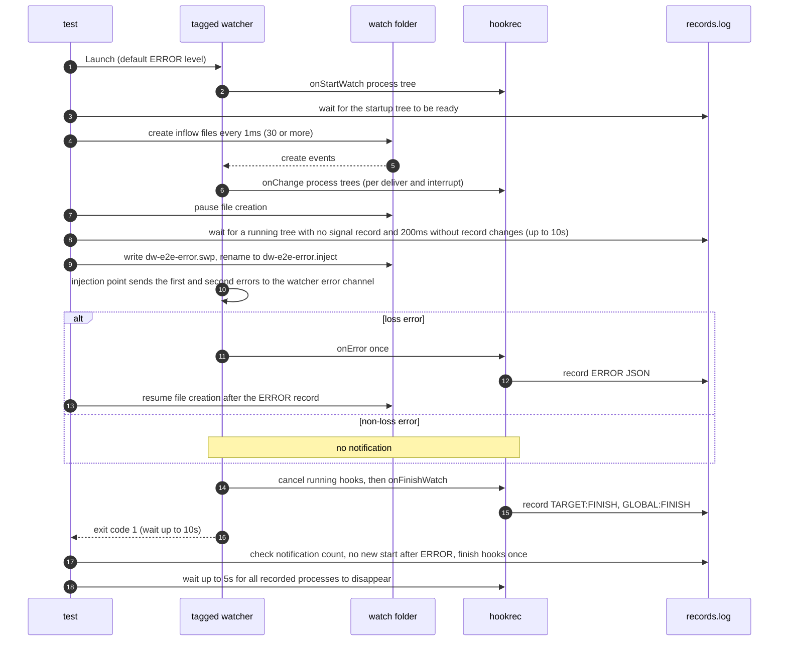

# `TestInjectedLossNotificationCLI`: notification for errors injected into the watcher error channel

🇺🇸 English | 🇰🇷 [한국어](injected-loss-notification-cli.ko.md)

- Sends an error into the watcher error channel of a watcher built with the `dw_e2e_inject` build tag, and checks that a loss error runs `global.lifeCycle.onError` once and exits with code 1, while a fatal error other than loss exits with code 1 without the notification.

- The injected error is not evidence of an observed real OS overflow.
- The notification's environment variables follow [Event-loss notification](../../../docs/guide/running.md#event-loss-notification).

## What it checks and success criteria

Every subtest checks the following.

- Before the injection, a hook process tree that has finished starting and has not received a shutdown signal is running, and the process records stay unchanged for 200ms. The test waits up to 10 seconds for this.
- The watcher exits with exit code 1 within 10 seconds of the marker file appearing.
- The default ERROR-level log contains `watch target "<watch folder>": <first error>` and has no DEBUG `event:` line.
- The log does not contain the second injected error, `later injected error must not replace the first`.
- In the loss subtests, the test resumes file creation once the `ERROR|` notification record appears, and no root parent of a hook process tree records `start` after that record.
- The finish hook records `TARGET:FINISH` and `GLOBAL:FINISH` each appear exactly once.
- Every recorded hook process disappears within 5 seconds.

In the loss subtests, there is exactly one `ERROR|<JSON>` notification record, and the JSON has only the 6 fields below.

| Field | Expected value |
|---|---|
| `DW_ERROR_TARGET` | Watch folder path |
| `DW_ERROR_KIND` | `event_loss` |
| `DW_ERROR_CAUSE` | `injected 'cause' {{.Path}} $HOME: fsnotify: queue or buffer overflow` |
| `DW_ERROR_MESSAGE` | `watch target "<watch folder>": <DW_ERROR_CAUSE value>` |
| `DW_ERROR_POSSIBLE_LOSS` | `true` |
| `workdir` | Run folder |

- `DW_ERROR_CAUSE` must keep the template, `$HOME`, and single quotes verbatim, without template or shell expansion.
- In `non-loss-fatal-does-not-notify`, the first error is `injected non-loss failure`, and there is no `ERROR|` record.

## Configuration

- The test launches `harness.InjectWatcherBin()` with `s.Launch` at the default ERROR log level.
- The global `onError` is `hookrec --error-context --line=NOTIFY` with the run folder as `dir`. When it runs, it records `ERROR|<JSON>`.
- The global `onFinishWatch` records `GLOBAL:FINISH`, and the target `onFinishWatch` records `TARGET:FINISH`.
- The target `onStartWatch` and `onChange` are `hookrec --depth=2`. Each starts a parent, child, and grandchild that keep running until they receive a shutdown signal.
- The target options are the per-subtest `hookBatch.deliver` and `run.interrupt`, plus `hookBatch.waitMillisecond`, which is 30 with `deliver: last` and 0 with `deliver: each`, `watch.fileEvent: C`, and `watch.exclude: ['*.probe', '*.swp', '*.inject']`.

The injection point in the tagged watcher works as follows.

- It reads `dw-e2e-error.inject` in the watch folder every 10ms and reacts only once.
- When the content is `loss`, it sends `injected 'cause' {{.Path}} $HOME: ` wrapping `fsnotify.ErrEventOverflow`; when the content is `nonloss`, it sends `injected non-loss failure`.
- Right after the first error, it sends `later injected error must not replace the first`.
- A build without the tag has no injection point.

## Subtests

| Subtest | Injected error | Change hook runs | Notification |
|---|---|---|---|
| `deliver=last/interrupt=none` | Loss | Last changed path after a 30ms wait. Waits for the running tree to finish | Once |
| `deliver=last/interrupt=oldest` | Loss | Last changed path after a 30ms wait. Cancels the running tree | Once |
| `deliver=each/interrupt=none` | Loss | Each received event in turn. Waits for the running tree to finish | Once |
| `deliver=each/interrupt=oldest` | Loss | Each received event. Cancels the running tree | Once |
| `non-loss-fatal-does-not-notify` | Non-loss | Same as `deliver=each/interrupt=none` | None |

## Sequence



## Running

- Run from the repository root.

The commands run locally, in Linux Docker, and on the UTM Windows VM, in that order.

```sh
go test -count=1 -v -run '^TestInjectedLossNotificationCLI$' ./e2e/scenarios
go run ./e2e/linux -- -run '^TestInjectedLossNotificationCLI$'
make e2e-windows ARGS="-- -run '^TestInjectedLossNotificationCLI$'"
```

- To run a single subtest, specify it as in `-run '^TestInjectedLossNotificationCLI$/^non-loss-fatal-does-not-notify$'`.
- Run the UTM command after completing the prerequisites in [Running E2E on a UTM Windows VM](../windows-utm.md) and starting the VM with `make e2e-windows-up`.

## Related code

- `e2e/scenarios/error_notification_test.go`: `TestInjectedLossNotificationCLI`, `runInjectedNotification`, which runs one subtest, `runningTree`, which finds a running tree, `errorContexts`, which reads the notification records, and the check functions `assertErrorContext`·`assertLossExit`
- `internal/app/service/runner_watch_target_tree_inject.go`: the injection point built only with the `dw_e2e_inject` tag. Without the tag, `runner_watch_target_tree_inject_off.go` returns the watcher error channel unchanged.
- `e2e/harness`: `NewScenario`, `InjectWatcherBin`, `Launch`, `Hook`, `AwaitReadyGenerations`, `AssertRunning`, `Await`, `Done`, `Exited`, `ExitErr`, `Log`, `Lines`, `CountRecord`, `ReadLinesLenient`, `ProcessRecords`, `Alive`, `AwaitProcessesGone`. Where each function lives and what it does is in [Code locations by responsibility](../harness.md#code-locations-by-responsibility).
