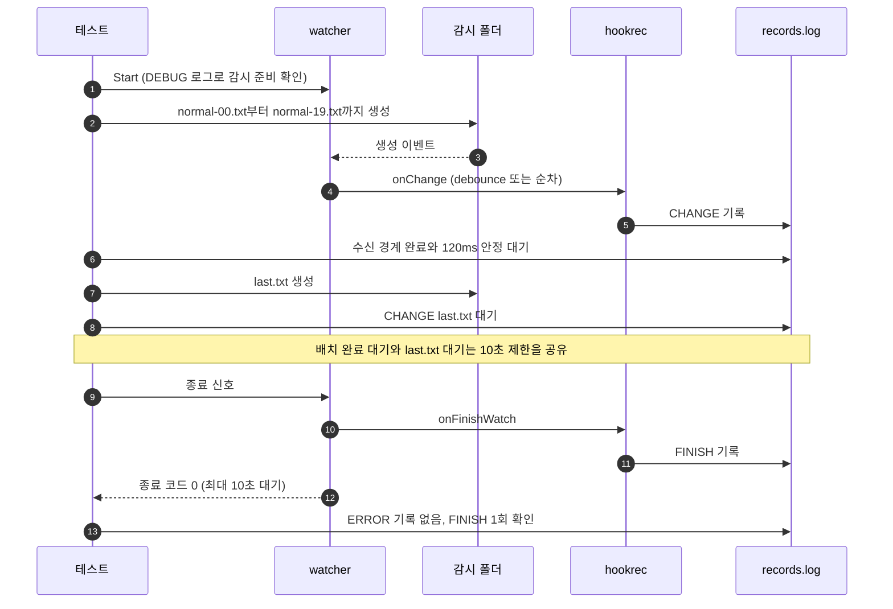

# `TestNormalChangesDoNotNotify`: 일반 변경에서 유실 알림 미실행

🇺🇸 [English](normal-changes-do-not-notify.md) | 🇰🇷 한국어

- `global.lifeCycle.onError`를 설정한 상태에서 일반 변경과 debounce에 의한 대체가 일어나도 유실 알림이 실행되지 않는지 `noWait` 두 값으로 확인합니다.

## 확인 내용과 성공 조건

- **배치 완료**: `normal-00.txt`~`normal-19.txt`의 `CREATE` 이벤트 가운데 DEBUG 로그에 실제로 수신된 것만 대상으로 합니다. 마지막 `CHANGE:` 기록의 경로가 마지막으로 수신된 경로와 같고, 로그와 기록이 120ms 동안 변하지 않아야 합니다. `noWait=true`에서는 `CHANGE:` 기록 수가 수신된 생성 이벤트 수와도 같아야 합니다. 판정의 근거와 한계는 [OS E2E의 수신 경계 판정](../reliability.ko.md#os-e2e의-수신-경계-판정)에 있습니다.
- **고립된 변경**: 배치가 안정된 뒤 만든 `last.txt`의 `CHANGE:` 기록이 나타나야 합니다. 이 대기와 배치 완료 대기는 하나의 10초 제한을 공유합니다.
- **알림 미실행**: watcher가 종료 신호를 받고 10초 안에 종료 코드 0으로 끝난 뒤, `ERROR|` 알림 기록이 하나도 없고 `FINISH` 기록이 정확히 한 번 있어야 합니다.

## 설정

- 전역 `onError`는 `hookrec --error-context --line=NOTIFY`입니다. 실행되면 `ERROR|<JSON>`을 기록합니다.
- 대상 `onChange`는 `CHANGE:{{.Path}}`를, `onFinishWatch`는 `FINISH`를 기록합니다.
- 대상 옵션은 하위 테스트별 `noWait`와 `waitMillisecond: 50`, `watchFileEvent: C`, `exclude: ['*.probe']`입니다.

## 하위 테스트

| 하위 테스트 | 변경 이벤트 처리 | 추가 확인 |
|---|---|---|
| `noWait=false` | 50ms debounce. 배치 중 앞선 이벤트는 대체될 수 있음 | 없음 |
| `noWait=true` | 수신한 이벤트마다 순차 실행 | 완료 수와 수신 수 일치 |

## 진행 순서



## 실행

- 저장소 루트에서 실행합니다.

차례로 로컬, Linux Docker, UTM Windows VM에서 실행하는 명령입니다.

```sh
go test -count=1 -v -run '^TestNormalChangesDoNotNotify$' ./e2e/scenarios
go run ./e2e/linux -- -run '^TestNormalChangesDoNotNotify$'
make e2e-windows ARGS="-- -run '^TestNormalChangesDoNotNotify$'"
```

- 하위 테스트 하나만 실행하려면 `-run '^TestNormalChangesDoNotNotify$/^noWait=true$'`처럼 지정합니다.
- UTM 명령은 [UTM Windows VM에서 E2E 실행](../windows-utm.ko.md)의 사전 준비를 마치고 `make e2e-windows-up`으로 VM을 켠 뒤 실행합니다.

## 관련 코드

- `e2e/scenarios/error_notification_test.go`: `TestNormalChangesDoNotNotify`, 알림 기록을 읽는 `errorContexts`
- `e2e/harness`: `Start`, `Hook`, `AwaitChangesComplete`, `AwaitLine`, `Stop`, `Lines`, `CountRecord`. 각 함수의 위치와 책임은 [책임별 코드 위치](../harness.ko.md#책임별-코드-위치)에 있습니다.
