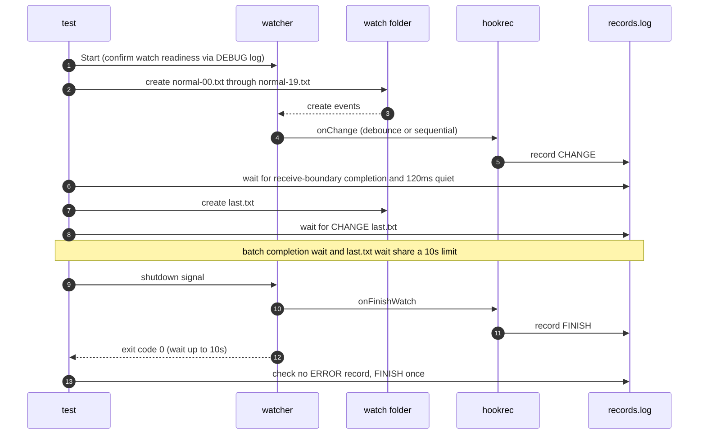

# `TestNormalChangesDoNotNotify`: no loss notification on normal changes

🇺🇸 English | 🇰🇷 [한국어](normal-changes-do-not-notify.ko.md)

- With `global.lifeCycle.onError` configured, checks for both values of `noWait` that the loss notification does not run on normal changes or on replacement by debounce.

## What it checks and success criteria

- **Batch completion**: Only the `CREATE` events of `normal-00.txt`–`normal-19.txt` that were actually received in the DEBUG log count. The path of the last `CHANGE:` record must equal the last received path, and the log and records must stay unchanged for 120ms. With `noWait=true`, the number of `CHANGE:` records must also equal the number of create events received. The basis and limits of this judgment are in [Receive boundary checks in OS E2E](../reliability.md#receive-boundary-checks-in-os-e2e).
- **Isolated change**: The `CHANGE:` record for `last.txt`, created after the batch settles, must appear. This wait and the batch completion wait share one 10-second limit.
- **No notification**: After the watcher exits with exit code 0 within 10 seconds of receiving the shutdown signal, there must be no `ERROR|` notification record and exactly one `FINISH` record.

## Configuration

- The global `onError` is `hookrec --error-context --line=NOTIFY`. When it runs, it records `ERROR|<JSON>`.
- The target `onChange` records `CHANGE:{{.Path}}`, and `onFinishWatch` records `FINISH`.
- The target options are the per-subtest `noWait`, plus `hookBatch.waitMillisecond: 50`, `watch.fileEvent: C`, and `watch.exclude: ['*.probe']`.

## Subtests

| Subtest | Change event handling | Extra checks |
|---|---|---|
| `noWait=false` | 50ms debounce. Earlier events in the batch may be replaced | None |
| `noWait=true` | Sequential run for each received event | Completion count matches receipt count |

## Sequence



## Running

- Run from the repository root.

The commands run locally, in Linux Docker, and on the UTM Windows VM, in that order.

```sh
go test -count=1 -v -run '^TestNormalChangesDoNotNotify$' ./e2e/scenarios
go run ./e2e/linux -- -run '^TestNormalChangesDoNotNotify$'
make e2e-windows ARGS="-- -run '^TestNormalChangesDoNotNotify$'"
```

- To run a single subtest, specify it as in `-run '^TestNormalChangesDoNotNotify$/^noWait=true$'`.
- Run the UTM command after completing the prerequisites in [Running E2E on a UTM Windows VM](../windows-utm.md) and starting the VM with `make e2e-windows-up`.

## Related code

- `e2e/scenarios/error_notification_test.go`: `TestNormalChangesDoNotNotify`, and `errorContexts`, which reads the notification records
- `e2e/harness`: `Start`, `Hook`, `AwaitChangesComplete`, `AwaitLine`, `Stop`, `Lines`, `CountRecord`. Where each function lives and what it does is in [Code locations by responsibility](../harness.md#code-locations-by-responsibility).
