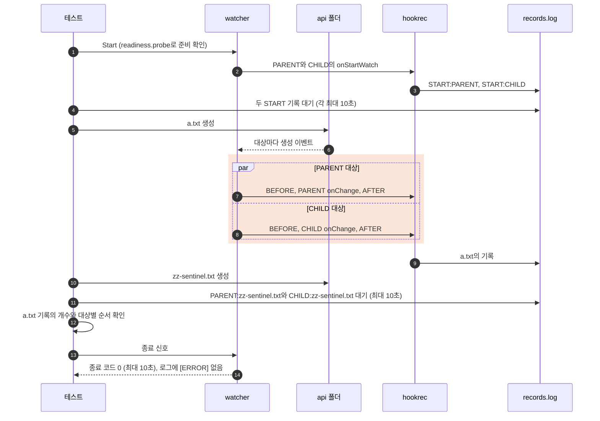

# `TestOverlappingTargets`: 경로가 같거나 상위·하위로 겹치는 감시 대상의 hook

🇺🇸 [English](overlapping-targets.md) | 🇰🇷 한국어

- [감시 대상의 경로가 겹칠 때](../../../docs/guide/events.ko.md#감시-대상의-경로가-겹칠-때)에 적힌 동작을 실제 watcher, 설정 파일과 셸을 거쳐 확인합니다. 겹치는 대상은 변경 하나에 각자 hook을 실행하고, 상대 대상을 기다리지 않습니다.

## 확인 내용과 성공 조건

- 모든 대상의 `onStartWatch`는 `START:<label>`을, `onChange`는 `<label>:<파일 이름>`을 기록합니다. 전역 hook을 둔 하위 테스트에서는 전역 `onBeforeChange`와 `onAfterChange`가 `BEFORE:<파일 이름>`과 `AFTER:<파일 이름>`을 기록합니다.
- 모든 하위 테스트에서 watcher는 시작하고, 실행하는 동안 `[ERROR]` 줄을 남기지 않으며, 종료 신호를 받고 10초 안에 종료 코드 0으로 끝나야 합니다.
  - watcher의 로그 수준은 ERROR, INFO, DEBUG뿐이므로, `[ERROR]` 줄이 없으면 오류나 경고를 출력하지 않은 것입니다.
- 기록 개수가 [하위 테스트](#하위-테스트)에 적힌 개수와 다르면 실패합니다.
- 앞의 두 하위 테스트에서 `a.txt`의 기록은 대상마다 `BEFORE`, `onChange`, `AFTER` 순서 하나씩으로 나뉘어야 합니다.
  - 전역 hook의 기록은 어느 대상이 실행했는지 드러내지 않으므로, 기록의 어느 지점에서도 `onChange` 기록이 `BEFORE` 기록보다 많거나 `AFTER` 기록이 `onChange` 기록보다 많으면 실패합니다.
  - 두 대상 사이의 순서는 정해져 있지 않으므로 확인하지 않습니다.
- 느린 hook 하위 테스트에서는 종료 신호가 상위 대상의 지연 hook을 취소하고, 그 프로세스가 5초 안에 사라져야 합니다([생존 판정](../harness.ko.md#프로세스-생존-판정과-강제-정리)).
- 겹치는 폴더에 대상마다 OS 감시 자원을 따로 쓰는지와, `api/**`를 둔 `PARENT`가 `api`를 감시 목록에 넣지 않는지는 hook 기록으로 드러나지 않으므로 확인하지 않습니다.

## 설정

- 하위 테스트마다 watcher를 따로 시작합니다. `api` 폴더는 `Start` 전에 만듭니다.
- 모든 대상에 `watch.exclude: ['*.probe']`, `watch.fileEvent: C`, `hookBatch.waitMillisecond: 0`, `hookBatch.deliver: each`를 둡니다.
- 테스트는 파일을 `O_CREATE|O_EXCL|O_RDONLY`로 빈 채 만들어, 파일마다 `C`만 발생시킵니다.
- `PARENT` 안에 파일을 쓰는 hook은 `hookrec --file=<감시 폴더>/out.txt --line=written`을 실행합니다. `hookrec`은 파일을 만들고 한 줄을 덧붙이며, `fileEvent: C`이므로 그 수정은 `PARENT`의 hook을 한 번 더 실행하지 않습니다.

## 하위 테스트

| 하위 테스트 | 대상 | 동작과 성공 조건 |
|---|---|---|
| `same path runs each target once` | `FIRST`와 `SECOND`가 모두 감시 폴더를 감시하고, 전역 hook을 둡니다. | `a.txt`를 만들면 `FIRST:a.txt`와 `SECOND:a.txt`가 하나씩, `BEFORE:a.txt`와 `AFTER:a.txt`가 두 개씩 있습니다. |
| `parent and child paths run each target once` | `PARENT`는 감시 폴더를, `CHILD`는 그 안의 `api` 폴더를 감시하고, 전역 hook을 둡니다. | `api/a.txt`를 만들면 `PARENT:a.txt`와 `CHILD:a.txt`가 하나씩, `BEFORE:a.txt`와 `AFTER:a.txt`가 두 개씩 있습니다. |
| `slow parent hook does not block child` | `PARENT`의 `onChange`는 30초 지연되는 hook입니다. | `api/a.txt`를 만들고 `PARENT`의 hook이 `BEGIN`을 기록한 뒤, `PARENT:a.txt`가 아직 없는 동안 `CHILD:a.txt`가 10초 안에 나타납니다. |
| `hook writing into another target runs its hooks` | `CHILD`의 `onChange`는 `CHILD:<파일 이름>`을 기록한 뒤, `CHILD` 밖이면서 `PARENT` 안인 감시 폴더에 `out.txt`를 만듭니다. | `api/a.txt`를 만들면 `CHILD:a.txt`가 나타나고, 이어서 `PARENT:out.txt`가 10초 안에 나타납니다. |
| `parent excluding the child folder runs only the child` | `PARENT`에 `watch.exclude: ['*.probe', 'api/**']`를 둡니다. | `api/a.txt`를 만들면 `CHILD:a.txt`가 하나 있고 `PARENT:a.txt`는 없습니다. |

## 진행 순서

다이어그램은 `parent and child paths run each target once`를 보여 주며, 다른 하위 테스트는 위 표에 따라 hook과 확인 내용만 다릅니다.



- `Start`는 감시 폴더의 `readiness.probe` 이벤트로만 준비를 확인하고, DEBUG 로그로는 그 이벤트를 받은 대상을 가릴 수 없습니다. 그래서 테스트는 대상마다 `START` 기록도 기다립니다. 대상은 자기 폴더를 감시 목록에 넣은 뒤 이 기록을 남깁니다.
- 정확한 개수는 고정 sleep 대신 뒤이어 만든 표지로 판정합니다. 대상은 한 폴더의 이벤트를 받은 순서대로 hook을 실행하므로, 모든 대상이 같은 폴더의 표지로 `onChange`를 실행했다면 앞선 동작의 기록은 모두 남아 있습니다.
- exclude 하위 테스트에서 `PARENT`는 `api`를 감시하지 않아 그 안의 표지를 받을 수 없습니다. 그래서 표지를 감시 폴더 바로 아래에 만들고 `PARENT:zz-sentinel.txt`만 기다립니다.
- 느린 hook 하위 테스트의 30초 지연은 종료 신호가 hook을 취소하므로 실행 시간을 늘리지 않습니다.

## 실행

저장소 루트에서 차례로 로컬, Linux Docker, UTM Windows VM에서 실행하는 명령입니다.

```sh
go test -count=1 -v -run '^TestOverlappingTargets$' ./e2e/scenarios
go run ./e2e/linux -- -run '^TestOverlappingTargets$'
make e2e-windows ARGS="-- -run '^TestOverlappingTargets$'"
```

- UTM 명령은 [UTM Windows VM에서 E2E 실행](../windows-utm.ko.md)의 사전 준비를 마치고 `make e2e-windows-up`으로 VM을 켠 뒤 실행합니다.

## 관련 코드

- `e2e/scenarios/overlapping_targets_test.go`에는 `TestOverlappingTargets`, 설정을 만들고 대상마다 `START` 기록을 기다리는 `startOverlapping`, 표지를 만들고 기다리는 `awaitSentinel`, 대상별 기록 순서를 확인하는 `assertRunPerTarget`, `[ERROR]` 줄 없는 종료를 확인하는 `stopWithoutErrors`가 있습니다.
- `e2e/scenarios/helpers_test.go`: `mkdirAll`과 `createEmpty`는 폴더와 빈 파일을 만듭니다.
- `e2e/harness`: `NewScenario`, `Start`, `Hook`, `HookrecBin`, `Await`, `AwaitLine`, `Lines`, `CountRecord`, `DelayedHookBegun`, `Log`, `Stop`, `AwaitDelayedHooksGone`. 각 함수의 위치와 책임은 [책임별 코드 위치](../harness.ko.md#책임별-코드-위치)에 있습니다.
