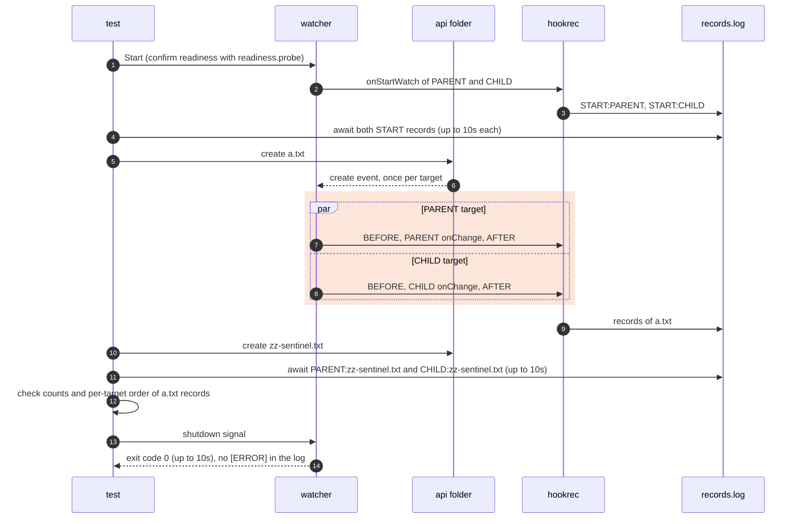

# `TestOverlappingTargets`: hooks of targets with the same or nested paths

🇺🇸 English | 🇰🇷 [한국어](overlapping-targets.ko.md)

- Checks the behavior in [Overlapping target paths](../../../docs/guide/events.md#overlapping-target-paths) through the actual watcher, configuration file, and shell: each overlapping target runs its own hooks for one change, without waiting for the other target.

## What it checks and success criteria

- Every target's `onStartWatch` records `START:<label>`, and `onChange` records `<label>:<file name>`. In the subtests with global hooks, global `onBeforeChange` and `onAfterChange` record `BEFORE:<file name>` and `AFTER:<file name>`.
- In every subtest, the watcher starts, logs no `[ERROR]` line while it runs, and exits with code 0 within 10 seconds of its shutdown signal.
  - The watcher has only the ERROR, INFO, and DEBUG log levels, so no `[ERROR]` line means that it printed no error or warning.
- A record count different from the one in [Subtests](#subtests) fails the test.
- In the first two subtests, the records of `a.txt` must split into one `BEFORE`, `onChange`, `AFTER` sequence per target.
  - Global records do not show which target ran them, so at no point in the records may `onChange` records outnumber `BEFORE` records, or `AFTER` records outnumber `onChange` records.
  - The order between the two targets is not checked, because it is not fixed.
- In the slow subtest, shutdown cancels the parent's delayed hook, and its process must disappear within 5 seconds. On Windows, a recorded PID that a program other than `hookrec` already holds at the first observation counts as gone ([liveness judgment](../harness.md#code-locations-by-responsibility)).
- That each target uses its own OS watch resources for the overlapping folders, and that `PARENT` with `api/**` does not add `api` to its watch list, are not checked, because hook records cannot show them.

## Configuration

- Each subtest starts a separate watcher. The `api` folder is created before `Start`.
- Every target uses `watch.exclude: ['*.probe']`, `watch.fileEvent: C`, `hookBatch.waitMillisecond: 0`, and `hookBatch.deliver: each`.
- The test creates files empty with `O_CREATE|O_EXCL|O_RDONLY`, so each file produces only `C`.
- The hook that writes into `PARENT` runs `hookrec --file=<watch folder>/out.txt --line=written`. `hookrec` creates the file and appends one line, and `fileEvent: C` keeps the update from running another `PARENT` hook.

## Subtests

| Subtest | Targets | Action and success criteria |
|---|---|---|
| `same path runs each target once` | `FIRST` and `SECOND` both watch the watch folder, with global hooks. | Create `a.txt`: `FIRST:a.txt` and `SECOND:a.txt` once each, and `BEFORE:a.txt` and `AFTER:a.txt` twice each. |
| `parent and child paths run each target once` | `PARENT` watches the watch folder and `CHILD` watches its `api` folder, with global hooks. | Create `api/a.txt`: `PARENT:a.txt` and `CHILD:a.txt` once each, and `BEFORE:a.txt` and `AFTER:a.txt` twice each. |
| `slow parent hook does not block child` | `PARENT`'s `onChange` is a hook delayed by 30 seconds. | Create `api/a.txt`: after `PARENT`'s hook records `BEGIN`, `CHILD:a.txt` appears within 10 seconds while `PARENT:a.txt` is still absent. |
| `hook writing into another target runs its hooks` | `CHILD`'s `onChange` records `CHILD:<file name>` and then creates `out.txt` in the watch folder, which is outside `CHILD` and inside `PARENT`. | Create `api/a.txt`: `CHILD:a.txt`, and then `PARENT:out.txt` within 10 seconds. |
| `parent excluding the child folder runs only the child` | `PARENT` has `watch.exclude: ['*.probe', 'api/**']`. | Create `api/a.txt`: `CHILD:a.txt` once and no `PARENT:a.txt`. |

## Sequence

The diagram shows `parent and child paths run each target once`; the other subtests replace the hooks and checks as in the table above.



- `Start` confirms readiness only from the event of `readiness.probe` in the watch folder, and the DEBUG log does not show which target received it. The test therefore also waits for each target's `START` record, which a target writes after it has added its folders to the watch list.
- Exact counts are judged with a later sentinel, not a fixed sleep. Each target runs the hooks of one folder's events in the order it received them, so once every target has run `onChange` for the sentinel in the same folder, the records of the earlier action are complete.
- In the exclude subtest, `PARENT` does not watch `api` and cannot receive a sentinel there, so the sentinel is created directly in the watch folder and only `PARENT:zz-sentinel.txt` is awaited.
- The 30-second delay of the slow subtest does not lengthen the run, because shutdown cancels the hook.

## Running

- Run from the repository root.

The commands run locally, in Linux Docker, and on the UTM Windows VM, in that order.

```sh
go test -count=1 -v -run '^TestOverlappingTargets$' ./e2e/scenarios
go run ./e2e/linux -- -run '^TestOverlappingTargets$'
make e2e-windows ARGS="-- -run '^TestOverlappingTargets$'"
```

- Run the UTM command after completing the prerequisites in [Running E2E on a UTM Windows VM](../windows-utm.md) and starting the VM with `make e2e-windows-up`.
- To run directly on a Windows host, see [Windows run commands](../windows.md#run-commands).

## Related code

- `e2e/scenarios/overlapping_targets_test.go`: `TestOverlappingTargets` and its configuration, sentinel, and record order checks.
- `e2e/scenarios/helpers_test.go`: `mkdirAll` and `createEmpty`.
- `e2e/harness`: `Start`, `Hook`, `HookrecBin`, `Await`, `AwaitLine`, `Lines`, `CountRecord`, `DelayedHookBegun`, `Log`, `Stop`, and `AwaitDelayedHooksGone`. Their locations and responsibilities are in [Code locations by responsibility](../harness.md#code-locations-by-responsibility).
