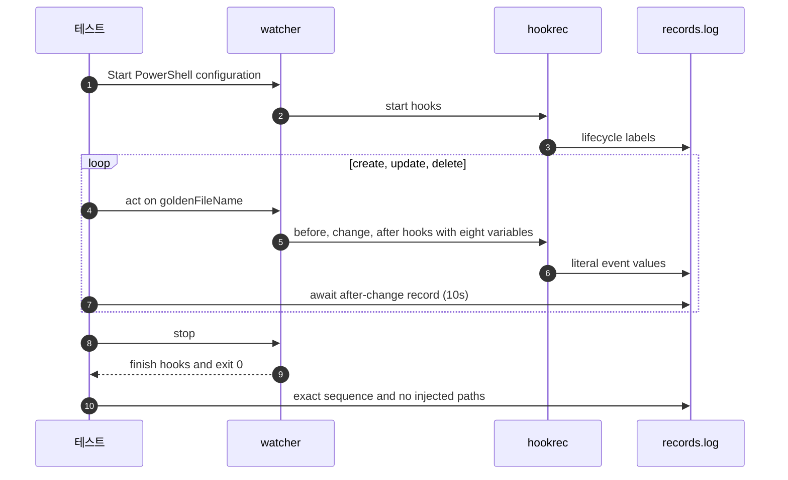

# `TestPowershellEventVariables`: Windows PowerShell의 이벤트 변수 원문 전달

🇺🇸 [English](powershell-event-variables.md) | 🇰🇷 한국어

- `TestGoldenPath`와 같은 파일 이름으로 Windows PowerShell의 이벤트 변수 여덟 개와 명령 주입 방지를 확인합니다.

## 확인 내용과 성공 조건

- 생성·수정·삭제 이벤트에서 전역 변경 전·대상 변경·전역 변경 후 hook의 여덟 변수 값이 원문 전체와 일치해야 합니다.
- 파일 이름에는 공백, `;`, `$(...)`, 작은따옴표, `&`, `%OS%`가 들어 있고, 프로그램 실행 위치와 감시 폴더에 `pwned*` 경로가 생기면 안 됩니다.
- 대상 종료 뒤 전역 종료 hook까지 전체 생명주기 순서가 golden 순서와 일치하고 종료 코드가 0이어야 합니다.

## 설정

- `goldenConfig`를 재사용하되 `shell: powershell`을 지정하고 hook 명령 앞에 PowerShell 호출 연산자 `&`를 붙입니다.
- [실행 명령에서 쓸 수 있는 변수](../../../docs/guide/configuration.ko.md#실행-명령에서-쓸-수-있는-변수)에 따라 템플릿을 따옴표 밖에 둡니다.

## 진행 순서



## 실행

- 저장소 루트에서 실행합니다.
- Windows에서만 지원하는 셸이므로 Windows 전용 build tag를 쓰며, macOS와 Linux에서는 실행 대상이 아닙니다.

```sh
make e2e-windows ARGS="-- -run '^TestPowershellEventVariables$'"
```

- UTM 명령은 [UTM Windows VM에서 E2E 실행](../windows-utm.ko.md)의 사전 준비를 마치고 VM을 켠 뒤 실행합니다.

## 관련 코드

- `e2e/scenarios/shell_windows_test.go`: `TestPowershellEventVariables`
- `e2e/harness`: `NewScenario`, `Start`, `Write`, `AwaitLine`, `Stop`, `Lines`.
