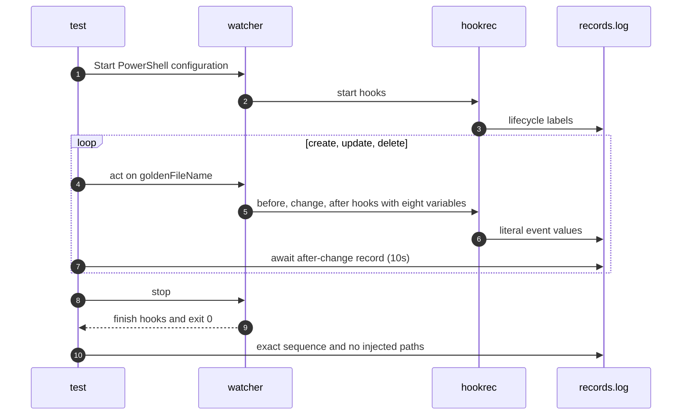

# `TestPowershellEventVariables`: literal event values through Windows PowerShell

🇺🇸 English | 🇰🇷 [한국어](powershell-event-variables.ko.md)

- The test checks eight event variables and injection prevention through Windows PowerShell using the same file name as `TestGoldenPath`.

## What it checks and success criteria

- The eight variables in global before-change, target change, and global after-change hooks match the complete original values for create, update, and delete events.
- The file name contains spaces, `;`, `$(...)`, a single quote, `&`, and `%OS%`; no `pwned*` path may appear in the program or watched directory.
- The entire lifecycle sequence matches the golden sequence, including target then global finish hooks; shutdown exits with code 0.

## Configuration

- The test reuses `goldenConfig` with `shell: powershell` and prefixes hook commands with the PowerShell call operator `&`.
- Templates remain outside quotes as specified in [Variables in commands](../../../docs/guide/configuration.md#variables-in-commands).

## Sequence



## Running

- Run from the repository root.
- These Windows-only shells use a Windows build tag; this scenario is not selected on macOS or Linux.

```sh
make e2e-windows ARGS="-- -run '^TestPowershellEventVariables$'"
```

- Run the UTM command after completing the prerequisites in [Running E2E on a UTM Windows VM](../windows-utm.md) and starting the VM.

## Related code

- `e2e/scenarios/shell_windows_test.go` defines `TestPowershellEventVariables`.
- `e2e/scenarios/helpers_test.go`: `goldenConfig` and `goldenFileName` are the configuration and file name shared with `TestGoldenPath`, and `changeValues` and `expectedSequence` build the expected records.
- The test uses `NewScenario`, `Start`, `Write`, `AwaitLine`, `Stop`, and `Lines` from `e2e/harness`.
