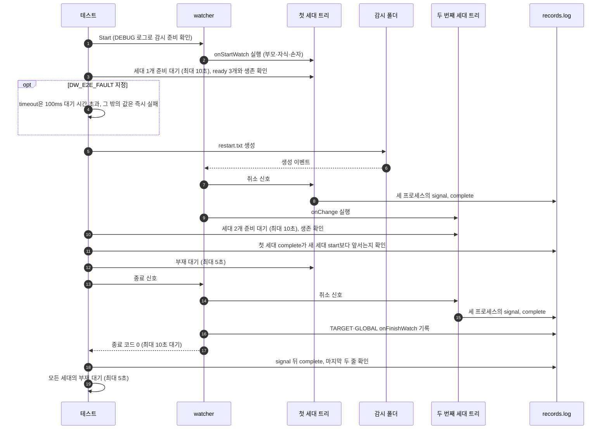

# `TestProcessLifecycle`: 프로세스 트리 hook의 교체와 정상 종료

🇺🇸 [English](process-lifecycle.md) | 🇰🇷 한국어

- 중단 모드(`interruptible: true`)에서 실제 부모·자식·손자 프로세스로 된 hook이 파일 생성으로 교체될 때, 이전 세대가 정상 완료한 뒤에 새 세대가 시작되는지 확인합니다.
- watcher를 종료할 때 현재 세대가 정상 완료한 뒤 종료 hook이 실행되는지도 확인합니다.

## 확인 내용과 성공 조건

- 시작 hook으로 만든 첫 세대의 부모·자식·손자가 모두 `ready`를 기록하고, `start`를 기록한 세 PID가 살아 있습니다.
- 파일을 생성하면 변경 hook의 두 번째 세대가 준비되고, 그 프로세스가 살아 있습니다.
- 첫 세대의 깊이 0·1·2 프로세스가 모두 `complete`를 기록한 뒤에 다른 세대의 첫 `start`가 기록됩니다. 첫 세대 프로세스는 5초 안에 모두 사라집니다.
- watcher가 종료 신호를 받고 10초 안에 종료 코드 0으로 끝납니다. `ready`를 기록한 모든 프로세스는 `signal`을 기록한 뒤 `complete`를 기록합니다.
- `records.log`의 마지막 두 줄은 `TARGET:onFinishWatch`, `GLOBAL:onFinishWatch` 순서입니다. 프로세스 기록도 같은 파일에 쌓이므로, 이 조건은 종료 hook이 현재 세대의 `complete`보다 뒤에 실행되었음을 뜻합니다.
- 모든 세대의 프로세스가 5초 안에 사라집니다. 이 부재 확인은 테스트 본문에서 하므로 시나리오 정리 단계의 강제 종료보다 앞섭니다. Windows에서는 기록된 PID를 처음 확인할 때 이미 `hookrec`이 아닌 프로그램이 쓰고 있으면 사라진 것으로 봅니다([생존 판정 방식](../harness.ko.md#책임별-코드-위치)).

## 설정

- 대상 `onStartWatch`와 `onChange`에 같은 `hookrec --depth=2` 명령을 설정합니다. 기록 형식(`세대|PID|깊이|상태`)과 신호 처리는 [`hookrec` 프로세스 트리와 지연 hook](../harness.ko.md#hookrec-프로세스-트리와-지연-hook)에 있습니다.
- 대상 `onFinishWatch`는 `TARGET:onFinishWatch`를, 전역 `onFinishWatch`는 `GLOBAL:onFinishWatch`를 기록합니다.
- 대상 옵션은 `interruptible: true`, `waitMillisecond: 100`, `watchEvent: C`, `exclude: ['*.probe']`입니다.

## 진행 순서



- `restart.txt`는 내용 없이 `O_CREATE|O_EXCL|O_RDONLY`로 열었다 닫아 생성합니다.
- `DW_E2E_FAULT`를 지정하면 첫 세대를 확인한 직후 테스트가 실패하므로, 실제 프로세스 트리가 살아 있는 상태에서 정리 경로를 검사할 수 있습니다. 명령과 확인할 진단 파일은 [의도적인 실패·시간 초과](../diagnostics.ko.md#의도적인-실패시간-초과)와 [Windows 실패 분석](../windows.ko.md#실패-분석)에 있습니다.

## 실행

- 저장소 루트에서 실행합니다.

차례로 로컬, Linux Docker, UTM Windows VM에서 실행하는 명령입니다.

```sh
go test -count=1 -v -run '^TestProcessLifecycle$' ./e2e/scenarios
go run ./e2e/linux -- -run '^TestProcessLifecycle$'
make e2e-windows ARGS="-- -run '^TestProcessLifecycle$'"
```

- UTM 명령은 [UTM Windows VM에서 E2E 실행](../windows-utm.ko.md)의 사전 준비를 마치고 `make e2e-windows-up`으로 VM을 켠 뒤 실행합니다.
- Windows 호스트에서 직접 실행하는 방법은 [Windows 실행 명령](../windows.ko.md#실행-명령)에 있습니다.

## 관련 코드

- `e2e/scenarios/process_test.go`: `TestProcessLifecycle`, 세대 교체 순서를 검사하는 `assertCompletedBeforeRestart`
- `e2e/harness`: `Start`, `Hook`, `AwaitReadyGenerations`, `AssertRunning`, `AwaitProcessesGone`, `Stop`, `AssertGracefulCompletion`, `ProcessRecords`, `Lines`. 각 함수의 위치와 책임은 [책임별 코드 위치](../harness.ko.md#책임별-코드-위치)에 있습니다.
