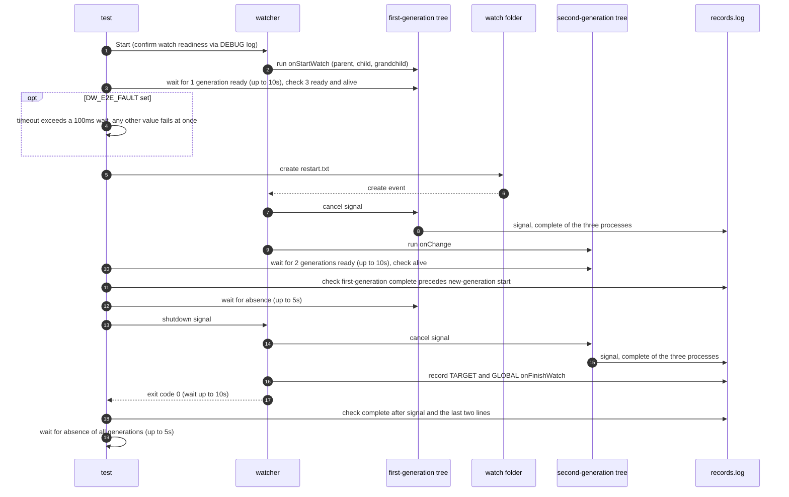

# `TestProcessLifecycle`: replacing and gracefully shutting down a process tree hook

🇺🇸 English | 🇰🇷 [한국어](process-lifecycle.ko.md)

In interruptible mode (`interruptible: true`), when a hook made of real parent, child, and grandchild processes is replaced by a file creation, checks that the new generation starts only after the previous generation completes gracefully. It also checks that, when the watcher shuts down, the finish hooks run after the current generation completes gracefully.

## What it checks and success criteria

- The parent, child, and grandchild of the first generation, created by the start hook, all record `ready`, and the three PIDs that recorded `start` are alive.
- Creating a file makes the second generation of the change hook ready, and its processes are alive.
- The first `start` of another generation is recorded only after the depth 0, 1, and 2 processes of the first generation have all recorded `complete`. All first-generation processes are gone within 5 seconds.
- The watcher exits with exit code 0 within 10 seconds of receiving the shutdown signal. Every process that recorded `ready` records `signal` and then `complete`.
- The last two lines of `records.log` are `TARGET:onFinishWatch` and `GLOBAL:onFinishWatch`, in that order. Process records go to the same file, so this condition means the finish hooks ran after the current generation's `complete`.
- The processes of every generation are gone within 5 seconds. This absence check happens in the test body, so it comes before the forced termination in the scenario cleanup step. On Windows, a recorded PID that a program other than `hookrec` already holds when it is first checked counts as gone ([how liveness is judged](../harness.md#code-locations-by-responsibility)).

## Configuration

- The target `onStartWatch` and `onChange` are set to the same `hookrec --depth=2` command. The record format (`generation|PID|depth|state`) and signal handling are described in [`hookrec` process trees and delayed hooks](../harness.md#hookrec-process-trees-and-delayed-hooks).
- The target `onFinishWatch` records `TARGET:onFinishWatch`, and the global `onFinishWatch` records `GLOBAL:onFinishWatch`.
- The target options are `interruptible: true`, `waitMillisecond: 100`, `watchEvent: C`, and `excludeSuffix: [.probe]`.

## Sequence



- `restart.txt` is created with no content by opening it with `O_CREATE|O_EXCL|O_RDONLY` and closing it.
- When `DW_E2E_FAULT` is set, the test fails right after checking the first generation, so the cleanup path can be exercised while a real process tree is alive. The commands and the diagnostics files to check are in [Intentional failures and timeouts](../diagnostics.md#intentional-failures-and-timeouts) and [Windows failure analysis](../windows.md#failure-analysis).

## Running

Run from the repository root. The commands run locally, in Linux Docker, and on the UTM Windows VM, in that order.

```sh
go test -count=1 -v -run '^TestProcessLifecycle$' ./e2e/scenarios
go run ./e2e/linux -- -run '^TestProcessLifecycle$'
make e2e-windows ARGS="-- -run '^TestProcessLifecycle$'"
```

Run the UTM command after completing the prerequisites in [Running E2E on a UTM Windows VM](../windows-utm.md) and starting the VM with `make e2e-windows-up`. To run directly on a Windows host, see [Windows run commands](../windows.md#run-commands).

## Related code

- `e2e/scenarios/process_test.go`: `TestProcessLifecycle`, and `assertCompletedBeforeRestart`, which checks the order of generation replacement
- `e2e/harness`: `Start`, `Hook`, `AwaitReadyGenerations`, `AssertRunning`, `AwaitProcessesGone`, `Stop`, `AssertGracefulCompletion`, `ProcessRecords`, `Lines`. Where each function lives and what it does is in [Code locations by responsibility](../harness.md#code-locations-by-responsibility).
