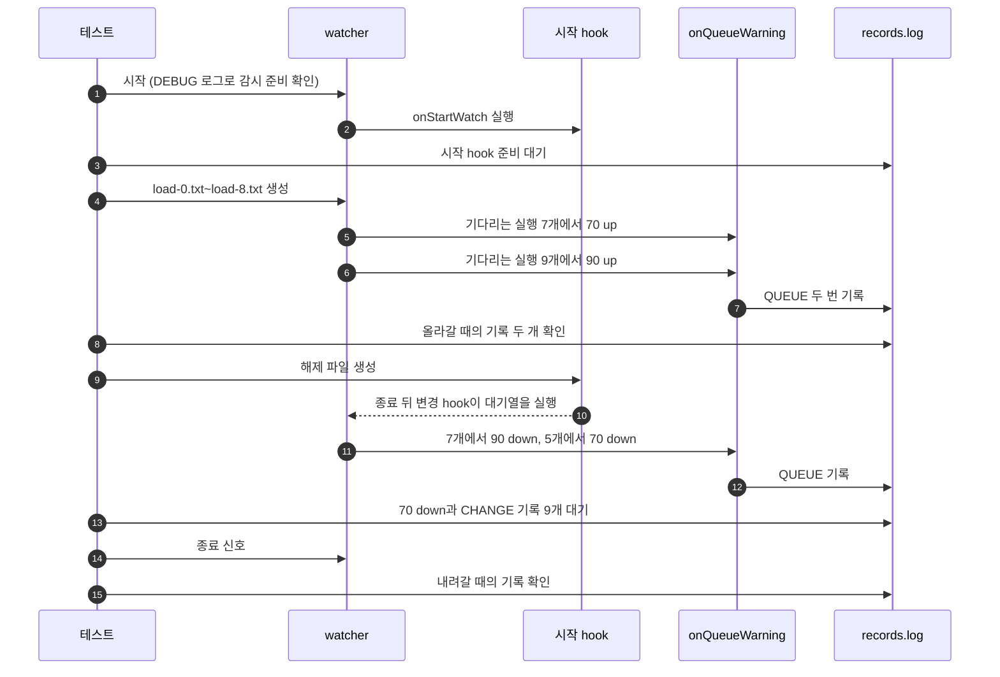

# `TestQueueWarningCLI`: 대기열 경고와 경고의 환경 변수

🇺🇸 [English](queue-warning-cli.md) | 🇰🇷 한국어

- `queue.size: 10`인 대상의 대기열을 70%와 90% 넘게 채웠다가 다시 비우면서, 오르내릴 때 `global.lifeCycle.onQueueWarning`이 받는 `DW_QUEUE_*` 환경 변수를 확인합니다.

## 확인 내용과 성공 조건

**올라갈 때의 경고**: `load-0.txt`~`load-8.txt`를 만든 뒤 10초 안에 `QUEUE|` 기록 두 개가 아래 값으로 나타나야 합니다.

| 기록 | `DW_QUEUE_LEVEL` | `DW_QUEUE_DIRECTION` | `DW_QUEUE_LENGTH` | `DW_QUEUE_TOP_PATHS` |
|---|---|---|---|---|
| 첫째 | `70` | `up` | `7` | `1 <load-0.txt>`~`1 <load-4.txt>`, 한 줄에 하나씩 |
| 둘째 | `90` | `up` | `9` | `1 <load-0.txt>`~`1 <load-4.txt>`, 한 줄에 하나씩 |

- **내려갈 때의 경고**: 시작 hook이 끝난 뒤 10초 안에 마지막 `QUEUE|` 기록이 `70` `down`이 되어야 하고, 9개 파일의 `CHANGE:` 기록이 파일마다 10초 안에 나타나야 합니다.
  - `70` `down` 기록은 `DW_QUEUE_LENGTH`가 `5`이고 `load-4.txt`~`load-8.txt`를 담습니다.
  - 그 앞에는 `DW_QUEUE_LENGTH`가 `7`이고 `load-2.txt`~`load-6.txt`를 담은 `90` `down` 기록이 하나 있을 수 있습니다. 가장 최근 경고 하나만 남기므로, `90` `down` 경고 hook이 아직 실행 중일 때 `70` `down`이 생기면 이 기록은 없습니다.
- 모든 기록에서 `DW_QUEUE_TARGET`은 감시 폴더이고 `DW_QUEUE_CAPACITY`는 `10`입니다. `DW_QUEUE_TOP_PATHS`의 경로는 파일의 전체 경로이며 `{{.Path}}`와 같은 형태입니다.

## 설정

- 전역 `onQueueWarning`은 `hookrec --queue-context`입니다. 실행되면 이름이 `DW_QUEUE_`로 시작하는 환경 변수를 모두 담은 `QUEUE|<JSON>`을 기록합니다.
- 대상 `onStartWatch`는 `hookrec --depth=0 --release-file=<작업 폴더>/release-start`입니다. 테스트가 해제 파일을 만들 때까지 실행되므로, 그동안 변경 hook이 실행되지 못하고 실행이 대기열에 남습니다.
- 대상 `onChange`는 `CHANGE:{{.Path}}`를 기록합니다.
- 대상 옵션은 `queue.size: 10`, `hookBatch.waitMillisecond: 0`, `hookBatch.deliver: each`, `watch.fileEvent: C`, `watch.exclude: ['*.probe']`입니다. 만든 파일 하나가 실행 하나가 됩니다.

## 진행 순서



## 실행

- 저장소 루트에서 실행합니다.

차례로 로컬, Linux Docker, UTM Windows VM에서 실행하는 명령입니다.

```sh
go test -count=1 -v -run '^TestQueueWarningCLI$' ./e2e/scenarios
go run ./e2e/linux -- -run '^TestQueueWarningCLI$'
make e2e-windows ARGS="-- -run '^TestQueueWarningCLI$'"
```

- UTM 명령은 [UTM Windows VM에서 E2E 실행](../windows-utm.ko.md)의 사전 준비를 마치고 `make e2e-windows-up`으로 VM을 켠 뒤 실행합니다.

## 관련 코드

- `e2e/scenarios/queue_warning_test.go`: `TestQueueWarningCLI`, 경고 기록을 읽는 `queueContexts`, `assertQueueContext`
- `e2e/hookrec/main.go`: `--queue-context`
- `e2e/harness`: `Start`, `Hook`, `AwaitReadyGenerations`, `Write`, `Await`, `AwaitLine`, `Stop`, `ReadLinesLenient`. 각 함수의 위치와 책임은 [책임별 코드 위치](../harness.ko.md#책임별-코드-위치)에 있습니다.
