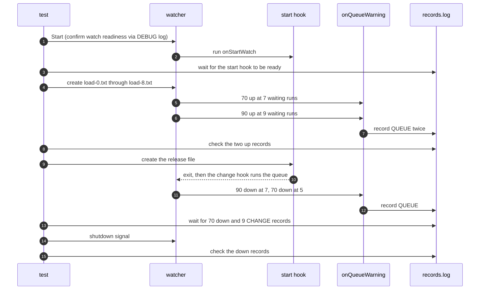

# `TestQueueWarningCLI`: queue warnings and their environment variables

🇺🇸 English | 🇰🇷 [한국어](queue-warning-cli.ko.md)

- Fills a target's queue of `queue.size: 10` past 70% and 90% and drains it again, and checks the `DW_QUEUE_*` environment variables that `global.lifeCycle.onQueueWarning` receives on the way up and down.

## What it checks and success criteria

**Warnings on the way up**: After `load-0.txt` through `load-8.txt` are created, two `QUEUE|` records must appear within 10 seconds, with the values below:

| Record | `DW_QUEUE_LEVEL` | `DW_QUEUE_DIRECTION` | `DW_QUEUE_LENGTH` | `DW_QUEUE_TOP_PATHS` |
|---|---|---|---|---|
| First | `70` | `up` | `7` | `1 <load-0.txt>` through `1 <load-4.txt>`, one per line |
| Second | `90` | `up` | `9` | `1 <load-0.txt>` through `1 <load-4.txt>`, one per line |

- **Warnings on the way down**: After the start hook ends, the last `QUEUE|` record must become `70` `down` within 10 seconds, and the `CHANGE:` record of each of the 9 files must appear within 10 seconds each.
  - The `70` `down` record has `DW_QUEUE_LENGTH` `5` and lists `load-4.txt` through `load-8.txt`.
  - Before it, there may be one `90` `down` record with `DW_QUEUE_LENGTH` `7` that lists `load-2.txt` through `load-6.txt`. It is missing when `70` `down` happens while the `90` `down` warning hook is still running, because only the latest warning is kept.
- In every record, `DW_QUEUE_TARGET` is the watch folder and `DW_QUEUE_CAPACITY` is `10`. Each path in `DW_QUEUE_TOP_PATHS` is the full path of the file, in the same form as `{{.Path}}`.

## Configuration

- The global `onQueueWarning` is `hookrec --queue-context`. When it runs, it records `QUEUE|<JSON>` with every environment variable whose name starts with `DW_QUEUE_`.
- The target `onStartWatch` is `hookrec --depth=0 --release-file=<work folder>/release-start`. It keeps running until the test creates the release file, so the change hook cannot run and runs stay in the queue.
- The target `onChange` records `CHANGE:{{.Path}}`.
- The target options are `queue.size: 10`, `hookBatch.waitMillisecond: 0`, `hookBatch.deliver: each`, `watch.fileEvent: C`, and `watch.exclude: ['*.probe']`. Each created file becomes one run.

## Sequence



## Running

- Run from the repository root.
- The commands that repeat the race scenarios together are in [Race and overload verification](../reliability.md#race-and-overload-verification).

The commands run locally, in Linux Docker, and on the UTM Windows VM, in that order.

```sh
go test -count=1 -v -run '^TestQueueWarningCLI$' ./e2e/scenarios
go run ./e2e/linux -- -run '^TestQueueWarningCLI$'
make e2e-windows ARGS="-- -run '^TestQueueWarningCLI$'"
```

- Run the UTM command after completing the prerequisites in [Running E2E on a UTM Windows VM](../windows-utm.md) and starting the VM with `make e2e-windows-up`.

## Related code

- `e2e/scenarios/queue_warning_test.go`: `TestQueueWarningCLI`, `queueContexts`, which reads the warning records, and `assertQueueContext`
- `e2e/hookrec/main.go`: `--queue-context`
- `e2e/harness`: `Start`, `Hook`, `AwaitReadyGenerations`, `Write`, `Await`, `AwaitLine`, `Stop`, `ReadLinesLenient`. Where each function lives and what it does is in [Code locations by responsibility](../harness.md#code-locations-by-responsibility).
