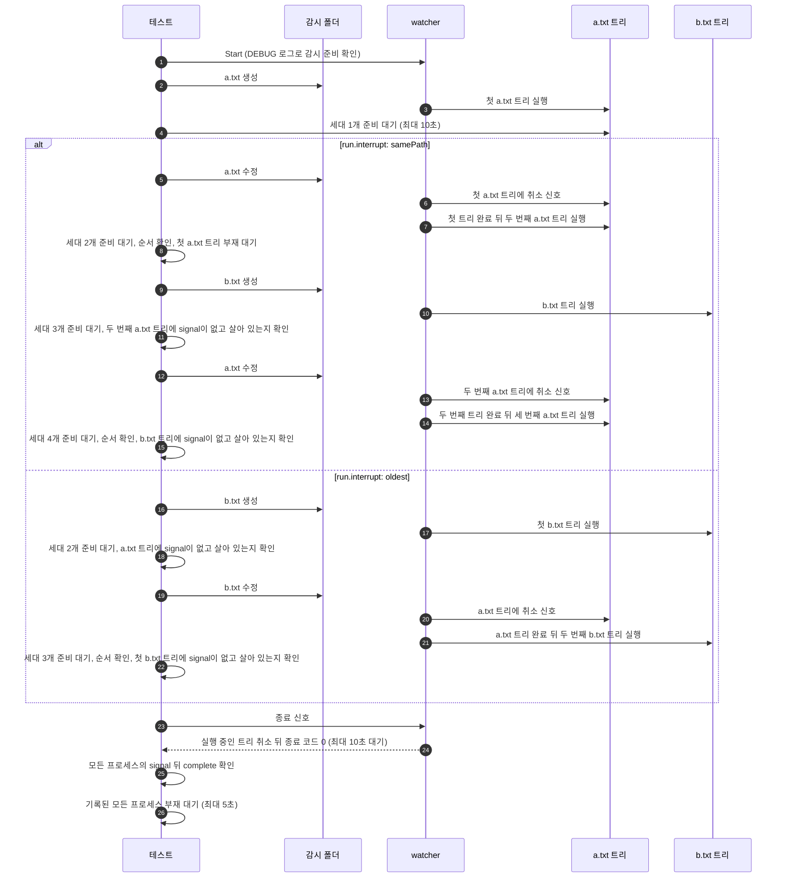
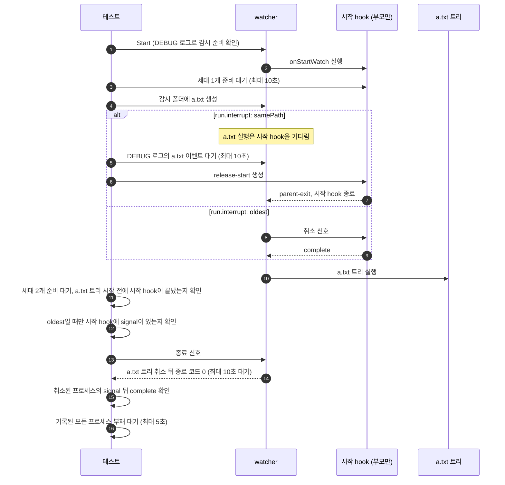

# `TestRunInterrupt`: `run.concurrency: 2`에서 `run.interrupt`가 취소하는 실행

🇺🇸 [English](run-interrupt.md) | 🇰🇷 한국어

- `run.concurrency: 2`에서 변경 hook과 시작 hook이 실제 부모·자식·손자 프로세스 트리를 실행하는 동안 새 실행이 들어옵니다.
- 이때 `run.interrupt: samePath`와 `oldest`에서 새 실행이 [run으로 hook 실행하기](../../../docs/guide/running.ko.md#run으로-hook-실행하기)에 적힌 대로 실행 중인 트리를 취소하는지, 새 트리는 취소된 트리가 완료한 뒤에야 시작하는지 확인합니다.

## 확인 내용과 성공 조건

- 변경 hook 트리마다 `--label`로 파일 이름을 기록하므로, 테스트는 각 세대가 어느 경로의 실행인지 구분합니다.
- 새 세대가 준비되기를 최대 10초 기다린 뒤, 새 실행이 어느 세대를 취소했는지 확인합니다.
  - 취소된 세대는 새 세대가 첫 `start`를 기록하기 전에 부모·자식·손자 모두 `complete`를 기록하고, 그 프로세스는 5초 안에 사라집니다.
  - 취소되면 안 되는 세대에는 `signal` 기록이 없고, 그 프로세스가 살아 있습니다. 새 실행은 자기가 취소한 실행이 끝난 뒤에야 시작하므로, 새 세대가 준비된 뒤의 이 확인은 새 실행이 그 세대를 취소하지 않았다는 증거가 됩니다.
- watcher가 종료 신호를 받고 10초 안에 종료 코드 0으로 끝납니다. `ready`를 기록한 취소된 프로세스는 모두 `signal`을 기록한 뒤 `complete`를 기록하고, 기록된 모든 프로세스는 5초 안에 사라집니다. Windows에서는 기록된 PID를 처음 확인할 때 이미 `hookrec`이 아닌 프로그램이 쓰고 있으면 사라진 것으로 봅니다([생존 판정 방식](../harness.ko.md#책임별-코드-위치)).
  - `onStartWatch/interrupt=samePath`에서 시작 hook은 취소되지 않고 스스로 끝나므로, 정상 완료 판정에서 뺍니다.

## 설정

- 대상 `onChange`는 `hookrec --depth=2 --label={{.Name}}`입니다. 기록 형식과 신호 처리는 [`hookrec` 프로세스 트리와 지연 hook](../harness.ko.md#hookrec-프로세스-트리와-지연-hook)에 있습니다.
- 모든 하위 테스트는 `run.concurrency: 2`, 하위 테스트별 `run.interrupt`, `watch.exclude: ['*.probe']`를 설정합니다. 종료 hook은 설정하지 않습니다.
- `changes/*` 하위 테스트는 `hookBatch`와 `watch.fileEvent`를 기본값으로 두므로, 단계마다 파일을 만들거나 고치면 100ms 기다린 뒤 그 파일의 실행이 하나 생깁니다.
- `onStartWatch/*` 하위 테스트는 `onStartWatch`에 `hookrec --depth=0 --release-file=<실행 폴더>/release-start`도 설정합니다. 이 hook은 그 파일이 생기거나 취소 신호를 받을 때까지 실행됩니다.
  - 이 하위 테스트는 `watch.fileEvent: C`, `hookBatch.waitMillisecond: 0`, `hookBatch.deliver: each`를 설정하므로, 파일을 만들면 watcher가 이벤트를 받자마자 실행이 하나 생깁니다.

## 하위 테스트

| 하위 테스트 | 단계 | 새 실행이 취소하는 것 |
|---|---|---|
| `changes/interrupt=samePath` | `a.txt` 생성, `a.txt` 수정, `b.txt` 생성, `a.txt` 수정 | `a.txt`를 고칠 때마다 실행 중인 `a.txt` 트리만 취소합니다. 자리가 비어 있을 때와 두 자리가 모두 찼을 때 모두 그렇습니다. `b.txt`를 만들 때는 아무것도 취소하지 않습니다. |
| `changes/interrupt=oldest` | `a.txt` 생성, `b.txt` 생성, `b.txt` 수정 | `b.txt`를 만들 때는 자리가 비어 있으므로 아무것도 취소하지 않습니다. `b.txt`를 고치면 먼저 시작한 `a.txt` 트리를 취소하고, 실행 중인 `b.txt` 트리는 그대로 둡니다. |
| `onStartWatch/interrupt=samePath` | 시작 hook이 도는 동안 `a.txt` 생성, 이어서 `release-start` 생성 | `a.txt` 실행은 시작 hook을 취소하지 않고, 시작 hook이 `parent-exit`를 기록한 뒤에 시작합니다. |
| `onStartWatch/interrupt=oldest` | 시작 hook이 도는 동안 `a.txt` 생성 | `a.txt` 실행이 시작 hook을 취소하고, 시작 hook이 `complete`를 기록한 뒤에 시작합니다. |

- `onStartWatch/interrupt=samePath`에서 `a.txt` 실행이 만들어졌다는 기록은 없으므로, 테스트는 DEBUG 로그에 `a.txt` 이벤트가 보이면 `release-start`를 만듭니다.
  - 실행이 시작 hook이 끝난 뒤에야 만들어졌다면, 테스트는 기다림을 확인하지 못한 채 통과합니다.

## 진행 순서

`changes/*` 하위 테스트의 진행 순서입니다.



`onStartWatch/*` 하위 테스트의 진행 순서입니다.



- 테스트는 `a.txt`와 `b.txt`를 쓰기 이벤트 없는 빈 파일로 만들고, 수정할 때는 기존 파일에 내용을 씁니다.

## 실행

- 저장소 루트에서 실행합니다.

차례로 로컬, Linux Docker, UTM Windows VM에서 실행하는 명령입니다.

```sh
go test -count=1 -v -run '^TestRunInterrupt$' ./e2e/scenarios
go run ./e2e/linux -- -run '^TestRunInterrupt$'
make e2e-windows ARGS="-- -run '^TestRunInterrupt$'"
```

- 하위 테스트 하나만 실행하려면 `-run '^TestRunInterrupt$/^changes$/^interrupt=samePath$'`처럼 하위 테스트 이름의 각 부분을 `/`로 나눠 지정합니다.
- UTM 명령은 [UTM Windows VM에서 E2E 실행](../windows-utm.ko.md)의 사전 준비를 마치고 `make e2e-windows-up`으로 VM을 켠 뒤 실행합니다.
- Windows 호스트에서 직접 실행하는 방법은 [Windows 실행 명령](../windows.ko.md#실행-명령)에 있습니다.

## 관련 코드

- `e2e/scenarios/process_test.go`: `TestRunInterrupt`
- `e2e/harness`: `NewScenario`, `Start`, `Hook`, `Await`, `Log`, `GenerationsLabeled`, `AwaitReadyGenerations`, `ProcessRecords`, `AssertRunning`, `Stop`, `AssertGracefulCompletion`, `AwaitProcessesGone`. 각 함수의 위치와 책임은 [책임별 코드 위치](../harness.ko.md#책임별-코드-위치)에 있습니다.
- `e2e/hookrec`: `--label` 옵션
