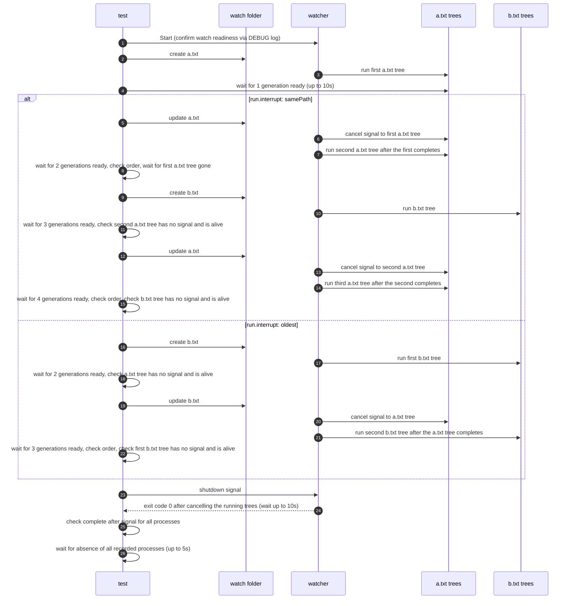
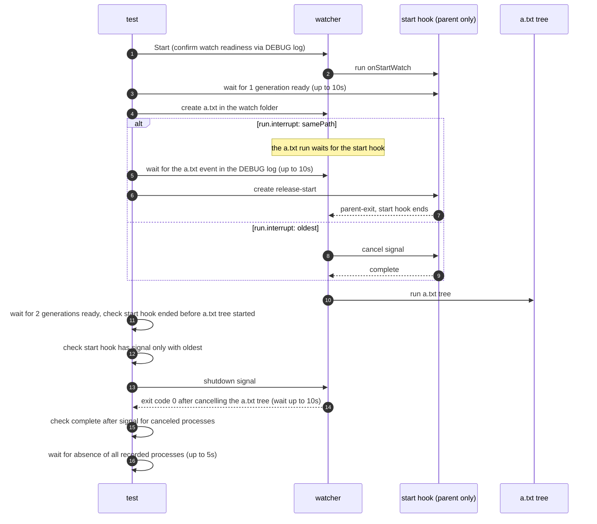

# `TestRunInterrupt`: runs that `run.interrupt` cancels with `run.concurrency: 2`

🇺🇸 English | 🇰🇷 [한국어](run-interrupt.ko.md)

- With `run.concurrency: 2`, change hooks and the start hook run real parent, child, and grandchild process trees, and new runs arrive while they run.
- Checks, for `run.interrupt: samePath` and `oldest`, which running tree each new run cancels as described in [Running hooks with run](../../../docs/guide/running.md#running-hooks-with-run), and that the new tree starts only after the canceled tree completes.

## What it checks and success criteria

- Each change hook tree records its file name with `--label`, so the test tells which path each generation runs for.
- After each new generation becomes ready, waiting up to 10 seconds, the test checks which generations the new run canceled:
  - A canceled generation records `complete` for its parent, child, and grandchild before the new generation records its first `start`, and its processes are gone within 5 seconds.
  - A generation that must not be canceled has no `signal` record, and its processes are alive. A new run starts only after the runs it canceled have ended, so this check after the new generation is ready shows that the new run did not cancel it.
- The watcher exits with exit code 0 within 10 seconds of receiving the shutdown signal. Every canceled process that recorded `ready` records `signal` and then `complete`, and every recorded process is gone within 5 seconds ([liveness check](../harness.md#process-liveness-and-forced-cleanup)).
  - In `onStartWatch/interrupt=samePath`, the start hook ends on its own and is not canceled, so it is left out of the graceful completion check.

## Configuration

- The target `onChange` is `hookrec --depth=2 --label={{.Name}}`. The record format and signal handling are described in [`hookrec` process trees and delayed hooks](../harness.md#hookrec-process-trees-and-delayed-hooks).
- Every subtest sets `run.concurrency: 2`, the per-subtest `run.interrupt`, and `watch.exclude: ['*.probe']`. No finish hook is configured.
- The `changes/*` subtests keep the default `hookBatch` and `watch.fileEvent`, so each file creation or update in a step makes one run for that file after a 100ms wait.
- The `onStartWatch/*` subtests also set `onStartWatch` to `hookrec --depth=0 --release-file=<run folder>/release-start`, which runs until that file appears or a cancel signal arrives.
  - They set `watch.fileEvent: C`, `hookBatch.waitMillisecond: 0`, and `hookBatch.deliver: each`, so creating a file makes one run as soon as the watcher receives the event.

## Subtests

| Subtest | Steps | What the new runs cancel |
|---|---|---|
| `changes/interrupt=samePath` | Create `a.txt`, update `a.txt`, create `b.txt`, update `a.txt` | Each update of `a.txt` cancels only the running `a.txt` tree, both when a slot is free and when both slots are taken. Creating `b.txt` cancels nothing. |
| `changes/interrupt=oldest` | Create `a.txt`, create `b.txt`, update `b.txt` | Creating `b.txt` cancels nothing because a slot is free. Updating `b.txt` cancels the `a.txt` tree, which started first, and leaves the running `b.txt` tree alone. |
| `onStartWatch/interrupt=samePath` | Create `a.txt` while the start hook runs, then create `release-start` | The `a.txt` run does not cancel the start hook and starts after the start hook records `parent-exit`. |
| `onStartWatch/interrupt=oldest` | Create `a.txt` while the start hook runs | The `a.txt` run cancels the start hook and starts after the start hook records `complete`. |

- No record shows that the `a.txt` run of `onStartWatch/interrupt=samePath` has been made, so the test creates `release-start` once the DEBUG log shows the `a.txt` event.
  - If the run were made only after the start hook ended, the test would pass without checking the wait.

## Sequence

The `changes/*` subtests:



The `onStartWatch/*` subtests:



- The test creates `a.txt` and `b.txt` as empty files without a write event, and an update writes content to the existing file.

## Running

Run these commands from the repository root, locally, in Linux Docker, and on the UTM Windows VM, in that order.

```sh
go test -count=1 -v -run '^TestRunInterrupt$' ./e2e/scenarios
go run ./e2e/linux -- -run '^TestRunInterrupt$'
make e2e-windows ARGS="-- -run '^TestRunInterrupt$'"
```

- To run a single subtest, specify each part of the subtest name separated by `/`, as in `-run '^TestRunInterrupt$/^changes$/^interrupt=samePath$'`.
- Run the UTM command after completing the prerequisites in [Running E2E on a UTM Windows VM](../windows-utm.md) and starting the VM with `make e2e-windows-up`.
- The commands that repeat the race scenarios together are in [Race and overload verification](../reliability.md#race-and-overload-verification).

## Related code

- `e2e/scenarios/process_test.go` contains `TestRunInterrupt`, `startLabeledChangeTrees`, which starts the watcher of the `changes/*` subtests, `labeledGenerations`, which checks the generations of a label, and `assertNotCanceled` and `assertEndedBeforeStart`, which check cancellation and order.
- `e2e/harness`: `NewScenario`, `Start`, `Hook`, `Write`, `Await`, `Log`, `Lines`, `GenerationsLabeled`, `AwaitReadyGenerations`, `ProcessRecords`, `AssertRunning`, `Stop`, `AssertGracefulCompletion`, `AwaitProcessesGone`. Where each function lives and what it does is in [Code locations by responsibility](../harness.md#code-locations-by-responsibility).
- `e2e/hookrec` implements the `--label` option.
