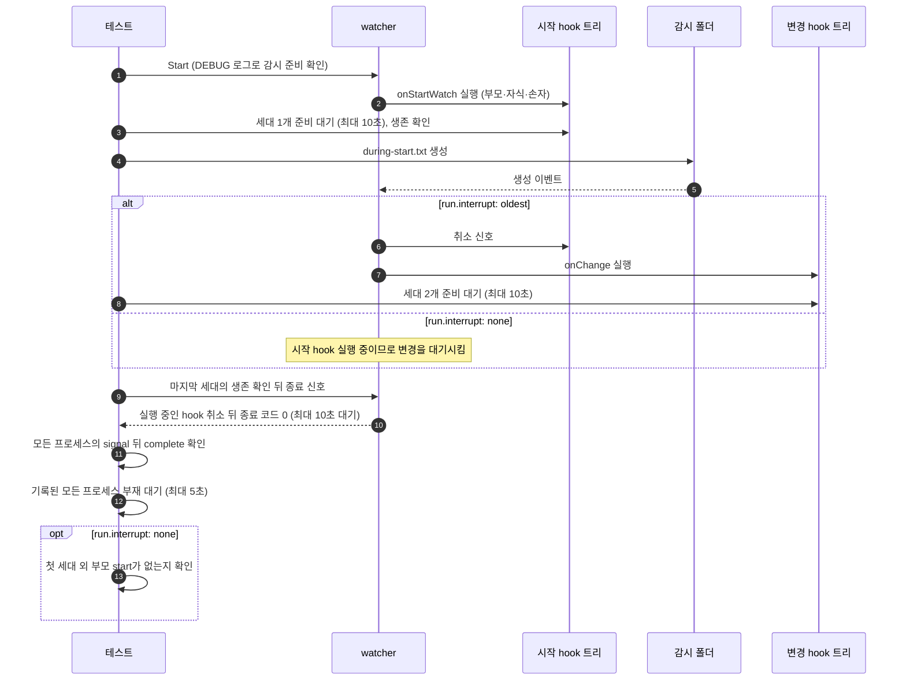

# `TestStartHookShutdownModes`: 실행 중인 시작 hook과 변경·종료의 경합

🇺🇸 [English](start-hook-shutdown-modes.md) | 🇰🇷 한국어

- 시작 hook이 실제 부모·자식·손자 프로세스 트리를 실행하는 동안 변경 이벤트와 종료 신호가 들어옵니다.
- 이때 `hookBatch.deliver`·`run.interrupt` 네 조합에서 시작 hook이 교체되거나 유지되고 종료 시 모든 프로세스가 정상 완료하는지 확인합니다.

## 확인 내용과 성공 조건

- 시작 hook의 세대가 준비되고, 그 프로세스가 살아 있습니다.
- `run.interrupt: oldest`이면 변경 이벤트가 시작 hook을 교체해 두 번째 세대가 준비됩니다.
- 종료 직전에 마지막으로 기록된 세대, 즉 실행 중인 세대의 프로세스가 살아 있습니다.
- watcher가 종료 신호를 받고 10초 안에 종료 코드 0으로 끝납니다. `ready`를 기록한 모든 프로세스는 `signal`을 기록한 뒤 `complete`를 기록하고, 기록된 모든 프로세스는 5초 안에 사라집니다. Windows에서는 기록된 PID를 처음 확인할 때 이미 `hookrec`이 아닌 프로그램이 쓰고 있으면 사라진 것으로 봅니다([생존 판정 방식](../harness.ko.md#책임별-코드-위치)).
- `run.interrupt: none`이면 첫 세대 외의 부모(깊이 2) `start` 기록이 없어야 합니다. 시작 hook은 종료 신호를 받기 전까지 끝나지 않고 종료는 대기 중인 변경을 버리므로, 변경 hook은 한 번도 실행되지 않아야 합니다.

## 설정

- 대상 `onStartWatch`와 `onChange`에 같은 `hookrec --depth=2` 명령을 설정합니다. 기록 형식과 신호 처리는 [`hookrec` 프로세스 트리와 지연 hook](../harness.ko.md#hookrec-프로세스-트리와-지연-hook)에 있습니다.
- 대상 옵션은 하위 테스트별 `hookBatch.deliver`·`run.interrupt`, `deliver: last`에서 10이고 `deliver: each`에서 0인 `hookBatch.waitMillisecond`, `watch.fileEvent: C`, `watch.exclude: ['*.probe']`입니다. 종료 hook은 설정하지 않습니다.

## 하위 테스트

| 하위 테스트 | 변경 이벤트 처리 | 추가 대기·확인 |
|---|---|---|
| `deliver=last/interrupt=none` | 10ms 기다린 뒤 마지막으로 바뀐 경로 실행, 시작 hook 유지 | 첫 세대 외 부모 `start` 없음 |
| `deliver=last/interrupt=oldest` | 10ms 기다린 뒤 마지막으로 바뀐 경로 실행, 시작 hook 취소 후 교체 | 세대 2개 준비 대기 |
| `deliver=each/interrupt=none` | 대기 없이 순차 실행, 시작 hook 유지 | 첫 세대 외 부모 `start` 없음 |
| `deliver=each/interrupt=oldest` | 대기 없이 실행, 시작 hook 취소 후 교체 | 세대 2개 준비 대기 |

## 진행 순서



- `during-start.txt`는 내용 없는 파일로 생성합니다.

## 실행

- 저장소 루트에서 실행합니다.

차례로 로컬, Linux Docker, UTM Windows VM에서 실행하는 명령입니다.

```sh
go test -count=1 -v -run '^TestStartHookShutdownModes$' ./e2e/scenarios
go run ./e2e/linux -- -run '^TestStartHookShutdownModes$'
make e2e-windows ARGS="-- -run '^TestStartHookShutdownModes$'"
```

- 하위 테스트 하나만 실행하려면 `-run '^TestStartHookShutdownModes$/^deliver=each$/^interrupt=none$'`처럼 하위 테스트 이름의 각 부분을 `/`로 나눠 지정합니다.
- UTM 명령은 [UTM Windows VM에서 E2E 실행](../windows-utm.ko.md)의 사전 준비를 마치고 `make e2e-windows-up`으로 VM을 켠 뒤 실행합니다.
- Windows 호스트에서 직접 실행하는 방법은 [Windows 실행 명령](../windows.ko.md#실행-명령)에 있습니다.

## 관련 코드

- `e2e/scenarios/process_test.go`: `TestStartHookShutdownModes`
- `e2e/harness`: `Start`, `Hook`, `AwaitReadyGenerations`, `AssertRunning`, `ProcessRecords`, `Stop`, `AssertGracefulCompletion`, `AwaitProcessesGone`. 각 함수의 위치와 책임은 [책임별 코드 위치](../harness.ko.md#책임별-코드-위치)에 있습니다.
