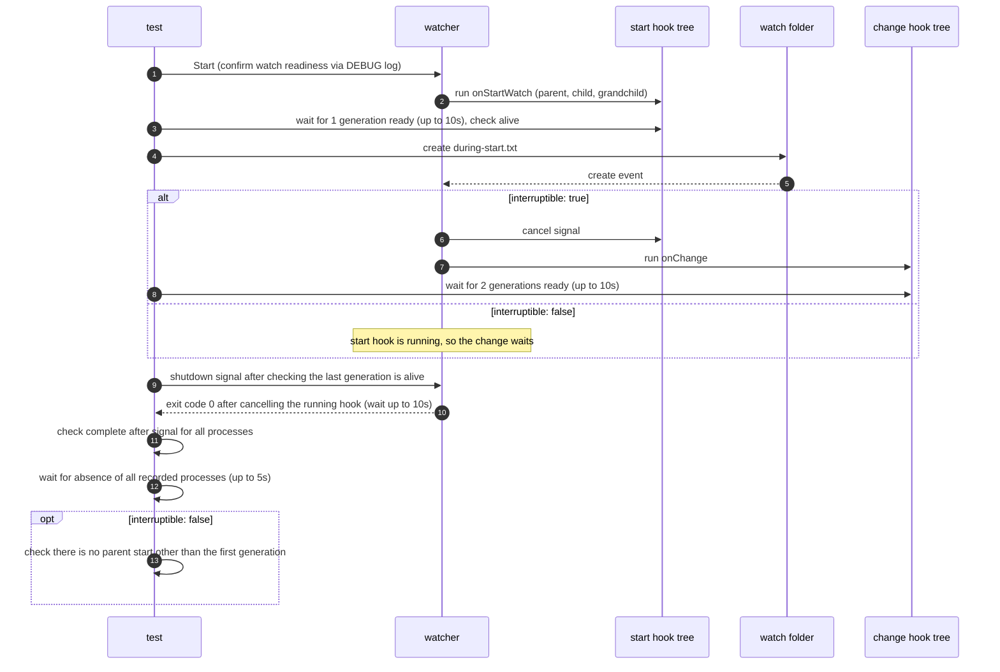

# `TestStartHookShutdownModes`: a running start hook racing with changes and shutdown

🇺🇸 English | 🇰🇷 [한국어](start-hook-shutdown-modes.ko.md)

While the start hook runs a real parent, child, and grandchild process tree, a change event and a shutdown signal arrive. Checks, in the four `noWait`·`interruptible` combinations, that the start hook is replaced or kept, and that all processes complete gracefully on shutdown.

## What it checks and success criteria

- The start hook's generation becomes ready, and its processes are alive.
- With `interruptible: true`, the change event replaces the start hook and a second generation becomes ready.
- Right before shutdown, the processes of the last recorded generation, that is the running generation, are alive.
- The watcher exits with exit code 0 within 10 seconds of receiving the shutdown signal. Every process that recorded `ready` records `signal` and then `complete`, and every recorded process is gone within 5 seconds. On Windows, a recorded PID that a program other than `hookrec` already holds when it is first checked counts as gone ([how liveness is judged](../harness.md#code-locations-by-responsibility)).
- With `interruptible: false`, there must be no parent (depth 2) `start` record other than the first generation. The start hook does not finish until it receives the shutdown signal, and shutdown discards pending changes, so the change hook must never run.

## Configuration

- The target `onStartWatch` and `onChange` are set to the same `hookrec --depth=2` command. The record format and signal handling are described in [`hookrec` process trees and delayed hooks](../harness.md#hookrec-process-trees-and-delayed-hooks).
- The target options are the per-subtest `noWait` and `interruptible`, plus `waitMillisecond: 10`, `watchEvent: C`, and `exclude: ['*.probe']`. No finish hook is configured.

## Subtests

| Subtest | Change event handling | Extra waits and checks |
|---|---|---|
| `noWait=false/interruptible=false` | 10ms debounce, start hook kept | No parent `start` other than the first generation |
| `noWait=false/interruptible=true` | 10ms debounce, start hook cancelled and replaced | Wait for 2 generations ready |
| `noWait=true/interruptible=false` | Sequential runs without waiting, start hook kept | No parent `start` other than the first generation |
| `noWait=true/interruptible=true` | Runs without waiting, start hook cancelled and replaced | Wait for 2 generations ready |

## Sequence



`during-start.txt` is created as an empty file.

## Running

Run from the repository root. The commands run locally, in Linux Docker, and on the UTM Windows VM, in that order.

```sh
go test -count=1 -v -run '^TestStartHookShutdownModes$' ./e2e/scenarios
go run ./e2e/linux -- -run '^TestStartHookShutdownModes$'
make e2e-windows ARGS="-- -run '^TestStartHookShutdownModes$'"
```

To run a single subtest, specify each part of the subtest name separated by `/`, as in `-run '^TestStartHookShutdownModes$/^noWait=true$/^interruptible=false$'`. Run the UTM command after completing the prerequisites in [Running E2E on a UTM Windows VM](../windows-utm.md) and starting the VM with `make e2e-windows-up`. To run directly on a Windows host, see [Windows run commands](../windows.md#run-commands).

## Related code

- `e2e/scenarios/process_test.go`: `TestStartHookShutdownModes`
- `e2e/harness`: `Start`, `Hook`, `AwaitReadyGenerations`, `AssertRunning`, `ProcessRecords`, `Stop`, `AssertGracefulCompletion`, `AwaitProcessesGone`. Where each function lives and what it does is in [Code locations by responsibility](../harness.md#code-locations-by-responsibility).
