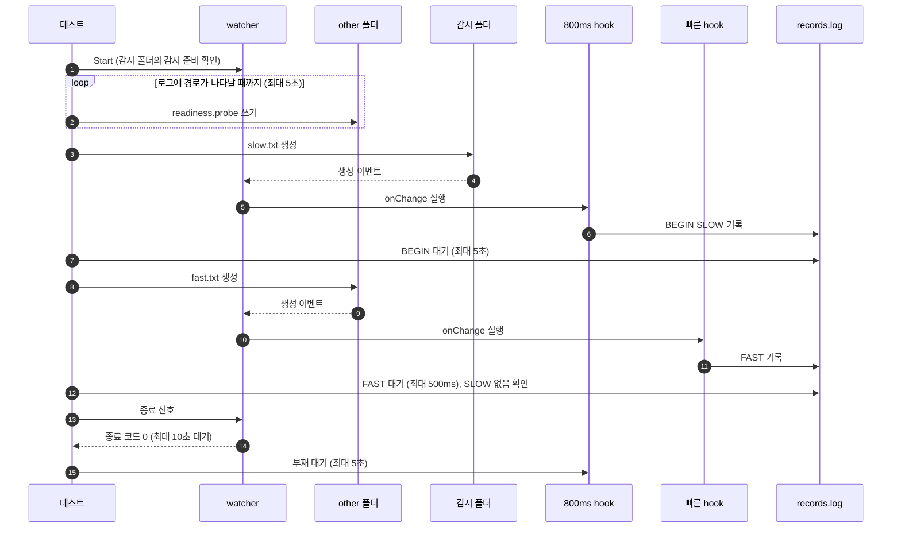

# `TestTargetsRunIndependently`: 감시 대상 사이의 독립 실행

🇺🇸 [English](targets-run-independently.md) | 🇰🇷 한국어

한 감시 대상의 hook이 800ms 동안 실행되는 동안, 다른 감시 대상의 hook이 그 완료를 기다리지 않고 바로 실행되는지 확인합니다.

## 확인 내용과 성공 조건

- 느린 대상의 hook이 `BEGIN`을 기록한 뒤 다른 대상에 파일을 만들면, 다른 대상의 `FAST` 기록이 500ms 안에 나타납니다.
- `FAST`가 나타난 시점에 `SLOW` 기록은 아직 없어야 합니다. `SLOW`가 먼저 있으면 빠른 대상이 느린 대상을 기다린 것으로 보고 실패합니다.
- watcher가 종료 신호를 받고 10초 안에 종료 코드 0으로 끝나며, 느린 hook 프로세스는 5초 안에 사라집니다.

## 설정

| 대상 | 경로 | `onChange` |
|---|---|---|
| 느린 대상 | 감시 폴더 | `hookrec --delay=800ms --line=SLOW` |
| 빠른 대상 | 실행 폴더의 `other` | `hookrec --line=FAST` |

두 대상 모두 `noWait: true`, `watchEvent: C`, `excludeSuffix: [.probe]`입니다.

## 진행 순서



`Start`는 감시 폴더의 `readiness.probe`로만 감시 준비를 확인합니다. 그래서 테스트는 `other/readiness.probe`를 반복해 쓰고, DEBUG 로그에 그 경로가 따옴표로 감싼 형태로 나타날 때 두 번째 대상이 준비된 것으로 판정합니다.

## 실행

저장소 루트에서 실행합니다. 차례로 로컬, Linux Docker, UTM Windows VM에서 실행하는 명령입니다.

```sh
go test -count=1 -v -run '^TestTargetsRunIndependently$' ./e2e/scenarios
go run ./e2e/linux -- -run '^TestTargetsRunIndependently$'
make e2e-windows ARGS="-- -run '^TestTargetsRunIndependently$'"
```

UTM 명령은 [UTM Windows VM에서 E2E 실행](../windows-utm.ko.md)의 사전 준비를 마치고 `make e2e-windows-up`으로 VM을 켠 뒤 실행합니다. 경합 시나리오를 함께 반복하는 명령은 [경합과 과부하 검증](../reliability.ko.md#경합과-과부하-검증)에 있습니다.

## 관련 코드

- `e2e/scenarios/reliability_test.go`: `TestTargetsRunIndependently`
- `e2e/harness`: `Start`, `Hook`, `Await`, `DelayedHookBegun`, `AwaitLine`, `CountRecord`, `Stop`, `AwaitDelayedHooksGone`. 각 함수의 위치와 책임은 [책임별 코드 위치](../harness.ko.md#책임별-코드-위치)에 있습니다.
