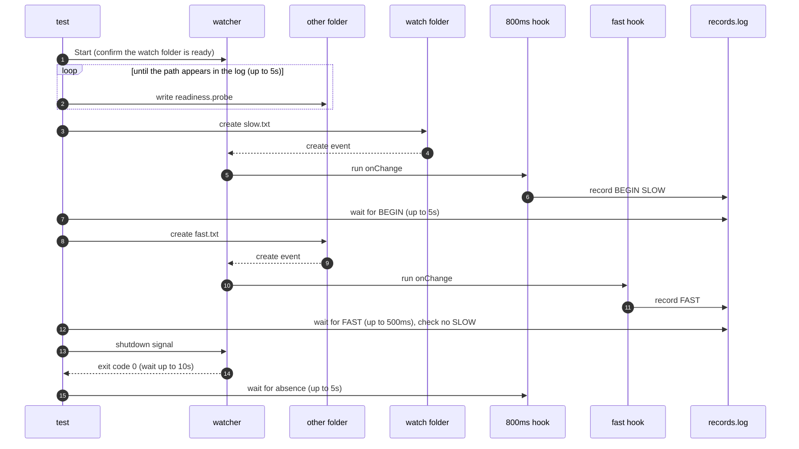

# `TestTargetsRunIndependently`: independent runs across watch targets

🇺🇸 English | 🇰🇷 [한국어](targets-run-independently.ko.md)

- While a hook of one watch target runs for 800ms, checks that a hook of another watch target runs right away without waiting for it to finish.

## What it checks and success criteria

- After the slow target's hook records `BEGIN`, creating a file in the other target makes the other target's `FAST` record appear within 500ms.
- When `FAST` appears, there must be no `SLOW` record yet. If `SLOW` is already there, the fast target is considered to have waited for the slow target, and the test fails.
- The watcher exits with exit code 0 within 10 seconds of receiving the shutdown signal, and the slow hook process is gone within 5 seconds. On Windows, a recorded PID that a program other than `hookrec` already holds when it is first checked counts as gone ([how liveness is judged](../harness.md#code-locations-by-responsibility)).

## Configuration

| Target | Path | `onChange` |
|---|---|---|
| Slow target | Watch folder | `hookrec --delay=800ms --line=SLOW` |
| Fast target | `other` in the run folder | `hookrec --line=FAST` |

- Both targets use `noWait: true`, `watch.fileEvent: C`, and `watch.exclude: ['*.probe']`.

## Sequence



- `Start` confirms watch readiness only through `readiness.probe` in the watch folder.
- The test therefore writes `other/readiness.probe` repeatedly and judges the second target ready when that path appears in quotes in the DEBUG log.

## Running

- Run from the repository root.

The commands run locally, in Linux Docker, and on the UTM Windows VM, in that order.

```sh
go test -count=1 -v -run '^TestTargetsRunIndependently$' ./e2e/scenarios
go run ./e2e/linux -- -run '^TestTargetsRunIndependently$'
make e2e-windows ARGS="-- -run '^TestTargetsRunIndependently$'"
```

- Run the UTM command after completing the prerequisites in [Running E2E on a UTM Windows VM](../windows-utm.md) and starting the VM with `make e2e-windows-up`.
- The commands that repeat the race scenarios together are in [Race and overload verification](../reliability.md#race-and-overload-verification).

## Related code

- `e2e/scenarios/reliability_test.go`: `TestTargetsRunIndependently`
- `e2e/harness`: `Start`, `Hook`, `Await`, `DelayedHookBegun`, `AwaitLine`, `CountRecord`, `Stop`, `AwaitDelayedHooksGone`. Where each function lives and what it does is in [Code locations by responsibility](../harness.md#code-locations-by-responsibility).
