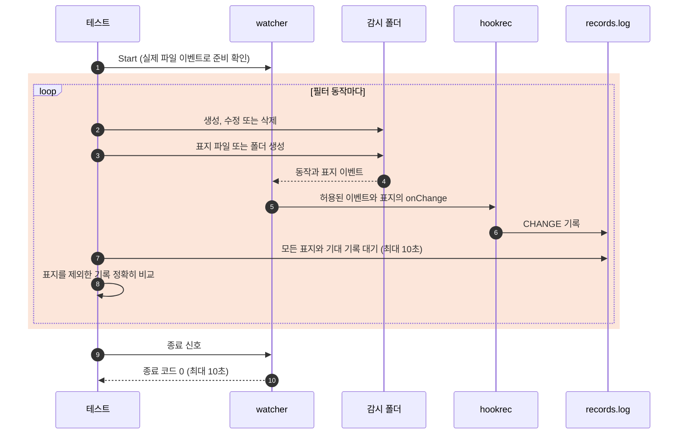

# `TestWatchOptions`: 감시 필터, 기본 제외와 링크인 감시 대상

🇺🇸 [English](watch-options.md) | 🇰🇷 한국어

- [설정](../../../docs/guide/configuration.ko.md#configyml), [폴더 이벤트](../../../docs/guide/events.ko.md#폴더-이벤트), [기본 제외 규칙](../../../docs/guide/events.ko.md#기본-제외-규칙), [exclude로 경로 제외하기](../../../docs/guide/events.ko.md#exclude로-경로-제외하기)에 적힌 감시 옵션을 실제 watcher, 설정 파일과 셸을 거쳐 확인합니다.
- [실행 명령에서 쓸 수 있는 변수](../../../docs/guide/configuration.ko.md#실행-명령에서-쓸-수-있는-변수)에 따라 폴더 링크인 `path`가 링크를 푼 폴더를 감시하고, 여덟 이벤트 변수에 링크를 푼 경로를 전달하는지 확인합니다.

## 확인 내용과 성공 조건

- 필터 하위 테스트의 기록은 `<Event>,<IsDir>,<감시 폴더 기준 경로>`입니다. 각 동작 뒤 표지를 제외한 기록이 기대 목록과 순서까지 정확히 일치해야 합니다.
- 아래 동작은 폴더와 내용을 함께 만들거나 `drop.txt` 다음에 `keep.txt`를 만든다고 적힌 경우를 제외하면 각각 별도 단계입니다.
- 기록이 빠지거나 더 있거나 순서가 다르면 실패합니다. 모든 watcher는 종료 신호를 받고 10초 안에 종료 코드 0으로 끝나야 합니다.

| 하위 테스트 | 동작과 기대 기록 |
|---|---|
| `subDir false` | 감시 대상 바로 아래 `a.txt` 생성·수정·삭제는 각각 `C,false,a.txt`, `U,false,a.txt`, `D,false,a.txt`입니다. 기존 하위 폴더의 `sub/b.txt`에 같은 동작을 하면 기록이 없습니다. `new` 생성은 `C,true,new`이고, 그 뒤 `new/c.txt` 생성은 기록이 없습니다. |
| `exclude the dist folder` | `dist/**`에서 기존 `dist` 안의 `dist/a.txt` 생성, `dist` 삭제, `dist`와 `b.txt` 동시 생성, 그 뒤 `dist/c.txt` 생성은 폴더 이벤트까지 모두 기록이 없습니다. |
| `exclude entries of dist except keep.txt` | `dist/*`와 `!dist/keep.txt`에서 `dist` 생성은 `C,true,dist`입니다. 그 안에 `drop.txt` 다음 `keep.txt`를 만들면 `C,false,dist/keep.txt`만 있습니다. `dist` 삭제는 `D,true,dist`입니다. |
| `exclude log files except important.log` | `**/*.log`와 `!important.log`에서 `build.log`, `logs/app.log`, `logs/important.log` 생성은 기록이 없습니다. 감시 대상 바로 아래 `important.log` 생성은 `C,false,important.log`입니다. |
| `fileEvent none` | `a.txt` 생성·수정·삭제는 기록이 없습니다. `d` 생성·삭제는 각각 `C,true,d`, `D,true,d`입니다. |
| `dirEvent none` | `d` 생성은 기록이 없습니다. 표지를 받은 뒤 `d/a.txt`를 만들면 `C,false,d/a.txt`입니다. `n`과 `n/a.txt`를 함께 만들면 흡수된 파일 이벤트까지 기록이 없습니다. 파일을 담은 `d` 삭제도 흡수된 파일 삭제까지 기록이 없습니다. |
| `default exclusion` | `.env` 생성·수정·삭제, `.git/index` 생성, `.idea`와 `workspace.xml` 동시 생성, `_draft.txt` 생성은 모두 기록이 없습니다. |
| `path named with a leading dot` | `.watch` 자체를 감시하고 `a.txt`를 만들면 `C,false,a.txt`입니다. |
| `path is a folder link` | 감시 폴더를 가리키는 `link`를 감시합니다. 링크를 푼 폴더에 `a.txt`를 생성·수정·삭제하면 `C`, `U`, `D` 기록이 각각 정확히 하나이고, 여덟 변수가 링크를 푼 기대값과 일치해야 합니다. |

- 링크 하위 테스트의 `Path`와 `AbsPath`는 링크를 모두 푼 파일의 절대 경로이고, `ParentPath`와 `ParentAbsPath`는 그 부모 폴더여야 합니다. `Name`, `ExtName`, `Event`, `IsDir`는 각각 `a.txt`, `.txt`, 현재 이벤트, `false`여야 합니다.
- 심볼릭 링크 생성에 실패하면 링크 하위 테스트만 SKIP합니다. 세 OS의 인수 검증이 완료되려면 Windows를 포함해 `--- SKIP` 없이 `--- PASS`여야 합니다.

## 설정

- 하위 테스트마다 watcher를 따로 시작합니다. 필터 하위 테스트는 `CHANGE:{{.Event}},{{.IsDir}},{{.Path}}`를 기록하고, 링크 하위 테스트는 `TestGoldenPath`와 같은 순서로 여덟 변수를 기록합니다.
- 모든 대상에 `watch.exclude: ['*.probe', ...]`, `hookBatch.waitMillisecond: 0`, `hookBatch.deliver: each`를 둡니다. 시험하는 옵션 외의 감시와 폴더 수집 옵션은 기본값을 유지합니다.
- `Start` 전에 `subDir false`의 `sub`, `dist/**`의 `old.txt`가 든 `dist`, log 제외의 `logs`, 기본 제외의 `HEAD`가 든 `.git`을 준비합니다.
- 수정은 기존 파일을 truncate 없이 열고 `x`를 한 번 씁니다. Windows의 `deliver: each`에서 `U` 기록 두 개를 만든 `os.WriteFile`의 truncate와 쓰기를 함께 하지 않습니다.

## 진행 순서



- hook 미실행은 고정 sleep 대신 뒤이어 만든 표지 이벤트로 판정합니다. 단계마다 감시 대상에 표지를 만들고, 감시 중인 하위 폴더의 파일 이벤트를 확인할 때는 그 하위 폴더에도 만듭니다. Windows는 폴더마다 이벤트를 따로 알립니다.
- `fileEvent: none`의 표지는 폴더입니다. 다른 필터 하위 테스트는 `O_CREATE|O_EXCL|O_RDONLY`로 빈 파일을 만들어 표지에서 `C`만 발생시킵니다.
- 제외되거나 감시하지 않는 폴더 안에서는 표지를 받을 수 없습니다. 이 단계는 감시 대상의 표지로 경계를 확인하며, `dist/*` 단계에서는 같은 폴더의 `keep.txt`도 앞선 `drop.txt`의 경계가 됩니다.
- 링크 하위 테스트는 각 동작의 완전한 변수 기록을 받은 뒤 다음 동작을 하고, 종료 후 기록 목록 전체를 비교합니다.

## 실행

- 저장소 루트에서 실행합니다.

차례로 로컬, Linux Docker, UTM Windows VM에서 실행하는 명령입니다.

```sh
go test -count=1 -v -run '^Test(WatchOptions|FolderEvents)$' ./e2e/scenarios
go run ./e2e/linux -- -run '^Test(WatchOptions|FolderEvents)$'
make e2e-windows ARGS="-- -run '^Test(WatchOptions|FolderEvents)$'"
```

- 두 시나리오가 표지 판독기를 함께 쓰므로 `TestFolderEvents`도 실행합니다.
- UTM 명령은 [UTM Windows VM에서 E2E 실행](../windows-utm.ko.md)의 사전 준비를 마치고 `make e2e-windows-up`으로 VM을 켠 뒤 실행합니다.
- Windows 호스트에서 직접 실행하는 방법은 [Windows 실행 명령](../windows.ko.md#실행-명령)에 있습니다.

## 관련 코드

- `e2e/scenarios/watch_options_test.go`: `TestWatchOptions`, 파일시스템 동작, 점으로 시작하는 감시 대상과 링크인 감시 대상입니다.
- `e2e/scenarios/helpers_test.go`: `TestFolderEvents`와 공유하는 `changeSteps`, `relativeChange`, `mkdirAll`, `createEmpty`입니다.
- `e2e/scenarios/helpers_test.go`: `changeValues`로 링크 대상의 여덟 변수 기대 기록을 만듭니다.
- `e2e/harness`: `Start`, `Hook`, `Await`, `AwaitLine`, `Lines`, `Stop`입니다. 각 함수의 위치와 책임은 [책임별 코드 위치](../harness.ko.md#책임별-코드-위치)에 있습니다.
