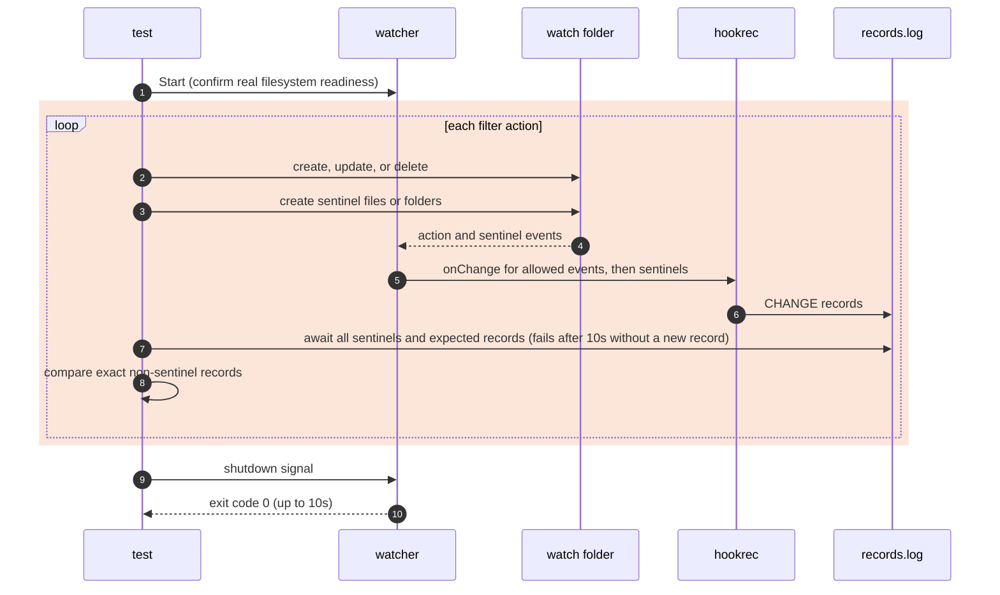

# `TestWatchOptions`: watch filters and a linked target

🇺🇸 English | 🇰🇷 [한국어](watch-options.ko.md)

- Checks the watch options in [Configuration](../../../docs/guide/configuration.md#configyml), [Folder events](../../../docs/guide/events.md#folder-events), and [Excluding paths with exclude](../../../docs/guide/events.md#excluding-paths-with-exclude) through the actual watcher, configuration file, and shell.
- Checks that a folder link used as `path` watches the resolved folder and supplies all eight event variables using that resolved path, as specified in [Variables in commands](../../../docs/guide/configuration.md#variables-in-commands).

## What it checks and success criteria

- For filter subtests, each record is `<Event>,<IsDir>,<path relative to the watched folder>`. After each action, the records other than sentinels must match the expected records in the [Subtests](#subtests) table exactly, in order.
- An absent record, an extra record, or a different order fails the test.
- In the link subtest, `Path` and `AbsPath` must equal the fully resolved absolute file path; `ParentPath` and `ParentAbsPath` must equal its parent folder. `Name`, `ExtName`, `Event`, and `IsDir` must equal `a.txt`, `.txt`, the current event, and `false`.
- Every watcher must exit with code 0 within 10 seconds of its shutdown signal.
- If the symbolic link cannot be created, only the link subtest skips. A complete three-OS acceptance run requires `--- PASS` and no `--- SKIP`, including on Windows.

### Options checked by runner tests

The watch options below are checked not by this scenario but by runner tests in `internal/app/service/runner_watch_target_test.go`.

| Option | Test |
|---|---|
| `subDir: false` | `TestFolderEventWithoutSubDir`, `TestRecordWithoutSubDirHoldsOnlyDirectChildren` |
| `dirEvent: none` | `TestNoFolderEventStillAbsorbsFileEvents` |
| Default exclusion and a target whose name starts with `.` | `TestDefaultExcludeChecksCreatedFileName`, `TestDefaultExcludeChecksModifiedAndRemovedName` |
| The combination of `**/*.log` and `!important.log` | `TestExcludePatternDropsFileEvents` |

## Configuration

- Each subtest starts a separate watcher. Filter subtests record `CHANGE:{{.Event}},{{.IsDir}},{{.Path}}`; the link subtest records all eight variables in the same order as `TestGoldenPath`.
- Every target uses `watch.exclude: ['*.probe', ...]`, `hookBatch.waitMillisecond: 0`, and `hookBatch.deliver: each`. Apart from the option under test, watch and folder collection options keep their defaults.
- Before `Start`, `dist` with `old.txt` is prepared for `exclude the dist folder`.
- An update opens the existing file without truncation and writes `x` once, because the truncation and write of `os.WriteFile` make two `U` records on Windows with `deliver: each`.

## Subtests

Each action of the filter subtests is a separate step unless the row says it creates a folder together with its contents, or creates `drop.txt` followed by `keep.txt`.

| Subtest | Actions and expected records |
|---|---|
| `exclude the dist folder` | With `dist/**`, create `dist/a.txt` in an existing `dist`, delete `dist`, recreate `dist` with `b.txt`, and then create `dist/c.txt`: none in every step, including the folder events. |
| `exclude entries of dist except keep.txt` | With `dist/*` and `!dist/keep.txt`, create `dist`: `C,true,dist`; create `drop.txt` followed by `keep.txt` inside it: only `C,false,dist/keep.txt`; delete `dist`: `D,true,dist`. |
| `fileEvent none` | Create, update, and delete `a.txt`: none. Create and delete `d`: `C,true,d` and `D,true,d`, respectively. |
| `path is a folder link` | Watch `link` in the run folder, which points to the watch folder. Create, update, and delete `a.txt` in the resolved folder: exactly one record for each of `C`, `U`, and `D`, with all eight variables equal to their expected resolved values. |

## Sequence



- Negative assertions use a later sentinel event, not a fixed sleep. Each step creates a sentinel directly in the target.
- With `fileEvent: none`, sentinels are folders. Other filter subtests use empty files created with `O_CREATE|O_EXCL|O_RDONLY` so that a sentinel produces only `C`.
- A sentinel created in an excluded location never reaches the hook, so the target sentinel also bounds actions inside an excluded folder. In the `dist/*` case, `keep.txt` also bounds the earlier `drop.txt` in the same folder.
- The link subtest waits for each complete expected variable record before performing the next action, then compares the entire record list after shutdown.

## Running

Run these commands from the repository root, locally, in Linux Docker, and on the UTM Windows VM, in that order.

```sh
go test -count=1 -v -run '^Test(WatchOptions|FolderEvents)$' ./e2e/scenarios
go run ./e2e/linux -- -run '^Test(WatchOptions|FolderEvents)$'
make e2e-windows ARGS="-- -run '^Test(WatchOptions|FolderEvents)$'"
```

- Run the UTM command after completing the prerequisites in [Running E2E on a UTM Windows VM](../windows-utm.md) and starting the VM with `make e2e-windows-up`.
- The commands also run `TestFolderEvents`, because both scenarios share `changeSteps`, which reads the sentinels.
- To run a single subtest, replace the spaces in its name with `_`, as in `-run '^TestWatchOptions$/^fileEvent_none$'`.

## Related code

- `e2e/scenarios/watch_options_test.go` contains `TestWatchOptions`, the filesystem actions `touch`, `mkdir`, `update`, and `remove`, and `linkedTarget`, which makes the linked target.
- `e2e/scenarios/helpers_test.go` contains `changeSteps`, `relativeChange`, `mkdirAll`, and `createEmpty`, shared with `TestFolderEvents`, and `changeValues`, which builds the expected records of the link subtest.
- `e2e/harness`: `NewScenario`, `Start`, `Hook`, `AwaitProgress`, `AwaitLine`, `Lines`, `Stop`. Where each function lives and what it does is in [Code locations by responsibility](../harness.md#code-locations-by-responsibility).
