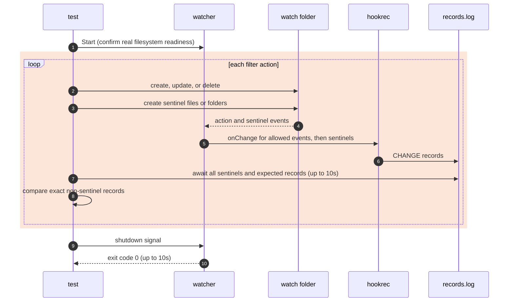

# `TestWatchOptions`: watch filters, default exclusion, and a linked target

🇺🇸 English | 🇰🇷 [한국어](watch-options.ko.md)

- Checks the watch options in [Configuration](../../../docs/guide/configuration.md#configyml), [Folder events](../../../docs/guide/events.md#folder-events), [Default exclusion](../../../docs/guide/events.md#default-exclusion), and [Excluding paths with exclude](../../../docs/guide/events.md#excluding-paths-with-exclude) through the actual watcher, configuration file, and shell.
- Checks that a folder link used as `path` watches the resolved folder and supplies all eight event variables using that resolved path, as specified in [Variables in commands](../../../docs/guide/configuration.md#variables-in-commands).

## What it checks and success criteria

- For filter subtests, each record is `<Event>,<IsDir>,<path relative to the watched folder>`. After each action, the records other than sentinels must match the expected list exactly, in order.
- Each action below is a separate step unless the row says it creates a folder together with its contents, or creates `drop.txt` followed by `keep.txt`.
- An absent record, an extra record, or a different order fails the test. Every watcher must exit with code 0 within 10 seconds of its shutdown signal.

| Subtest | Actions and expected records |
|---|---|
| `subDir false` | Create, update, and delete `a.txt` in the target: `C,false,a.txt`, `U,false,a.txt`, and `D,false,a.txt`, respectively. The same actions on `sub/b.txt` in an existing subfolder produce none. Create `new`: `C,true,new`; then create `new/c.txt`: none. |
| `exclude the dist folder` | With `dist/**`, create `dist/a.txt` in an existing `dist`, delete `dist`, recreate `dist` with `b.txt`, and then create `dist/c.txt`: none in every step, including the folder events. |
| `exclude entries of dist except keep.txt` | With `dist/*` and `!dist/keep.txt`, create `dist`: `C,true,dist`; create `drop.txt` followed by `keep.txt` inside it: only `C,false,dist/keep.txt`; delete `dist`: `D,true,dist`. |
| `exclude log files except important.log` | With `**/*.log` and `!important.log`, create `build.log`, `logs/app.log`, and `logs/important.log`: none. Create `important.log` directly in the target: `C,false,important.log`. |
| `fileEvent none` | Create, update, and delete `a.txt`: none. Create and delete `d`: `C,true,d` and `D,true,d`, respectively. |
| `dirEvent none` | Create `d`: none. After the sentinel, create `d/a.txt`: `C,false,d/a.txt`. Create `n` together with `n/a.txt`: none, including the absorbed file event. Delete `d` with its file: none, including the absorbed file deletion. |
| `default exclusion` | Create, update, and delete `.env`; create `.git/index`; create `.idea` together with `workspace.xml`; create `_draft.txt`: none. |
| `path named with a leading dot` | Watch `.watch` itself and create `a.txt`: `C,false,a.txt`. |
| `path is a folder link` | Watch `link` pointing to the watch folder. Create, update, and delete `a.txt` in the resolved folder: exactly one record for each of `C`, `U`, and `D`, with all eight variables equal to their expected resolved values. |

- In the link subtest, `Path` and `AbsPath` must equal the fully resolved absolute file path; `ParentPath` and `ParentAbsPath` must equal its parent folder. `Name`, `ExtName`, `Event`, and `IsDir` must equal `a.txt`, `.txt`, the current event, and `false`.
- If creating the symbolic link fails, only the link subtest skips. A complete three-OS acceptance run requires `--- PASS` and no `--- SKIP`, including on Windows.

## Configuration

- Each subtest starts a separate watcher. Filter subtests record `CHANGE:{{.Event}},{{.IsDir}},{{.Path}}`; the link subtest records all eight variables in the same order as `TestGoldenPath`.
- Every target uses `watch.exclude: ['*.probe', ...]`, `hookBatch.waitMillisecond: 0`, and `hookBatch.deliver: each`. Apart from the option under test, watch and folder collection options keep their defaults.
- Existing folders are prepared before `Start`: `sub` for `subDir false`, `dist` with `old.txt` for `dist/**`, `logs` for log exclusion, and `.git` with `HEAD` for default exclusion.
- An update opens the existing file without truncation and writes `x` once. It does not combine the truncation and write of `os.WriteFile`, which produced two `U` records on Windows with `deliver: each`.

## Sequence



- Negative assertions use a later sentinel event, not a fixed sleep. Each step creates a sentinel in the target and, for watched subfolder file events, in that subfolder too, because Windows reports folders separately.
- With `fileEvent: none`, sentinels are folders. Other filter subtests use empty files created with `O_CREATE|O_EXCL|O_RDONLY` so that a sentinel produces only `C`.
- Sentinels cannot be observed inside excluded or unwatched folders. The target sentinel bounds these steps; in the `dist/*` case, `keep.txt` also bounds the earlier `drop.txt` in the same folder.
- The link subtest waits for each complete expected variable record before performing the next action, then compares the entire record list after shutdown.

## Running

- Run from the repository root.

The commands run locally, in Linux Docker, and on the UTM Windows VM, in that order.

```sh
go test -count=1 -v -run '^Test(WatchOptions|FolderEvents)$' ./e2e/scenarios
go run ./e2e/linux -- -run '^Test(WatchOptions|FolderEvents)$'
make e2e-windows ARGS="-- -run '^Test(WatchOptions|FolderEvents)$'"
```

- `TestFolderEvents` is included because both scenarios share the sentinel reader.
- Run the UTM command after completing the prerequisites in [Running E2E on a UTM Windows VM](../windows-utm.md) and starting the VM with `make e2e-windows-up`.
- To run directly on a Windows host, see [Windows run commands](../windows.md#run-commands).

## Related code

- `e2e/scenarios/watch_options_test.go`: `TestWatchOptions`, filesystem actions, dot-named target, and linked target.
- `e2e/scenarios/helpers_test.go`: `changeSteps`, `relativeChange`, `mkdirAll`, and `createEmpty` shared with `TestFolderEvents`.
- `e2e/scenarios/golden_path_test.go`: `changeValues` builds the expected eight-variable record for the linked target.
- `e2e/harness`: `Start`, `Hook`, `Await`, `AwaitLine`, `Lines`, and `Stop`. Their locations and responsibilities are in [Code locations by responsibility](../harness.md#code-locations-by-responsibility).
