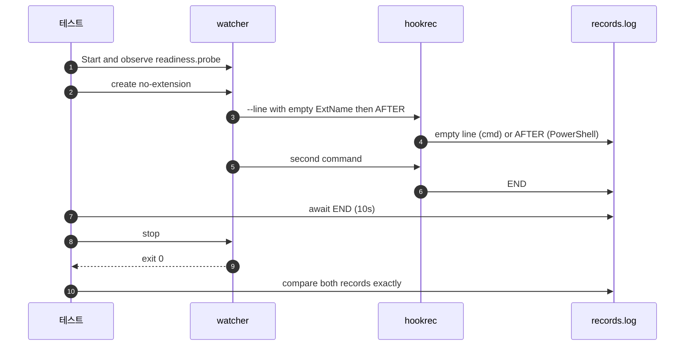

# `TestWindowsShellEmptyArgument`: cmd의 빈 인자와 PowerShell의 인자 생략

🇺🇸 [English](windows-shell-empty-argument.md) | 🇰🇷 한국어

- 확장자 없는 파일의 `{{.ExtName}}`을 따옴표 밖에 펼칠 때 문서에 적힌 셸별 차이를 확인합니다.

## 확인 내용과 성공 조건

- 첫 hook은 `hookrec --line {{.ExtName}} AFTER`를 실행하고, 다음 hook은 `END`를 기록해 완료 경계를 제공합니다.
- `cmd`는 빈 인자 하나를 전달하므로 `--line`이 그 인자를 읽고, 기록은 빈 줄과 `END` 두 줄이어야 합니다.
- Windows PowerShell은 빈 인자를 생략하므로 `--line`이 `AFTER`를 읽고, [실행 명령에서 쓸 수 있는 변수](../../../docs/guide/configuration.ko.md#실행-명령에서-쓸-수-있는-변수)대로 기록은 `AFTER`, `END`여야 합니다.
- `END`는 10초 안에 기록되고 종료 신호 뒤 종료 코드 0으로 끝나야 합니다.

## 설정

- 두 하위 테스트 모두 생성 이벤트를 감시하고 `*.probe`를 제외하며, 실제 감시 준비 뒤 `no-extension` 파일을 만듭니다.
- PowerShell 명령은 호출 연산자 `&`를 씁니다.

## 하위 테스트

- `cmd`는 빈 인자 유지를 확인합니다.
- `powershell`은 빈 인자 생략을 확인합니다.

## 진행 순서



## 실행

- 저장소 루트에서 실행합니다.
- Windows에서만 지원하는 셸이므로 Windows 전용 build tag를 쓰며, macOS와 Linux에서는 실행 대상이 아닙니다.

```sh
make e2e-windows ARGS="-- -run '^TestWindowsShellEmptyArgument$'"
```

- UTM 명령은 [UTM Windows VM에서 E2E 실행](../windows-utm.ko.md)의 사전 준비를 마치고 VM을 켠 뒤 실행합니다.

## 관련 코드

- `e2e/scenarios/shell_windows_test.go`: `TestWindowsShellEmptyArgument`
- `e2e/harness`: `NewScenario`, `Hook`, `Start`, `Write`, `AwaitLine`, `Stop`, `Lines`.
