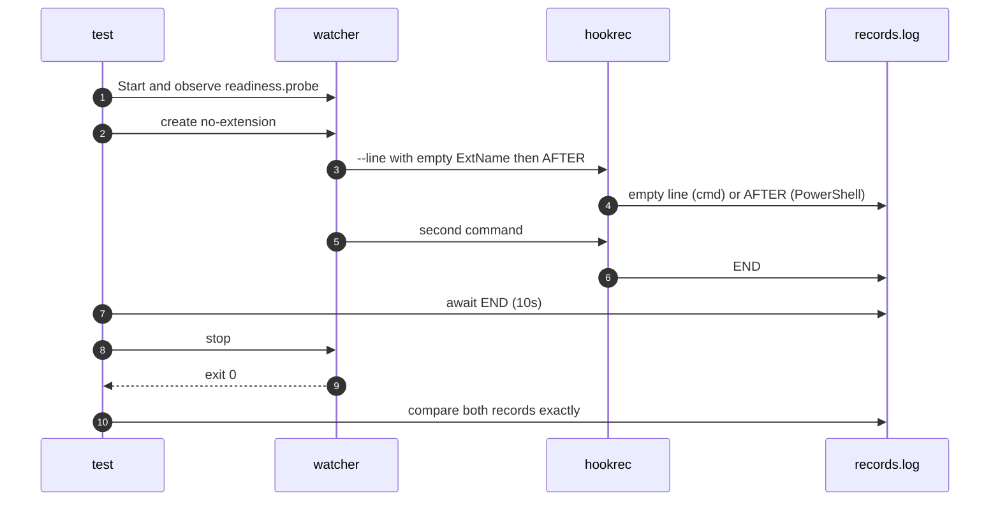

# `TestWindowsShellEmptyArgument`: cmd empty arguments and PowerShell omission

🇺🇸 English | 🇰🇷 [한국어](windows-shell-empty-argument.ko.md)

- The test checks the documented difference when an extensionless file expands `{{.ExtName}}` outside quotes.

## What it checks and success criteria

- The first hook runs `hookrec --line {{.ExtName}} AFTER`; the second hook records `END`, providing an observed completion boundary.
- `cmd` passes one empty argument, so `--line` consumes it and the records are exactly an empty line followed by `END`.
- Windows PowerShell omits the empty argument, so `--line` consumes `AFTER` and the records are exactly `AFTER`, `END`, as specified in [Variables in commands](../../../docs/guide/configuration.md#variables-in-commands).
- The `END` record appears within 10 seconds, and shutdown exits with code 0.

## Configuration

- Both subtests watch create events, exclude `*.probe`, and create `no-extension` after actual watch readiness.
- PowerShell commands use the call operator `&`.

## Subtests

- `cmd` expects the empty argument to remain.
- `powershell` expects the empty argument to be omitted.

## Sequence



## Running

- Run from the repository root.
- These Windows-only shells use a Windows build tag; this scenario is not selected on macOS or Linux.

```sh
make e2e-windows ARGS="-- -run '^TestWindowsShellEmptyArgument$'"
```

- Run the UTM command after completing the prerequisites in [Running E2E on a UTM Windows VM](../windows-utm.md) and starting the VM.

## Related code

- `e2e/scenarios/shell_windows_test.go` defines `TestWindowsShellEmptyArgument`.
- The test uses `NewScenario`, `Hook`, `Start`, `Write`, `AwaitLine`, `Stop`, and `Lines` from `e2e/harness`.
